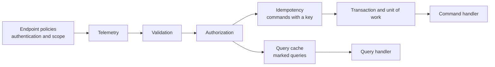

# ADR-0032: Wrap handlers in a fixed decorator pipeline with hand-written registration, typed results, and a scope-and-role permission table

## Context and problem statement

Plan section 8.2 gives the application layer a CQRS pipeline: each use case has one handler behind a direct interface, and decorators wrap the handler in a fixed order. It leaves four things open, and the plan says that an ADR settles them: the reason for the order, whether the decoration uses Scrutor or hand-written registration, where the decorators live, and how the errors map to Problem Details. Plan section 8.1 limits the layers: the Application references the Domain and the base class library only, the CrossCutting layer implements the decorators, and only the composition root may hold an `IServiceProvider`. [ADR-0026](0026-api-only-compose-stack-and-catalog-realm.md) adds a fifth question: Keycloak 26.8.0 grants a requested scope to a user who lacks the role that the scope maps to, so the scope alone cannot be the authorization decision (risk R21).

This ADR serves REQ-ARC-003, REQ-APP-001 to REQ-APP-006, and REQ-IDN-002. WP1.7 delivers it in three stacked pull requests, because the package is larger than one review can hold: the results, the errors, the ports, and the permission table first, then the pipeline and its registration, then the use cases.

## Decision drivers

- A reader can see the order of the decorators in one place, and a test fails when the order changes.
- No decoration step hides behind reflection, scanning, or a service locator (REQ-APP-006, `ArchitectureRules`).
- The layer rules of plan section 8.1 hold without a change to the reference table, which would need its own ADR.
- A refusal that a caller can cause is a value with one status code, and one table decides it (ADR-0028).
- A token that carries a scope without the matching role is refused (R21).

## Considered options

1. Hand-written decorator chains, composed by pipeline types in CrossCutting and registered through feature extension methods that the composition root implements (chosen).
2. Scrutor (MIT) decorates the handler registrations by assembly scan.
3. Put the decorators and the registration in the Application, behind `Microsoft.Extensions.DependencyInjection.Abstractions`.

## Decision outcome

Chosen option: **hand-written chains**, because the order is code that a reader sees and a test pins, and because options 2 and 3 break a layer rule or hide the order.

### The handler interfaces and the results

- `ICommandHandler<TCommand, TResult>` and `IQueryHandler<TQuery, TResult>` take a request and a `CancellationToken` and return `Task<Result<TResult>>`. A decorator implements the same interface and wraps another handler, so an endpoint injects the interface for its own request and never knows how many decorators sit behind it.
- `Result<T>` holds a value or an `ApplicationError`, and the error is one of seven sealed cases: `ValidationFailed`, `NotFound`, `Conflict`, `PreconditionFailed`, `PreconditionRequired`, `Forbidden`, and `IdempotencyKeyReused`. A refusal is a value. An exception is for a programming error or a fault, and the API turns it into `internal-error` or `service-unavailable`.
- One table, `ProblemMapping`, maps each case to one of nine entries of the error catalog: `Conflict` carries a reason that selects `sku-already-exists`, `product-discontinued`, or `idempotency-request-in-progress`. The eight entries that the application never raises (a body that cannot be parsed, a missing or malformed idempotency key, a missing token, a body that is too large or of the wrong type, a rate limit, and the two server faults) belong to the API, which reads the headers and owns the transport (WP1.10). A test of `Catalog.Contract.Tests` compares every row with the catalog page.
- A rule of the domain model maps through `ApplicationError.From`: `Invalid` and `CategoryNotActive` become `ValidationFailed` on the field that the error names, and `ProductDiscontinued` becomes `Conflict` with the reason `ProductDiscontinued` (ADR-0028, ADR-0029).

### The order of the decorators, outermost first

| Position | Command | Query | Why it sits here |
| --- | --- | --- | --- |
| 1 | Telemetry and logging | Telemetry | It wraps everything, so a refusal, a replay, and a fault are all traced, counted, and timed. A step that sat outside it would be invisible |
| 2 | Validation | Validation | It needs no I/O, so a malformed request is refused before the pipeline spends a lookup on it. It runs before authorization because the endpoint policy has already checked the token, so a 400 tells the caller nothing that it is not entitled to know |
| 3 | Authorization | Authorization | It runs before any state is touched. Both the scope and the role are checked (see below) |
| 4 | Idempotency, when the command has a key | Query cache, for marked queries | A replay returns the first result without a transaction, and a cache hit returns without the handler. Both come after authorization, so a caller cannot read a stored result that it may not see |
| 5 | Transaction and unit of work | None | A query reads only, and it needs no transaction |
| 6 | Handler | Handler | The use case |

Endpoint policies (authentication and scope) run before the pipeline, at the HTTP edge. The pipeline repeats the scope check together with the role check because Keycloak does not withhold a scope (R21), so the use case does not trust that the edge did it.

The idempotency record must be written in the same transaction as the effect (plan section 8.4), although the idempotency step sits outside the transaction step. They cooperate through the unit of work. The idempotency decorator asks the store to reserve the key, and it registers a hook with `IUnitOfWork.BeforeCommit`. The transaction decorator runs the handler through `IUnitOfWork.ExecuteAsync`, which calls the hooks inside the transaction, just before the commit, and the hook writes the record of the result through `IIdempotencyStore.CompleteAsync`. If the work fails, the decorator releases the reservation so the caller can retry. The transaction decorator knows nothing about idempotency.

After a successful commit the transaction decorator calls `IOutboxDispatcher.DispatchCommittedAsync` on a best-effort basis, because the outbox processor is the guarantee ([ADR-0012](0012-domain-events-outbox-vs-direct-orchestration.md)).

### Where the code lives

| Layer | What it holds |
| --- | --- |
| Application | The handler interfaces, the requests and their handlers, the results and errors, the mapping table, the permission table, `GuidV7IdGenerator`, and the ports: `IProductRepository`, `ICategoryRepository`, `IUnitOfWork`, `ICatalogCache`, `IIdGenerator`, `ICurrentPrincipal`, `IOutboxDispatcher`, `IUseCaseTelemetry`, and `IIdempotencyStore`. The read stores that the queries need are defined with the queries |
| CrossCutting | One decorator for each step, the pipeline types that compose them in the order above, and the FluentValidation validators |
| Api | The registration over `IServiceCollection`, and the adapters of the ports that need the token (WP1.10) |

The Application stays free of libraries: `application-depends-on-domain-and-the-bcl-only` allows no type outside the Domain and the base class library, and this ADR keeps that rule as it is. The validators use FluentValidation (Apache-2.0, plan section 17), so they live next to the validation decorator in CrossCutting, which may use any permitted package. They run the factory of each value object of the domain model for the fields of a request, so a validator reuses each rule, reports every invalid field at once, and never writes a rule a second time. The handlers still refuse a broken rule on their own, so the model stays the last line.

### Registration

A feature registers its handlers through an extension method on `IFeatureRegistry`, which the Application defines, such as `registry.AddProducts()`. The method names each handler explicitly, in a fixed order. The composition root implements `IFeatureRegistry` over `IServiceCollection` and composes each chain with the pipeline types of CrossCutting. The `IServiceProvider` therefore appears only in the composition root, where the rule allows it, and the handlers stay `internal sealed` because the registry receives them as type arguments that the Application passes. Registration extension tests record what a feature registers (WP1.7), and an integration test resolves each handler through the real container (WP1.10).

Scrutor is not used. Its decoration needs factory delegates over `IServiceProvider` in CrossCutting, which the service-locator rule forbids, it discovers decoration by scanning or by open generics so the order lives in registration side effects, and it adds a dependency that the hand-written chain does not need. FluentValidation 12.1.1 is the one package that this decision adds (Apache-2.0, no dependency on net8.0 or later, checked 2026-11-01), and Dependabot proposes later versions.

### Authorization

Each request type declares one access level through `IProtectedRequest.RequiredAccess`, a static abstract member, so a handler cannot change it and the decorator needs no reflection. One table, `PermissionPolicy`, maps each level to its scope and to the roles that grant it:

| Access level | Scope | Roles that grant it |
| --- | --- | --- |
| `Read` | `catalog.read` | `catalog-reader`, `catalog-editor`, `catalog-admin` |
| `Write` | `catalog.write` | `catalog-editor`, `catalog-admin` |
| `Admin` | `catalog.admin` | `catalog-admin` |

A caller needs the scope and one of the roles. A caller without the scope gets `Forbidden` with the reason `MissingScope`, and a caller with the scope and without a role gets `MissingRole`, the case that R21 describes. The API binds the same table to its endpoint policies (WP1.10), so both sides check in the same way, and a test compares the scopes and the role names with the contract and the realm file. This ADR does not amend plan section 8.7: the maintainer still decides whether to write the role check into the plan.

### Consequences

- Good: the order is in one pipeline type for each request kind and in the table above, and the tests of the second pull request compose a chain from recording fakes and fail when a step moves.
- Good: the Application keeps its two-line reference rule, and no table row in `ReferencePolicy` changes.
- Good: one table decides every status code of a refusal, and a test holds it to the catalog.
- Bad: the registry interface is one more abstraction between a feature and the container. Mitigation: it has two methods, and it exists so that the Application never sees the container.
- Bad: a command handler that needs a value that the database makes, such as the new version of a row, must call `IUnitOfWork.SaveChangesAsync` inside the transaction. Mitigation: the repositories document it, and the use-case tests cover it.
- Neutral: the validators sit apart from the requests that they check. They live in one namespace of CrossCutting, named after the feature.

### Confirmation

- WP1.7, first pull request: the results, the error cases, the mapping table, the permission table, the ports, and the identifier generator have unit tests (`tests/Catalog.Application.Tests`). The rule `application-ports-are-segregated` fails on a port with more than five operations, and the agreement tests in `tests/Catalog.Contract.Tests/ApplicationAgreementTests.cs` hold the tables to the catalog, the contract, and the realm.
- WP1.7, second pull request: `CommandPipeline` and `QueryPipeline` in `src/Catalog.CrossCutting/Decorators` compose the decorators, and `tests/Catalog.Application.Tests/PipelineOrderTests.cs` runs requests through the production chains over fakes that share one journal and asserts the order and every short circuit (REQ-APP-002, REQ-APP-003). Each decorator also has its own tests. The rule `decorators-are-composed-only-by-pipelines` fails when a decorator names another decorator, with a violating fixture. The registration extension tests (REQ-APP-006) arrive with the features in the third pull request.
- WP1.7, third pull request: the ten use cases (five for categories and five for products) with their read stores and validators, run through the production chain over an in-memory catalog (`CategoryUseCaseTests`, `ProductUseCaseTests`, `ProductQueryTests`), the registration tests (`RegistrationTests`, REQ-APP-006), and four more architecture rules, each with a violating fixture: handlers implement a handler interface, pipeline code uses no reflection, query handlers use no write port, and command handlers use no read store (REQ-APP-001, REQ-ARC-003, REQ-ARC-005). The Application mutation baseline scores 96.92 percent ([the evidence record](../testing/evidence/2026-11-01-application-mutation-baseline.md), REQ-QUA-006).
- WP1.10: the endpoints bind the tables, and integration tests prove the order and the status codes through HTTP.

## Pros and cons of the options

### Hand-written decorator chains and feature registration (chosen)

- Good: the order is visible code, and a reader follows a request from the endpoint to the handler.
- Good: no new dependency, and no reflection.
- Bad: each new request kind needs a line in its feature extension method.

### Scrutor

- Good: less code to register a decorator for every handler of a generic interface.
- Bad: the decoration needs an `IServiceProvider` factory, which the service-locator rule forbids in CrossCutting, and the order depends on registration order across files.
- Bad: one more dependency to track under [ADR-0004](0004-licensing-and-dependency-license-policy.md).

### Decorators and registration in the Application

- Good: the pipeline sits next to the handlers.
- Bad: the Application would need the dependency injection package, which the reference table bans, and a change to the table needs its own ADR.

## Revisit when

- A request kind needs a step that the order does not name, such as a rate limit inside the pipeline.
- Keycloak releases a version that withholds a scope from a user who lacks the mapped role, which would let the scope carry the decision again (R21).
- The number of handlers makes the feature extension methods hard to review.

## Further reading

- [Implementation plan, section 8.2](../plans/implementation-plan.md)
- [ADR-0026: Compose stack and catalog realm](0026-api-only-compose-stack-and-catalog-realm.md)
- [ADR-0028: HTTP conventions of version 1](0028-http-api-conventions-of-v1.md)
- [Error catalog](../reference/error-catalog.md)
