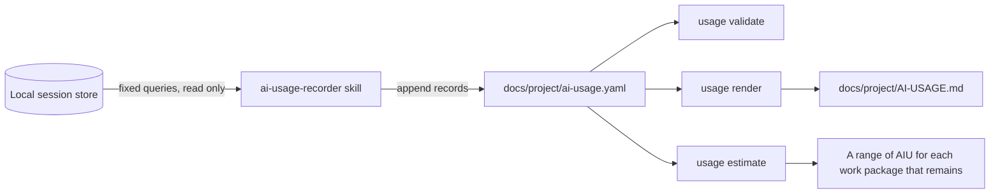

# AI usage statistics

Every change to this repository is made in an AI-paired session ([session boundaries](session-boundaries.md)), and one of the goals of the
project is to learn what that costs. This page explains how each session records its cost, how the numbers are kept honest, and how they
become an estimate for the work that remains. The decision is [ADR-0031](../adr/0031-ai-usage-ledger-and-estimate.md), and the plan text is
section 5.8 of [the implementation plan](../plans/implementation-plan.md). The generated report is [AI usage](../project/AI-USAGE.md).

## The unit, and what it is not

The Copilot session store reports an AI unit (AIU) for every model call. It is computed from the tokens of the call and the price of each
kind of token, so a call that reads a large cached context costs less than one that rewrites it, and a model with a higher price costs more
for the same tokens. GitHub bills Copilot usage in AI credits, and 1 AI credit is $0.01 USD (checked 2026-10-12). For the models used here, the
store's price per million tokens is the published price in dollars times 100, so an AIU is an AI credit at the price of the call.

The ledger and the report say AIU and hold no money, for three reasons: a plan includes an allowance and some discounts that the store does not
know, prices change (the cached-input price of Claude Sonnet 5.5 halved on 2026-10-08), and a request multiplier, such as the 15 that is
recorded for Claude Opus 5.5, does not scale the AIU. [ADR-0031](../adr/0031-ai-usage-ledger-and-estimate.md) lists the checks.

## How a number gets into the ledger



The split is the one that [session boundaries](session-boundaries.md) uses. The skill reads a per-machine store that holds the sessions of every
repository on the machine, so it reads only the session that it is recording. The command reads the ledger, `status.yaml`, and the schema,
so it is deterministic, runs in CI, and gives the same answer on every machine.

```bash illustrative
dotnet run --project tools/Governance.Auditor -- usage validate
dotnet run --project tools/Governance.Auditor -- usage render
dotnet run --project tools/Governance.Auditor -- usage render --check
dotnet run --project tools/Governance.Auditor -- usage estimate
dotnet run --project tools/Governance.Auditor -- usage estimate --phase 2 --json
```

| Command | What it does | Exit code |
| --- | --- | --- |
| `usage validate` | Checks the ledger against its schema and the consistency rules below | 0 when nothing is an error, and 1 otherwise |
| `usage render` | Writes `docs/project/AI-USAGE.md` from the ledger. `--check` writes nothing and fails when the page differs | 0 or 1, as above |
| `usage estimate` | Prints a range of AIU for each work package that remains, with its method and its caveats. `--phase` limits it, and `--json` prints one line of JSON | 0, or 1 when the ledger is not valid |

The estimate informs planning and never blocks a merge. The `governance` workflow runs `usage validate` and `usage render --check` on every
pull request, and it does not run `usage estimate`.

## The ledger

`docs/project/ai-usage.yaml` has three lists, and [its schema](../project/ai-usage.schema.json) rejects any other key, so a field that could
hold text from a prompt has nowhere to go.

**Records** are slices. A slice is a window of one session that belongs to one phase or work package and one kind of activity.

| Field | Meaning |
| --- | --- |
| `session` | The ID of the session. It is an opaque identifier, and the report shows its first eight characters |
| `phase`, `work-package` | The scope of the slice. A slice of planning or coordination has a phase and no work package |
| `activity` | `delivery` (the work of a work package), `fix` (a bug fix after a merge), `planning` (work on the plan itself), or `coordination` (a session that starts, monitors, or hands over other sessions). Only delivery feeds the estimate |
| `confidence` | `exact` when the session held that scope alone, and `windowed` when the window was derived from facts |
| `window` | The time of the first and of the last call that the slice holds |
| `user-turns`, `compactions` | How many turns of the maintainer and how many compactions of the conversation fall in the window |
| `note` | One plain sentence about the window and which fact set it. It never quotes a prompt |
| `usage` | The rows below |

Each row of `usage` is one model at one reasoning effort, as the main agent or as sub-agents.

| Field | Meaning |
| --- | --- |
| `model`, `reasoning-effort`, `agent` | Which model, at which effort (`unspecified` for the calls that compact a conversation), and whether the calls were the main agent's or a sub-agent's |
| `request-multiplier` | The multiplier that the store records for the model. It is a fact and it does not scale the AIU |
| `calls`, `aiu` | The number of model calls and their AI units |
| `fresh-input-tokens`, `cache-read-tokens`, `cache-write-tokens` | The input that was not served from the cache, and the input that was read from or written to it. The store's input tokens are the sum of the three |
| `output-tokens`, `reasoning-tokens` | The tokens that the model wrote, of which the reasoning tokens are a part |
| `peak-context-tokens` | The largest context of any call, which is the largest input of a call |
| `model-seconds` | The sum of the durations of the calls |

**Changes** hold the size of the change that the work produced: the pull requests, the files, the additions, and the deletions. They belong
to a work package (or to a phase) and not to a slice, because a pull request is the work package's, and a work package can span several slices
and several sessions.

**Waivers** say why a phase or a work package has no record of its own. Phase 0 is recorded at phase level.

## The attribution rules

A session is not a work package. One session held WP1.1 and the start of WP1.2, and another held three work packages and a plan amendment. A
record is therefore a slice, and these rules decide where its window starts and ends.

1. A session that the maintainer started for one work package alone owns its whole window, and its slices are `exact`.
2. In a session that holds more than one scope, the boundary between two windows comes from the first of these facts that exists: the turn
   in which the maintainer named the next work package, the times of the pull requests (when a pull request was opened and merged), the
   times of the commits, the checkpoints (a compaction), and the idle gaps between bursts of calls. Such a slice is `windowed`, and its
   `note` says which fact set it.
3. A burst is a run of calls with no gap of ten minutes. The first call after a gap rewrites the cache of the whole context, so it costs
   about twenty times the calls after it and belongs to the work that follows the gap. A window never starts or ends inside a burst except
   at a turn of the maintainer.
4. A call belongs to exactly one slice, and the slices of a session do not overlap. The calls of a sub-agent are attributed by time, to the
   slice whose window holds them, and they get their own rows.
5. Phase 0 is recorded at phase level, because one session built it in one day before the work packages were tracked one by one.
6. Planning is work on the plan itself, such as an amendment. Coordination is a session that starts, monitors, or hands over other sessions,
   such as the one that kept the plan panel up to date. A session that only watched does not hold a work package.
7. A record is never edited. Calls that come after a record was written are recorded later as another slice of the same session with a later
   window.

A reader should trust an `exact` slice and read a `windowed` one with its note beside it.

## The consistency rules

`usage validate` checks the ledger against the schema first, and then these rules, and every one of them has a test that fails on a ledger that
breaks it.

| Rule | What it says |
| --- | --- |
| `usage-phase`, `usage-work-package`, `usage-work-package-phase` | The phase and the work package exist in `status.yaml`, and the work package belongs to the phase |
| `usage-not-started` | A work package that `status.yaml` still lists as planned has no usage |
| `usage-window`, `usage-overlap` | A window ends after it starts, and two slices of a session do not overlap |
| `usage-duplicate`, `usage-duplicate-row` | The same slice is not recorded twice, and a model at an effort and agent is one row |
| `usage-parts` | A part does not exceed its whole: the reasoning tokens are within the output, the input of the calls is within the peak context times the calls, and the turns and the compactions are within the calls |
| `usage-exact-shared` | An `exact` slice does not share its session with another scope |
| `usage-delivery-scope` | Delivery belongs to a work package, unless its phase is recorded at phase level |
| `usage-change`, `usage-change-missing` | A size of change names a work package or phase that exists and the pull request that `status.yaml` names, and a completed work package with usage but no size of change is a warning |
| `usage-waiver`, `usage-waiver-stale`, `usage-waiver-empty` | A waiver names a phase or work package that exists, it is not kept after usage is recorded, and a phase that is waived is recorded at phase level |
| `usage-missing` | A completed work package of a phase that has started has delivery usage or a waiver |

## The report

[AI usage](../project/AI-USAGE.md) is generated from the ledger. It shows the totals, then the AIU of each phase by kind of activity, then
each completed work package with its calls, model time, peak context, compactions, size of change, and AIU for each 1,000 changed lines, then
the AIU for each size class, then the models and efforts with their tokens, and then the sessions. Do not edit it by hand, because CI fails
when it differs from what `usage render` writes.

The columns that are easy to misread:

- **Peak context** is the largest context of any call, so it measures how full the conversation got, and a value near 760,000 tokens means
  that a compaction was close.
- **Fresh input** is small next to **cache read**, because an agent mostly rereads what it has already sent. The cost sits in the reads of a
  large context and in the rewrites after an idle period, more than in the output.
- **AIU per 1,000 lines** is a rough guide. A package of documents and a package of code differ, and a spike changes few lines and costs a lot.

## The estimate

`usage estimate` answers one question: how many AIU might the work packages that remain need?

1. For each completed work package, take the AIU of its delivery slices. Planning, coordination, and fixes are not part of a package.
2. For a size class that has completed work packages, the range of a planned package of that size is the minimum, the median, and the
   maximum of the observed AIU of that size.
3. For a size class with none, scale the median AIU for each day of weight by the weight of the size. The weights are the midpoints of
   [plan section 5.7](../plans/implementation-plan.md): S 0.5, M 3, and L 6.5 days. The output says that the size has no completed work
   package, because this is the least reliable line.
4. A phase is the sum of the work packages that remain in it, and a size with one observation says that its range is a single point.

The method has no randomness and reads the ledger and `status.yaml` only, so two runs give the same text. The output always prints its
method and its caveats, which are the part to read first: very few observations, a model mix that the estimate assumes will repeat, an AIU
that does not grow with the days of a size class, a request multiplier that does not scale it, the share of the observations that are
windowed, and the share of the AIU that planning, coordination, and fixes took, which a phase budget must add.

This is the output for the small sample project that the tests use. It has an S and an M work package completed, so a planned L is scaled.

[!code-text[The estimate for a sample project](../../tests/Governance.Auditor.Tests/Fixtures/usage/estimate.expected.txt)]

## What the numbers say so far

These facts were true on 2026-10-12, when the history of Phase 0 and of WP1.0 to WP1.14 was back-filled from the session store. Run `usage
estimate` and read the report for the current numbers.

- Six sessions made 3,228 calls and used 25,761 AIU, which is about $258 at the list price, for information only. Phase 0 used 9,122 AIU,
  of which 3,989 went to planning and 5,133 to delivery. WP1.0 to WP1.6 and WP1.14, with the planning and coordination of Phase 1, used 16,640.
- A completed S work package cost 1,337 and 1,474 AIU, the five completed M packages cost 1,355 to 1,934, and the one L package cost 3,271.
  The small packages are not cheap, because every session pays to read the repository and to rewrite its cache. The days of focused effort
  that the plan names are not a good scale for AIU, which is why the estimate uses the observed AIU of a size class.
- Almost all of the delivery AIU was Claude Sonnet 5.5 at the extra-high effort. The estimate therefore assumes that mix, and a different
  model or effort changes it a great deal.
- The three work packages that a fresh session held alone cost 1,474 to 1,934 AIU, and the five that shared a session cost 1,337 to 3,271, so
  the ranges overlap and the ledger cannot yet say whether a fresh session is cheaper than a long one.
  [ADR-0030](../adr/0030-session-boundaries-and-ai-paired-delivery.md) named this as the reason to revisit its decision, and every new
  `exact` slice adds evidence.
- Planning, coordination, and fixes were more than a fifth of all the AIU, and none of it is in the estimate of a work package.

## Where it is wired

- The `/ai-usage-recorder` skill holds the canonical queries and writes the entry. `/session-handoff` runs it before the session boundary
  check, and [AGENTS.md](../../AGENTS.md) and [AI skills governance](../governance/ai-skills.md) name it.
- The `governance` workflow runs `usage validate` and `usage render --check` on every pull request, like the checks of `status.yaml`.
- The generated [project status](../project/STATUS.md) links to the report.
- The threat model records that the ledger holds opaque session IDs and numbers only, and that the skill reads a local per-machine store.
