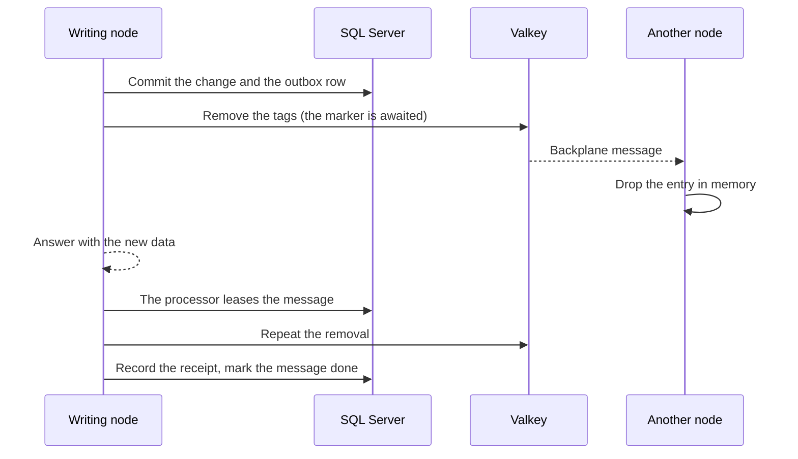

# The cache consistency model

The catalog caches the results of `GetProduct` and `ListProducts` in the memory of each API node (L1) and in Valkey (L2). A cache that never goes stale cannot be fast, and a cache that goes stale without a bound cannot be trusted, so this page states the bound. It says what a reader may rely on after a write, how a write finds the entries that it made stale, how long each failure can keep the old data alive, and where a test or a metric shows it. The decisions are [ADR-0016](../adr/0016-cache-implementation-fusioncache.md), [ADR-0038](../adr/0038-catalog-cache-adapter-and-valkey-connection.md), and [ADR-0039](../adr/0039-cache-invalidation-by-immediate-dispatch-and-the-outbox.md), and the plan text is section 8.5 of [the implementation plan](../plans/implementation-plan.md).
[The cache reference](../reference/caching.md) lists the settings and the keys, and [the persistence reference](../reference/persistence.md) describes the outbox.

## What the cache promises

| Promise | Who it is for | What it means |
| --- | --- | --- |
| **Read your own writes** | The node that handled the write | A read on that node after the response never shows the old data from the cache. The node removes the entries before it answers, and its memory loses them even when Valkey is down |
| **Bounded staleness** | Every other node | A node can serve the old data for the time of one pub/sub message while the backplane works, and for at most the memory time to live otherwise (30 seconds for a product, 10 for a list) |
| **Eventual convergence** | Every node | A removal that was lost or failed is repeated by the outbox until Valkey confirms it, so the nodes end with the new data |

It does **not** promise more, and a design that needs more must not read the cache:

- **No linearizability.** Two nodes can answer one request with different data for a short time after a write.
- **No atomicity across keys.** A product and a list that holds it are removed one after the other, so a reader can see the new product and the old list for a moment.
- **No protection against a write that bypasses the application.** A change made by hand in the database raises no event, so no entry is removed until it expires. A cache entry never outlives its time to live (5 minutes in Valkey, 30 seconds in memory).

## How a write removes the stale entries

1. **Commit.** The unit of work saves the change and one outbox row for each domain event in one transaction.
2. **Immediate removal.** After the commit, the dispatcher of the request gives each message to the invalidation subscriber in process. The subscriber asks the policy which tags the event makes stale: the product and every list for a product event, and the category for a category event. It removes each tag through the cache. FusionCache does not delete the entries. It writes a marker with the current time for the tag, in memory and in Valkey, and tells the other nodes. An entry that is older than the marker is dropped when someone reads it.
3. **The other nodes.** The backplane message makes the other nodes write the marker to their memory, so their next read drops the old entry and loads the new data.
4. **The answer.** The response carries the new data. The removal was awaited, so the writing node reads its own writes.
5. **The repeat.** The outbox processor delivers the same message to the same subscriber with a receipt, normally within a few seconds. The second removal makes the entries that were loaded in between stale again. That closes the race of a reader that read the old row before the commit and wrote it to the cache after the first removal.
6. **The retry.** If Valkey could not confirm a removal, the subscriber throws, and the processor tries the whole message again with an exponential backoff until it is confirmed. A message that the policy cannot read goes to the dead-letter state instead of being skipped.

## How long each failure keeps the old data

| What went wrong | Who can serve old data | For how long | What bounds it | Where a test or a metric shows it |
| --- | --- | --- | --- | --- |
| Nothing | Another node | The time of one pub/sub message | The backplane | `CacheAcrossNodesTests` wait for the message that the other node applied, and the read after it is new |
| The backplane does not reach a node, or refuses the publish | That node | At most the memory time to live, 30 seconds (10 for a list) | The expiration of the entry in memory | `CacheAcrossNodesTests` (a node that the backplane does not reach), `CacheOutageTests` (a server that refuses the channel), and the gauge `catalog.cache.backplane.down` |
| Valkey is down | Every node except the one that wrote | At most the memory time to live, and the writer reads its own write from the database | The expiration, and the breaker that skips the shared cache | `CacheOutageTests`, `CacheInvalidationConvergenceTests`, and the gauge `catalog.cache.shared.down` |
| Valkey is down when a node writes, and returns later | The other nodes, until the outbox confirms the removal | The outage, plus the backoff of the outbox, bounded by the memory time to live for a node that missed the message | The backoff of the outbox, then the expiration | `CacheInvalidationConvergenceTests`: the outbox retried until the server returned, and the other node ended with the new data |
| The writing node dies after the commit, before it removes anything | Every node | Until the next pass of any processor, which is the poll interval of 5 seconds unless the host died while it held the lease (then at most the lease of 2 minutes) | The outbox | `CacheInvalidationConvergenceTests`: the host that did not write delivered the message, and the host that wrote and lost its dispatch converged |
| A reader loaded the old row before the commit and cached it after the first removal | That reader's node and Valkey | Until the repeat of the outbox, or the expiration | The second removal | `OutboxImmediateDispatchTests` and `CacheInvalidationConvergenceTests` show the repeat with a receipt |
| The clocks of two nodes differ | The node whose clock is behind | By the size of the difference | Clock synchronization | FusionCache compares the time of the entry with the time of the marker, and each is the wall clock of the node that wrote it (checked 2026-11-03 in [the FusionCache tagging page](https://github.com/ZiggyCreatures/FusionCache/blob/v2.9.0/docs/Tagging.md)) |
| Valkey evicts a marker before its time to live ends | Every node that holds the entry only in Valkey | At most the time to live of the entry in Valkey, 5 minutes | The expiration | A marker lives twice as long as the longest entry, so only eviction loses one early. The Compose stack evicts the least recently used key (`allkeys-lru`), and an alert on evicted keys is open (WP1.11) |

**Two limits to know.**

- The repeat of the outbox cannot reach a node that was disconnected from the backplane when the message was published and still holds the entry in memory. The marker is in Valkey, but a node does not ask Valkey for an entry that its memory still holds, so the entry lives until its time to live ends. The bound is the memory time to live, and the gauge says while the breaker is open.
- When Valkey restarts, it comes back empty, so no old entry is left in it. A node that kept an entry in memory serves it until it expires, as above.

## What a reader of the metrics sees

| Signal | Meaning |
| --- | --- |
| `catalog.cache.shared.down` is 1 | The breaker of the shared cache is open. Reads run on memory and the database, and a removal is not confirmed |
| `catalog.cache.backplane.down` is 1 | A publish failed. The other nodes may serve old data for up to the memory time to live |
| `catalog.cache.invalidations` with `outcome=incomplete` | A removal could not be confirmed. The outbox will try again |
| `catalog.outbox.immediate` with `outcome=failed` | The removal right after the commit failed for a handler. The outbox repeats it |
| `catalog.outbox.failed` and `catalog.outbox.dead_lettered` | A retry that is still failing, and a message that needs a person |
| `catalog.cache.requests` with `degraded=true` | Reads that a degraded node answered. A hit among them can be stale for the memory time to live |

The alerts on these signals are planned in WP1.11, and the canary analysis of Phase 4 reads the hit ratio.

## Why the design is this way

- **Remove, do not update.** A removal is a marker with a time, so it is cheap and cannot put wrong data in the cache. Updating the entries would need the write path to know every shape and every list that the data belongs to.
- **Awaiting the removal costs a request time.** The response waits for the call to Valkey, which the timeout of 500 milliseconds and the breaker bound. That is the price of reading your own writes, and plan section 8.5 asks for it.
- **The outbox is the guarantee, and the immediate removal is the speed.** The in-process delivery makes the common case fast, and the receipt keeps the outbox path from doing its work twice when it is delivered again. Both call one policy, so a test of the fallback tests the fast path too.
- **A bounded memory time to live is the last line.** Everything else can fail, and 30 seconds is the longest that a node serves old data in each case above, apart from the clock and the eviction.

## Further reading

- [ADR-0039](../adr/0039-cache-invalidation-by-immediate-dispatch-and-the-outbox.md): the decision and the options that were rejected.
- [Caching](../reference/caching.md): the settings, the keys, the tags, and the metrics.
- [Persistence](../reference/persistence.md): the outbox, the receipts, and the dispatcher.
- [The evidence record](../testing/evidence/2026-11-03-cache-invalidation-run.md): what ran where, with the counts.
