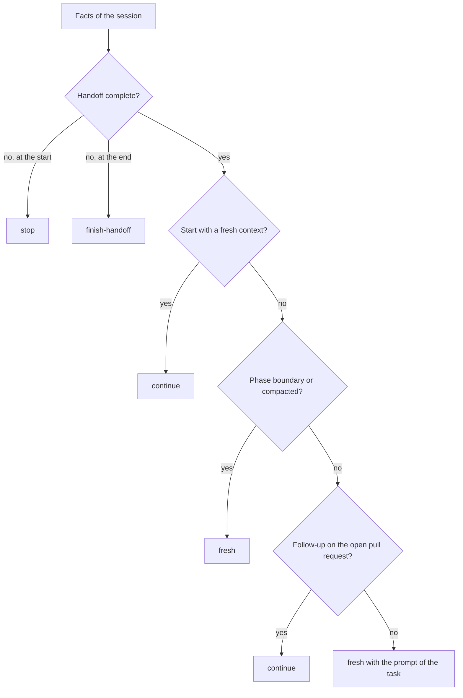

# Session boundaries and AI-paired delivery

Every change to this repository is made in an AI-paired session, including the smallest bug fix. A session is the unit of context: it holds
what the agent has read and what it has been told, and nothing else. This page explains why a session has a boundary at each end, how the
`governance session` command decides where the boundary falls, and what the next session receives. The decision is
[ADR-0030](../adr/0030-session-boundaries-and-ai-paired-delivery.md), and the plan text is section 5.8 of
[the implementation plan](../plans/implementation-plan.md).

## Why a session has a boundary

A long conversation is not free. It carries everything that was read in it, so an agent can mix up two tasks, and when the host compacts the
conversation, only a summary of the earlier work is left and the detail is lost (the Copilot CLI lists a checkpoint in the session's own
folder for each compaction, checked 2026-10-12). A fresh session starts clean, but it can only start well if the repository says where to
start. That is the resume protocol in [AGENTS.md](../../AGENTS.md): a new session reads `STATUS.md`, not the memory of an old one.

So the project makes a fresh session the default, and it makes the handoff between two sessions a thing that can be checked.

## The two moments

The check runs twice in every session.

| Moment | When | What it answers |
| --- | --- | --- |
| `start` | The first step of a session, in the resume protocol | Did the last session leave its work in order, and is this the fresh session that the task needs? |
| `end` | The last step of a session, run by `/session-handoff` | Is the handoff complete, and does the next task belong in a fresh session, with which kickoff prompt? |

## How to run it

The command reads `docs/project/status.yaml` and the local Git state, and it prints its answer. It starts Git without a shell, and it reads no
network service, no GitHub CLI, and no session store, so the same facts give the same answer on every machine.

```bash illustrative
dotnet run --project tools/Governance.Auditor -- session --moment start --context fresh
dotnet run --project tools/Governance.Auditor -- session --moment end
dotnet run --project tools/Governance.Auditor -- session --moment end --task pull-request --context compacted
dotnet run --project tools/Governance.Auditor -- session --moment start --task bug-fix --json
```

The caller says three things, because the repository cannot know them.

| Option | Values | Meaning |
| --- | --- | --- |
| `--moment` | `start`, `end` | Whether the session is starting or ending. Required. |
| `--context` | `fresh`, `used`, `compacted` | Whether the conversation began with the kickoff prompt, has been used, or was summarized. The default is `used`. |
| `--task` | `work-package`, `pull-request`, `bug-fix` | The kind of task that comes next. The default is `work-package`. `pull-request` means review comments or a failed check on the open pull request of the current work package. |

## The answer

The answer is one of four words. The exit code is 0 when the command produced advice, 1 when the advice is `finish-handoff` or `stop`,
and 2 when the tool could not run. A mistyped option also exits with 1, as it does for every governance command, but it prints no advice, so
read the first line of the output: it is `session:` and the advice.

| Advice | Meaning |
| --- | --- |
| `continue` | Carry on in this session. |
| `fresh` | Stop here and start a fresh session with the kickoff prompt that the command prints. |
| `finish-handoff` | The handoff has gaps. Close them, then run the check again. |
| `stop` | The previous session left work behind. Do not start. Ask the maintainer. |

This is the answer at the end of a work package in a small sample project, with the kickoff prompt that it prints. The golden file is the
fixture that the tests compare with, so the output that you read here is checked in CI.

[!code-text[The end of a work package in a sample project](../../tests/Governance.Auditor.Tests/Fixtures/skills/session-boundary-advisor/expected-output.txt)]

## The facts and the rules

Five facts decide the answer. The command works out two of them, and the caller gives the other three.

| Fact | Values | Where it comes from |
| --- | --- | --- |
| `handoff` | `complete`, `incomplete` | The command. It is `incomplete` when a gap exists. |
| `boundary` | `package`, `phase` | The command, from `status.yaml`. |
| `moment` | `start`, `end` | The caller. |
| `context` | `fresh`, `used`, `compacted` | The caller. |
| `task` | `work-package`, `pull-request`, `bug-fix` | The caller. |

A **handoff gap** is one of these: uncommitted changes, commits that are not pushed (or, with no upstream, commits that no remote has), a
`status.yaml` that is not valid, or a `STATUS.md` that differs from what `status.yaml` renders. Being behind the upstream is a note and not a
gap. The command does not fetch, so its counts are as of the last fetch.

The **boundary** is `phase` when the next work package starts a phase (its number ends in `.0`, or its phase differs from that of the last
completed work package), when no work package is completed yet, or when every work package of the current phase is completed and the phase is
not. `governance status validate` refuses an in-progress phase in that state, so it takes a blocked phase to reach it, and it is rare. Every
other case is `package`.

The **next work package** is the one that `resume.next-work-package` names in `status.yaml` when it is ready. Otherwise it is the first
work package, in phase order, that is planned or in progress and whose dependencies are all completed. The field exists because the
maintainer chooses the order, and the order of the list is not always the order that the maintainer wants.

The rules are data in [`governance/policies/session-policy.yaml`](../../governance/policies/session-policy.yaml), and the first rule that
matches decides.



| Order | Rule | When it applies | Advice |
| --- | --- | --- | --- |
| 1 | `leftovers` | The moment is `start` and the handoff is incomplete | `stop` |
| 2 | `handoff-first` | The moment is `end` and the handoff is incomplete | `finish-handoff` |
| 3 | `fresh-session-start` | The moment is `start` and the context is `fresh` | `continue` |
| 4 | `phase-boundary` | The boundary is `phase` | `fresh` |
| 5 | `compacted` | The context is `compacted` | `fresh` |
| 6 | `pull-request-follow-up` | The task is `pull-request` | `continue` |
| 7 | `bug-fix` | The task is `bug-fix` | `fresh` |
| 8 | `work-package` | Everything else | `fresh` |

The tool does not only parse the policy file, it checks it. The schema rejects an unknown value or key. The tool also tries all 72
combinations of the facts, and it refuses a policy with a rule that no combination reaches, a combination that no rule answers, an open
handoff that is told to go on, or a complete handoff that is told to stop. A prompt may only use placeholders that exist, so a typo cannot
reach a session.

## The kickoff prompts

For `fresh`, the command prints a kickoff prompt that is ready to paste. There are three templates in the policy file, and the command fills
their placeholders from `status.yaml`: the work package, its Issue, the phase plan, and the branch.

| Task | What the prompt asks of the session |
| --- | --- |
| Work package | Resume from the repository, check that the working tree is clean, work on the `wp/<phase>.<nn>-<slug>` branch from the phase branch in the main checkout and never in a worktree, read the listed files, ask before every push, merge, or settings change, meet the Definition of Done, and end with `/session-handoff`. |
| Pull request follow-up | Fix the review comments and the failed checks of one pull request, and nothing else. |
| Bug fix | Work on a `fix/<slug>` branch, write the failing regression test first and tag it with the requirement that it protects, run the blast-radius evaluator, update the changelog, and meet the same Definition of Done as a feature. |

Every change is paired with an AI session, even a one-line fix, so a bug fix leaves the same evidence as a feature: a test that failed first, a
changelog entry, and a reviewed pull request. [ADR-0003](../adr/0003-branch-and-work-package-protocol.md) defines a hotfix as a `fix/<slug>`
branch against `master`. Most work that has merged during a phase exists only on the phase branch, so the bug-fix prompt tells the session to
stop and ask the maintainer which branch to use when the faulty code is not on `master`.

## What the check is not

- It is advice and not a required check. No workflow job runs it, and it exits with 1 only when the advice is `finish-handoff` or `stop`.
- It does not make a decision that the repository forbids without the maintainer: it never pushes, and it never changes a setting.
- It does not measure cost. Recording what each session costs is planned in WP1.15, which reads the same boundaries.

## Where it is wired

- The resume protocol and the end-of-session protocol in [AGENTS.md](../../AGENTS.md) call it, and plan section 6 lists the steps.
- The [`/session-boundary-advisor`](../../.github/skills/session-boundary-advisor/SKILL.md) skill explains the answer and hands the prompt
  over, and the [`/session-handoff`](../../.github/skills/session-handoff/SKILL.md) skill ends by running the check.
- [AI skills governance](../governance/ai-skills.md) records why the skill reports the command and never decides.
