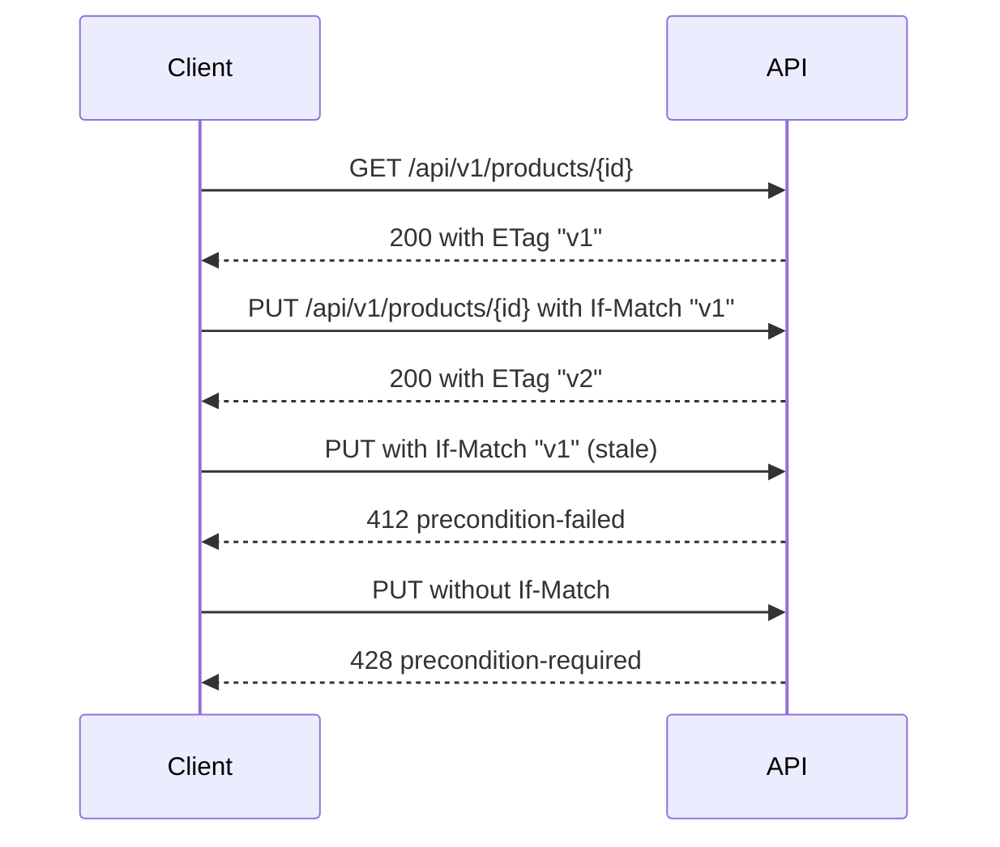

# API contract v1

The contract of the product catalog API is an OpenAPI 3.1 document that is written before the API and that the API must follow
([ADR-0017](../adr/0017-contract-first-api-design.md)). It is the only description of the HTTP surface, so this page summarizes it and does not repeat it. Read the document for every schema and example:
[`contracts/openapi/catalog/v1/catalog.openapi.yaml`](../../contracts/openapi/catalog/v1/catalog.openapi.yaml).

The API that serves this contract arrives in WP1.10 (planned). Until then, the contract, its tests, and its checks are the whole of v1. The rules and their reasons are in [the API style guide](api-style-guide.md) and
[ADR-0028](../adr/0028-http-api-conventions-of-v1.md), and every error type is in [the error catalog](error-catalog.md).

## Operations

The API has two resources, categories and products, and one action on each, which is `discontinue`. Nothing is deleted. A product or a category moves from `active` to `discontinued`, and stays.

| Resource | Collection | One item |
| --- | --- | --- |
| Categories | `/api/v1/categories` | `/api/v1/categories/{categoryId}` |
| Products | `/api/v1/products` | `/api/v1/products/{productId}` |

A product list takes `categoryId`, `status`, `q` (text in the name or the SKU), `sort` (`createdAt` or `name`), `pageSize` (1 to 100), and `cursor`. A category list takes `status`, `pageSize`, and `cursor`.

## Permission matrix

Every operation requires a bearer token from the catalog realm, and every operation names the one scope that it needs. The identity side of the matrix is in [plan section 8.7](../plans/implementation-plan.md).

| Operation | Method | Path | Scope | Success |
| --- | --- | --- | --- | --- |
| `listCategories` | GET | `/api/v1/categories` | `catalog.read` | 200 |
| `createCategory` | POST | `/api/v1/categories` | `catalog.admin` | 201 |
| `getCategory` | GET | `/api/v1/categories/{categoryId}` | `catalog.read` | 200 |
| `updateCategory` | PUT | `/api/v1/categories/{categoryId}` | `catalog.admin` | 200 |
| `discontinueCategory` | POST | `/api/v1/categories/{categoryId}/discontinue` | `catalog.admin` | 200 |
| `listProducts` | GET | `/api/v1/products` | `catalog.read` | 200 |
| `createProduct` | POST | `/api/v1/products` | `catalog.write` | 201 |
| `getProduct` | GET | `/api/v1/products/{productId}` | `catalog.read` | 200 |
| `updateProduct` | PUT | `/api/v1/products/{productId}` | `catalog.write` | 200 |
| `discontinueProduct` | POST | `/api/v1/products/{productId}/discontinue` | `catalog.admin` | 200 |

The three scopes do not include each other in the contract: an operation names the scope that it needs, and the realm grants them through roles. A token that lacks the scope gets a 403 `forbidden`.

## Headers

| Header | Direction | Used by | Rule |
| --- | --- | --- | --- |
| `Authorization` | Request | Every operation | A bearer token |
| `Idempotency-Key` | Request | `createCategory`, `createProduct` | Required. A quoted string of 1 to 128 printable ASCII characters. The same key with the same body replays the first response |
| `If-Match` | Request | Every `PUT` and every `discontinue` | Required. One strong `ETag`. A missing header returns 428 and a stale one returns 412 |
| `If-None-Match` | Request | `getCategory`, `getProduct` | Optional. When it matches the current `ETag`, the answer is 304 with no body |
| `ETag` | Response | Every answer that carries one item | The strong entity tag, which is the value to send back in `If-Match` |
| `Location` | Response | `createCategory`, `createProduct` | The address of the new item |
| `Link` | Response | `listCategories`, `listProducts` | `rel="next"` when there is a next page |
| `Retry-After` | Response | 429 and 503 | Seconds to wait |
| `WWW-Authenticate` | Response | 401 | The bearer challenge |
| `api-supported-versions` | Response | Every answer | The versions that the server supports |
| `api-deprecated-versions`, `Deprecation`, `Sunset` | Response | Every answer of a deprecated version | See [the style guide](api-style-guide.md#versioning-and-deprecation) |

## Updating with an ETag

The `ETag` of an item changes whenever the item changes. An update that carries the `ETag` that the client read can only succeed when nobody changed the item in between, so two clients cannot overwrite each other without knowing it.



## Creating with an idempotency key

A create is not safe to repeat, because a client that never saw the answer cannot tell whether the item exists. The `Idempotency-Key` header makes the repeat safe: the API remembers the key for 24 hours and answers a repeat with the first answer.

| The request | The answer |
| --- | --- |
| A new key | The item is created, and the answer is 201 |
| The same key and the same body, after the first request finished | The first answer again, with the same status, body, `Location`, and `ETag` |
| The same key and the same body, while the first request is still running | 409 `idempotency-request-in-progress` |
| The same key and a different body | 422 `idempotency-key-reused` |
| No key | 400 `idempotency-key-required` |

## Pages and cursors

A list answers with `items`, a `nextCursor` that is null on the last page, and a `Link` header with `rel="next"` while there is a next page. A cursor is opaque. It is valid only with the filters and the sort of the request that produced it, and a client never builds or changes one.

## Check the contract

The contract is checked in three ways, and each one is a command that you can run before you push.

1. **The lint.** Spectral reads the contract with [the ruleset](../../contracts/openapi/spectral.yaml), and a warning fails it. CI runs this command in the `Contract lint` job:

   [!code-bash[Contract lint in CI](../../.github/workflows/ci.yml#contract-lint)]

2. **The tests.** `tests/Catalog.Contract.Tests` reads the contract and checks it against this page and the error catalog, and it runs in the build and test job. `tools/ci/ContractRules.Tests.ps1` breaks the contract once for each lint rule and expects the rule to fire, and it runs in the script tests.
3. **The conformance check.** From WP1.10, the build generates the served document, and this command compares it with the contract and ignores descriptions, examples, and summaries. The script and its tests exist today:

   ```bash illustrative
   pwsh -NoProfile -File tools/ci/Test-ContractConformance.ps1 -Served path/to/served.json
   ```

The tools are described on the pages for [OpenAPI](tools/openapi.md), [Spectral](tools/spectral.md), and [oasdiff](tools/oasdiff.md), and the choice between them is [ADR-0027](../adr/0027-contract-linter-and-conformance-tooling.md).

## What comes later

- **WP1.10** serves the contract, generates the served document, and runs the conformance check. Scalar renders the contract in the Development environment only.
- **WP4.1** adds the check against the last released contract, the generated `Catalog.Client`, and Schemathesis. **WP4.2** adds the Pact consumer tests.
- **WP1.13** publishes this page and the error catalog on the documentation site.
