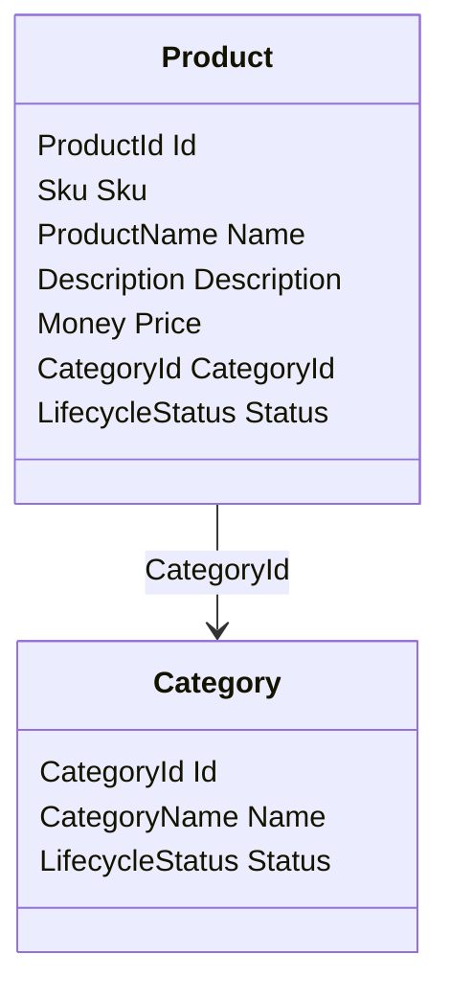
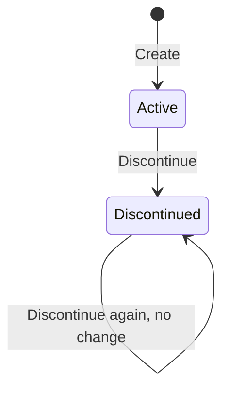

# Domain model

The domain model is the project [`src/Catalog.Domain`](../../src/Catalog.Domain/Catalog.Domain.csproj). It holds the rules of the product catalog and nothing else: it references the base class library only, so it has no database, no framework, no clock, and no identifier generator
in it ([ADR-0029](../adr/0029-domain-model-and-mutation-baseline.md)). The use cases that call it arrive in WP1.7 (planned), the persistence in WP1.8 (planned), and the HTTP endpoints in WP1.10 (planned). The version 1 contract that the model agrees with is in [the API contract](api-contract.md).

## The aggregates

An aggregate is the one object that the rest of the system loads, changes, and saves as a unit. The catalog has two. A product belongs to one category, and it holds the identifier of that category and not the category itself.

Both aggregates derive from `AggregateRoot<TId>`, which holds the identifier and the events that the aggregate recorded since the persistence layer last cleared them.

## Value objects

A value object is built with its static `Create`, which returns a result, and a value that exists is valid. Two values with the same content are equal. The bounds below are the ones of the contract, and
[`DomainAgreementTests`](../../tests/Catalog.Contract.Tests/DomainAgreementTests.cs) fails when the two differ.

| Type | Rule | Contract schema |
| --- | --- | --- |
| `Sku` | 3 to 32 ASCII letters and digits, with single hyphens between them, kept in capital letters. White space is refused and never trimmed | `SkuInput`, and `Sku` for the canonical form |
| `ProductName` | Trimmed, 1 to 200 characters, one line, valid Unicode | `ProductName` |
| `CategoryName` | Trimmed, 1 to 100 characters, one line, valid Unicode | `CategoryName` |
| `Description` | Trimmed, at most 2000 characters, line breaks and tabs allowed, and blank text means no description | `Description` |
| `Money` | An amount that is not negative, below 10 to the power of 12, with exactly as many decimal places as the currency has. An amount that needs rounding is refused and never rounded | `Money` |
| `Currency` | `USD`, `EUR`, and `GBP` with two decimal places, and `JPY` with none, written in capital letters | `CurrencyCode` |
| `ProductId` and `CategoryId` | A UUID version 7 of the RFC 9562 variant. The aggregates take an identifier and never make one | `Id` |

Length is counted in Unicode characters, as `minLength` and `maxLength` count them in JSON Schema, so an emoji is one character, although a .NET string holds two UTF-16 code units for it. A control character is refused in a name and in a SKU, and a description allows only the tab and the line breaks.

## Lifecycle

A product and a category are `Active` when they are created, and they become `Discontinued` and stay that way. Nothing is deleted.

## Operations and rules

| Operation | What it does | What it refuses |
| --- | --- | --- |
| `Category.Create` | Makes an active category and records `CategoryCreated` | Nothing. A null argument throws |
| `Category.Rename` | Gives the category a new name, in either state. The same name changes nothing and records nothing | Nothing |
| `Category.Discontinue` | Makes the category `Discontinued`. A second call changes nothing and records nothing | Nothing |
| `Product.Create` | Makes an active product in an active category and records `ProductCreated` | `CategoryNotActive` when the category is discontinued |
| `Product.Update` | Replaces the name, the description, the price, and the category in one step, and records one event for each part that changed. Either every change is accepted or none is | `ProductDiscontinued` for a new price or a new category on a discontinued product. `CategoryNotActive` for a move to a discontinued category |
| `Product.Discontinue` | Makes the product `Discontinued`. A second call changes nothing and records nothing | Nothing |

A discontinued product still changes its name and its description. The category rule applies to the assignment: a product may be created in, or moved to, an active category only, and a product that stays in a category that was discontinued after the assignment can still change. The contract says the same in the description of `updateProduct`.
A product takes the `Category` as an argument and not only its identifier, so the compiler stops code that skips the check. That the SKU is unique across the catalog is not a rule of one product, so the application checks it first for a friendly error, and the unique index of the database is the rule that cannot be raced.

## Errors

A refused rule is a value, a failed `DomainResult` that holds a `DomainError`, and a programming error such as a null argument is an exception. The application maps a code to one entry of [the error catalog](error-catalog.md).

| Code | Entry of the error catalog | Field |
| --- | --- | --- |
| `Invalid` | `validation-failed`, status 400 | The JSON path of the value in the request: `sku`, `name`, `description`, `price.amount`, `price.currency`, `productId`, or `categoryId` |
| `CategoryNotActive` | `validation-failed`, status 400 | `categoryId` |
| `ProductDiscontinued` | `product-discontinued`, status 409 | None, because the failure belongs to no single field |

The model names a field the way the contract does, and `Within("price")` nests it, so the application lists an error under `errors` without a translation table. A test checks that each path exists in the request schemas of the contract.

## Events

Each accepted change records an event on the aggregate, oldest first, and the persistence layer reads and clears them when it saves. Every event carries `EventType`, which is the name of its type, `SchemaVersion`, which is 1, and `OccurredAt`, which comes from the `TimeProvider` that the operation received.
The outbox (WP1.8, planned) stores them as JSON, so the shape of an event is a contract with the rows that are already stored. A test holds a golden list of the properties of each event, and it fails when one changes, which is the moment to raise `SchemaVersion` and to write the upgrade for the old payloads.

| Event | Recorded by | Properties |
| --- | --- | --- |
| `CategoryCreated` | `Category.Create` | `CategoryId`, `Name`, `OccurredAt` |
| `CategoryRenamed` | `Category.Rename`, when the name changes | `CategoryId`, `OldName`, `NewName`, `OccurredAt` |
| `CategoryDiscontinued` | `Category.Discontinue`, the first time | `CategoryId`, `OccurredAt` |
| `ProductCreated` | `Product.Create` | `ProductId`, `Sku`, `Name`, `Description`, `Price`, `CategoryId`, `OccurredAt` |
| `ProductDetailsChanged` | `Product.Update`, when the name or the description changes | `ProductId`, `Name`, `Description`, `OccurredAt` |
| `ProductPriceChanged` | `Product.Update`, when the price changes | `ProductId`, `OldPrice`, `NewPrice`, `OccurredAt` |
| `ProductCategoryChanged` | `Product.Update`, when the category changes | `ProductId`, `OldCategoryId`, `NewCategoryId`, `OccurredAt` |
| `ProductDiscontinued` | `Product.Discontinue`, the first time | `ProductId`, `OccurredAt` |

One update that changes several parts records the events in the order details, price, category, and all of them carry the same time.

## How it is tested

Each test names the requirement that it proves, and `governance trace` reads the names ([the traceability report](../testing/traceability.md)).

- `tests/Catalog.Domain.Tests` holds the example tests and the property tests. The tests use a `FakeTimeProvider` that starts at a fixed instant and identifiers that they build from a counter, so a result is the same on every host. The property tests state each rule as an exactly-when property against an oracle that shares no code with the model, and one test checks every step of a random sequence of operations against a snapshot.
- `tests/Catalog.Contract.Tests/DomainAgreementTests.cs` compares the model with the contract and with the error catalog, and with this page.
- `tests/Catalog.Architecture.Tests/AssemblyReferenceTests.cs` reads the references of the built assembly and fails when the domain references anything but the base class library.
- The mutation score of the domain tests is 94.62 percent (checked 2026-10-12), and [the evidence record](../testing/evidence/2026-10-12-domain-mutation-baseline.md) explains each survivor.

## What is not here yet

- The identifier generator, the `IIdGenerator` port, and the use cases arrive in WP1.7 (planned).
- The mapping to the database, the row version, the outbox, and the payload snapshots of the events arrive in WP1.8 (planned).
- The endpoints and the served contract arrive in WP1.10 (planned).
