# HTTP API

The HTTP API is the project [`src/Catalog.Api`](../../src/Catalog.Api/Catalog.Api.csproj). It is the composition root of the catalog: it registers every adapter of the persistence layer, the cache, and the application layer, it holds the middleware that every request passes, and it serves the ten operations of the contract
([ADR-0040](../adr/0040-http-api-composition-and-token-validation.md), [ADR-0041](../adr/0041-http-endpoints-versioning-and-conditional-requests.md), [ADR-0042](../adr/0042-served-contract-conformance-and-snapshots.md), plan sections 8.1, 8.6, 8.7, 8.9, and 9). This page describes what exists today.

## The composition

[`Program.cs`](../../src/Catalog.Api/Program.cs) builds the host with `AddCatalogApi` and `UseCatalogApi`, and nothing else. [`CatalogComposition`](../../src/Catalog.Api/Composition/CatalogComposition.cs) has one extension method for each concern, in the order that the host needs them:

| Method | Registers |
| --- | --- |
| `AddCatalogOptions` | Every section of settings with its validator, which runs when the host starts, so a wrong setting stops the host before it serves a request |
| `AddCatalogPersistence` | The credential source, the interceptors, the write and read contexts, the repositories, the unit of work, the stores, the outbox, and the hosted services ([the persistence page](persistence.md)) |
| `AddCatalogCache` | The shared cache, the backplane, the adapter, and `CacheInvalidationSubscriber` as the one singleton handler of the outbox ([the caching page](caching.md)) |
| `AddCatalogApplication` | The identifier generator, the caller, the interim telemetry, the ten validators, and the handlers of the two features through `ServiceCollectionFeatureRegistry`, which composes each chain with `CommandPipeline` and `QueryPipeline` |
| `AddCatalogSecurity` | The bearer handler, the endpoint policies, the rate limiter, and the forwarded headers |
| `AddCatalogVersioning` | The version segment of the path, with no default version, and the reporting of the versions |
| `AddCatalogHealth` | The four health checks |

A rule of `Catalog.Architecture.Tests` fails when a type of the Api outside the namespace `Catalog.Api.Composition` depends on a type of `Catalog.Infrastructure` or `Catalog.CrossCutting`, so the adapters are named in one place. The handlers and their chains are scoped to the request, the dispatcher is scoped, the cache and the
subscriber are singletons, and the credential source, the metrics, and the processor are singletons that the container disposes.

## The pipeline

```mermaid
flowchart LR
  accTitle: The order of the middleware of the API
  accDescr: A request passes the trace, the forwarded headers, the security headers, the exception handler, the status code pages, routing, the port gate, the version report, authentication, the rate limiter, and authorization before it reaches an endpoint.
  A[Trace] --> B[Forwarded headers] --> C[Security headers] --> D[Exception handler] --> E[Status code pages] --> F[Routing] --> G[Port gate] --> V[Version report] --> H[Authentication] --> I[Rate limiter] --> J[Authorization] --> K[Endpoint]
```



| Step | What it does |
| --- | --- |
| Trace | Starts an activity when none exists, so every error carries a trace identifier that is the one of the request |
| Forwarded headers | Reads `X-Forwarded-For`, `-Proto`, and `-Host` from the proxies that the settings name, and from no one else |
| Security headers | Registers the headers that every answer carries, including an error from another middleware |
| Exception handler | Turns an exception into the 500 or 503 of the error catalog and logs the exception with the trace identifier |
| Status code pages | Writes the body of an empty 4xx or 5xx, such as the 405 of routing or the 404 of an unknown path |
| Port gate | Keeps the management endpoints on the management port and the API on the public port, and checks the host of a request to the public port |
| Version report | Registers the `api-supported-versions` header of the chosen endpoint, so a 401, a 403, and a 429 carry it as the contract says |
| Authentication | Validates the bearer token, and answers 401 with the challenge and the catalog entry |
| Rate limiter | Counts the caller and answers 429 with `Retry-After` |
| Authorization | Checks the endpoint policy, which is the scope and one of the roles |

## Ports and hosts

Kestrel listens on two sockets of one address. The public port serves the API, and the management port serves the health endpoints and nothing else. The gate reads the port that the connection arrived on, so a `Host` header that names the other port changes nothing, and a request that arrives on the wrong port gets a 404. A request to the public port must also name an allowed host, because the `Location` and `Link` headers are built from it. The management port does not check the host, because a probe names the address of the pod.

## The settings

Every section is bound from configuration and validated at start. A message names the setting and never repeats its value. No file in the repository holds a secret, so the two passwords come from the environment.

| Setting | Default | Meaning |
| --- | --- | --- |
| `Catalog:Hosting:ListenAddress` | `127.0.0.1` | The address of both sockets. A container sets `0.0.0.0` |
| `Catalog:Hosting:PublicPort`, `ManagementPort` | 8080, 8081 | The two ports, which must differ |
| `Catalog:Hosting:AllowedHosts` | `localhost;127.0.0.1;[::1]` | The hosts of the public port, as one string with semicolons. A name is exact, or `*.name` matches a subdomain. `*` is allowed in Development only |
| `Catalog:Auth:Issuer` | none | The issuer that a token must name, compared exactly. There is no default outside Development |
| `Catalog:Auth:MetadataAddress` | the issuer and `/.well-known/openid-configuration` | Where the API reads the keys, when it reaches the identity provider at an address other than the issuer |
| `Catalog:Auth:Audience` | `catalog-api` | The audience that a token must name |
| `Catalog:Auth:RequireHttpsMetadata` | `true` | Only the Development environment may turn it off |
| `Catalog:Auth:ClockSkew` | 30 seconds | At most 30 seconds |
| `Catalog:Auth:MetadataRefreshInterval` | 5 minutes | The shortest time between two reads of the metadata, from 1 second to 24 hours |
| `Catalog:Limits:MaxRequestBodyBytes` | 32 KiB | The largest body, from 1 KiB to 1 MiB |
| `Catalog:Limits:MaxJsonDepth` | 8 | The deepest nesting of a body, from 2 to 64 |
| `Catalog:Limits:ReadPermits`, `WritePermits` | 600, 120 | The requests of one caller in a window |
| `Catalog:Limits:Window` | 1 minute | The length of the window |
| `Catalog:ForwardedHeaders:KnownNetworks`, `KnownProxies` | none | The trusted proxies, as networks in CIDR notation and as addresses, each one string with semicolons. A network with a prefix of 0 is refused |
| `Catalog:ForwardedHeaders:ForwardLimit` | 1 | The number of proxies that the API reads from the chain |
| `Catalog:Database`, `Catalog:Outbox`, `Catalog:Idempotency` | see [the persistence page](persistence.md) | The database connection and its credential, the outbox, and the idempotency store |
| `Catalog:Valkey`, `Catalog:Cache` | see [the caching page](caching.md) | The connection to Valkey and the cache |

The setting `KnownNetworks` keeps the name of the plan. ASP.NET Core 10 renamed the property of the same name to `KnownIPNetworks` and marks the old one obsolete (checked 2026-11-03), and the API fills the new property. A list is one string with semicolons, as the `AllowedHosts` setting of ASP.NET Core is, because a .NET configuration array merges
the file, the environment, and the default, and a setting from the environment could not remove an entry of the file.

`appsettings.json` holds the defaults that every environment shares, and `appsettings.Development.json` holds the addresses of the Compose stack: the issuer `http://localhost:8180/realms/catalog`, the database on `localhost,1433` with the login `sa`, and Valkey on `localhost:6379` with the user `catalog-dev`.
The two passwords arrive as `Catalog__Database__Password` and `Catalog__Valkey__Password`. `.env` holds them for the stack (`MSSQL_SA_PASSWORD` and `VALKEY_APP_PASSWORD`).

## Token validation

| Check | Rule |
| --- | --- |
| Issuer | The exact string of `Catalog:Auth:Issuer`. The issuer that the metadata names is ignored |
| Audience | The exact string of `Catalog:Auth:Audience` |
| Signature | A key of the metadata verifies it. The handler reads the metadata again when a token names an unknown key, at most once for each refresh interval, and keeps no previous key set |
| Algorithm | RS256 or ES256, written in code |
| Lifetime | The token needs an expiry, and the skew is at most 30 seconds |
| Claims | The names are the ones of the token. Scopes come from the space-delimited `scope`, roles from `realm_access.roles`, and the caller from `sub`, or `azp` when there is no subject |

A refused token gets 401 with `WWW-Authenticate: Bearer realm="catalog", error="invalid_token"`, and a request without a token gets the same challenge without the error. The body is the `unauthorized` entry of [the error catalog](error-catalog.md), and the challenge names no cause. A token in the query string is not read.

## Endpoint policies

Each access level has one policy, named after its scope, and a policy needs the scope and one of the roles of `PermissionPolicy`, the same table that the authorization decorator reads ([the application layer](application-layer.md#permissions)). A token with the scope and without the role gets 403 `forbidden` with a detail that names the roles, and a token without the scope gets a detail that names the scope.
An endpoint binds the level of its use case with `RequireAccessOf<TRequest>()`, so the endpoint and the pipeline read the level from the same request type.

## Limits

A caller with a token is counted by its identifier, and any other caller by its address. A read and a write have separate counts. The answer to a refused request is 429 `rate-limited` with `Retry-After` in whole seconds. The health endpoints are not limited. Kestrel limits the body to `MaxRequestBodyBytes` and the headers to 16 KiB, and the endpoints read a body with the size and the depth of the settings, so the limits hold on a host that has no Kestrel limit ([the bodies](#bodies)).

## Security headers

| Header | Value |
| --- | --- |
| `X-Content-Type-Options` | `nosniff` |
| `X-Frame-Options` | `DENY` |
| `Content-Security-Policy` | `default-src 'none'; frame-ancestors 'none'` |
| `Referrer-Policy` | `no-referrer` |
| `Permissions-Policy` | `geolocation=(), camera=(), microphone=()` |
| `Cross-Origin-Resource-Policy` | `same-origin` |
| `Cache-Control` | `no-store` |
| `Strict-Transport-Security` | `max-age=31536000; includeSubDomains`, only when the request came over HTTPS, which a trusted proxy can tell |

The server header is off. A header that an endpoint already set is kept.

## Endpoints

The ten operations of [the API contract](api-contract.md) are served under `/api/v1`, and the name of each endpoint is the `operationId` of the contract. An endpoint reads the request through `Catalog.Api.Mapping`, runs the handler through its interface, and writes the response. It holds no rule of the catalog,
and a rule of `Catalog.Architecture.Tests` fails when a type of `Catalog.Api.Endpoints` depends on the domain model, an adapter, or a decorator ([ADR-0041](../adr/0041-http-endpoints-versioning-and-conditional-requests.md)).

| Operation | Method and path | Level | Success | Reads |
| --- | --- | --- | --- | --- |
| `listCategories` | `GET /categories` | read | 200 | `status`, `pageSize`, `cursor` |
| `createCategory` | `POST /categories` | admin | 201 | `Idempotency-Key`, the body |
| `getCategory` | `GET /categories/{categoryId}` | read | 200 or 304 | `If-None-Match` |
| `updateCategory` | `PUT /categories/{categoryId}` | admin | 200 | `If-Match`, the body |
| `discontinueCategory` | `POST /categories/{categoryId}/discontinue` | admin | 200 | `If-Match` |
| `listProducts` | `GET /products` | read | 200 | `categoryId`, `status`, `q`, `sort`, `pageSize`, `cursor` |
| `createProduct` | `POST /products` | write | 201 | `Idempotency-Key`, the body |
| `getProduct` | `GET /products/{productId}` | read | 200 or 304 | `If-None-Match` |
| `updateProduct` | `PUT /products/{productId}` | write | 200 | `If-Match`, the body |
| `discontinueProduct` | `POST /products/{productId}/discontinue` | admin | 200 | `If-Match` |

The order of the checks of a request is the policy (401 and 403), the identifier in the path, the headers, the body, and then the use case, which reports its own errors together. A request that is wrong in two ways reports the first.

### Versions

The version is a segment of the path, and a path without a version or with an unknown one is not routed. The set holds `1.0`, and every response of a versioned route carries `api-supported-versions: 1.0`, including an answer that a middleware writes. No version is deprecated, so `api-deprecated-versions`, `Deprecation`, and `Sunset` are absent until WP4.1.

### Conditional requests

- **`ETag`.** A create, a read, a change, and a discontinue send the version of the resource as a strong `ETag`. A `GET` with the current tag in `If-None-Match` answers 304 with the `ETag` and no body.
- **`If-Match`.** A change and a discontinue need the tag that the caller read. A missing header is 428 `precondition-required`, and a stale one is 412 `precondition-failed`. Discontinuing a resource that is already discontinued answers 200 with the same representation and the same `ETag`.
- **The form of the headers.** One strong token in quotes of at most 64 characters, as the API returned it. A weak tag, a list, `*`, and an unquoted value are a `validation-failed` error for the header.

### Idempotent creates

A create needs one `Idempotency-Key`, a quoted string of 1 to 128 printable ASCII characters without a quote or a backslash. A missing or invalid key is 400 `idempotency-key-required`, and it is checked before the body. The same key with the same body replays the first answer (201 with the same `Location`, `ETag`, and body, even when the resource changed since),
another body with the same key is 422 `idempotency-key-reused`, and the same key while the first request still runs is 409 `idempotency-request-in-progress`. The pipeline and the store do the work ([ADR-0036](../adr/0036-idempotency-store.md)).

### Pages

A list takes `pageSize` from 1 to 100 (20 by default) and the opaque `cursor`. The body holds `items` and `nextCursor`, and when a next page exists the response also carries `Link: <address>; rel="next"` with an absolute address that keeps every parameter of the request in its order and puts the new cursor last. A cursor is valid for the sort that made it.
A category list can be narrowed by `status`, and a product list by `categoryId`, `status`, `q` (text in the name or the SKU, ignoring case), and `sort` (`createdAt` for newest first, `name` for A to Z).

### Bodies

A body must be `application/json` (with no charset or `utf-8`), at most 32 KiB (the limit counts the bytes that are read, so a body without a length is checked too), and at most 8 levels deep. The API lists every member that the contract does not name with its path, and a value of the wrong type with its path, as `validation-failed` errors, and a body that is not JSON or is too deep
is 400 `malformed-request`. An amount is a string such as `89.99`, with no sign and no exponent, and the API writes an amount with the decimal places of its currency (`1990` for JPY). Every instant is UTC with a `Z`. A SKU is written in upper case, and a name is trimmed.

### Errors of the endpoints

| Status | Type | When |
| --- | --- | --- |
| 400 | `validation-failed` | A parameter, a header, a path identifier, or a member of the body is not valid, with the messages for each field |
| 400 | `malformed-request` | The body is not JSON, or it is nested deeper than the limit |
| 400 | `idempotency-key-required` | A create has no valid `Idempotency-Key` |
| 404 | `not-found` | No category or product has the identifier |
| 409 | `sku-already-exists`, `product-discontinued`, `idempotency-request-in-progress` | The request conflicts with the state of the catalog |
| 412, 428 | `precondition-failed`, `precondition-required` | The version is stale, or no version was sent |
| 413, 415 | `payload-too-large`, `unsupported-media-type` | The body is too large, or it is not `application/json` |
| 422 | `idempotency-key-reused` | The key was used with another body |

An identifier must be a UUID of version 7, because the model refuses any other, so an identifier of another version is a 400 for the field and not a 404.

## Errors

One writer makes every error. Its `type` is the address of an entry of [the error catalog](error-catalog.md), and a status that the catalog does not list, such as 405, has the type `about:blank` (RFC 9457). The `detail` is fixed text, the `instance` is the path, and the `traceId` is the trace of the request. The API raises eight entries by itself (`malformed-request`, `idempotency-key-required`, `unauthorized`, `payload-too-large`, `unsupported-media-type`, `rate-limited`, `internal-error`, and `service-unavailable`) and maps the other nine from the typed errors of the application ([ADR-0032](../adr/0032-decorator-pipeline-and-application-results.md)).
An unhandled exception is a 500 with a generic text, and the log holds it with the trace identifier. A database exception anywhere in the chain is a 503 with `Retry-After: 5`.

## Health endpoints

The endpoints are on the management port and are not routed by the gateway. The body is JSON with the status, the duration, and each check with its status and its text, and the status of a probe is 200 for `Healthy` and `Degraded`, and 503 for `Unhealthy`.

| Endpoint | Checks | Meaning |
| --- | --- | --- |
| `/health/live` | None | The process answers |
| `/health/startup` | `credentials` | The configuration is valid, and the source of the database credential holds a credential |
| `/health/ready` | `credentials`, `database`, `outbox`, `cache` | See below |

- **database.** The connection opens with the credential of the source, and the history of the database has every migration that this build expects. A schema that is ahead of the code is healthy ([the migration policy](../plans/implementation-plan.md)). An unreachable server, a revoked login, and a schema that is behind are unhealthy.
- **outbox.** A message in the dead-letter state, or a message that was due before a whole lease and two polls ago, is `Degraded`, and a database that cannot be read is unhealthy. The alerts that watch the counters are WP1.11.
- **cache.** The state of the circuit breakers of the shared cache and the backplane. A node whose Valkey is down is `Degraded` and never unhealthy, so readiness stays green ([the consistency model](../explanation/cache-consistency-model.md)).

No text of an exception, no connection string, no user name, and no credential is in a report or in a log line, and the writer replaces the description of a check that threw.

## The served document and the viewer

The host generates its own OpenAPI document, and CI compares it with [the authored contract](api-contract.md) ([ADR-0042](../adr/0042-served-contract-conformance-and-snapshots.md)). Each of the ten endpoints carries a `ContractOperation` (`WithContract`): its tag, the schema of its success response, the shared parameters, the schema of its body, and its 409 response.
[`ServedContract`](../../src/Catalog.Api/Documentation/ServedContract.cs) then takes the path, the method, the operation identifier, and the scope from the endpoint table, derives the refusals from what the operation accepts (a path identifier gives a 404, a precondition header a 412 and a 428, a body a 413 and a 415, an idempotency key a 422 and a 409), and keeps
the information, the servers, the tags, the security, and every shared schema, parameter, header, and response from the copy of the authored file that the assembly embeds. `TransportAgreementTests` compare the records of `Catalog.Contracts.V1` with those schemas.

| Where | What |
| --- | --- |
| `TestResults/served/catalog.openapi.json` | The document that `ServedContractTests` write. The `ci` workflow runs `tools/ci/Test-ContractConformance.ps1 -Served` on it, blocking, and the documents must be structurally equal after descriptions, examples, and summaries are ignored |
| `GET /openapi/v1.json` and `/scalar/v1` | The document and the [Scalar](tools/scalar.md) viewer. Only the Development environment registers them, with a content policy of its own for `/scalar`, and a Production host answers 404 for `/openapi/v1.json`, `/scalar`, and `/scalar/v1` |

## Telemetry until WP1.11

`LoggingUseCaseTelemetry` implements `IUseCaseTelemetry` with one structured log line for each outcome of a use case, with the name of the use case and the kind of refusal. WP1.11 replaces it with an adapter over an activity source and a meter, and the registration is the one line that changes.

## Run it against the Compose stack

Start the stack, apply the migrations with the bundle of [the runbook](../runbooks/database-migration.md), and set the two passwords from `.env` and the Development environment, which `appsettings.Development.json` needs for the addresses of the stack and which registers the viewer:

```bash illustrative
./dev compose up
export ASPNETCORE_ENVIRONMENT=Development
export Catalog__Database__Password="<MSSQL_SA_PASSWORD from .env>"
export Catalog__Valkey__Password="<VALKEY_APP_PASSWORD from .env>"
dotnet run --project src/Catalog.Api
```

The API listens on `127.0.0.1:8080`, and the probes answer on `127.0.0.1:8081`. A token comes from the `catalog` realm of the stack ([Keycloak](tools/keycloak.md)). The viewer is at `http://127.0.0.1:8080/scalar/v1`.

## How it is tested

Each test names the requirement that it proves, and `governance trace` reads the names ([the traceability report](../testing/traceability.md)). `tests/Catalog.Api.Tests` starts the real composition in process, with an in-process identity provider that serves the metadata and the keys over HTTP and signs tokens with keys that it makes at run time.

- `ConfigurationValidationTests`, `AppSettingsFilesTests`, and `CompositionTests` prove the settings, the settings files, the lifetimes, and that each wrong setting stops the host with a message that names it (REQ-ARC-002, REQ-APP-006).
- `TokenClaimsTests`, `JwtValidationTests`, `JwksRotationTests`, and `AccessPolicyTests` prove the claims, every check of the token, the rotation and the withdrawal of a key, and all 192 combinations of scope and role (REQ-IDN-002, REQ-IDN-003).
- `ProblemDetailsTests`, `SecurityHeadersTests`, `RateLimitTests`, and `ForwardedHeadersTests` prove the error shape on every path, the headers, the limiter, and the proxies (REQ-API-005, REQ-API-007, REQ-ARC-002).
- `HealthTests` starts real sockets and a real SQL Server 2022 container from the digest of `compose.yaml`, and proves the probes, the two ports, and that no secret reaches an answer or a log (REQ-QUA-001, REQ-CACHE-003).
- `CategoryEndpointTests` and `ProductEndpointTests` run every operation against a real SQL Server 2022 container and a real Valkey 8.1 container, with a database and a cache environment of their own for each class: the headers, the conditional requests, the idempotent creates, the filters, and the pages (REQ-API-001, REQ-API-003, REQ-API-004, REQ-API-005).
- `RequestBodyTests` and `VersioningTests` prove the strict and bounded reading of a body and the version headers, and they need no database (REQ-API-006, REQ-API-002).
- `ServedContractTests` write the served document for the oasdiff check, show the operations and their scopes, and prove that the viewer and the document exist in Development only (REQ-CON-002). `TransportAgreementTests` compare each transport record with its schema in the contract (REQ-CON-002, REQ-API-001).
- `AuthorizationMatrixTests` read the scope of each operation from the authored contract and send all 64 combinations of scope and role to each of the ten operations, against a ladder of roles that the test writes apart from the permission table, and they check the 401 cases (REQ-IDN-002).
- `KeycloakRealmContractTests` start the pinned Keycloak 26.8.0 image from `compose.yaml` with the realm file, and prove the issuer, the keys, the audience, the scopes, and the roles of real tokens, and that the real API accepts them and refuses a tampered token and a token of another issuer (REQ-IDN-001, REQ-IDN-005).
- `SnapshotTests` compare the error bodies, the 429 answer, the use-case refusals, and the generated paths with the files in `tests/Catalog.Api.Tests/Snapshots`. The helper `Snapshot` replaces the trace identifier and writes a `.received.json` next to the file on a difference. `SNAPSHOT_ACCEPT=1` accepts a change outside CI, and a person reads the diff of the `.verified.json` files in the review. Verify is not used (ADR-0042, [the tool inventory](tools/inventory.yaml)).
- The token handler reads the system clock and has no `TimeProvider`, so the tests build tokens from the clock of the machine, and every boundary keeps a margin of one second on each side.
- `tests/Catalog.Architecture.Tests` holds the rule that keeps the adapters in the composition namespace, and `tests/Catalog.Contract.Tests/ApiAgreementTests.cs` compares the error table of the API with the error catalog.
