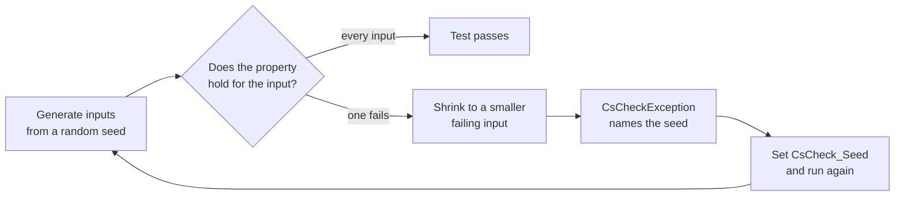

# CsCheck

## Overview

An example test checks the input that its author thought of. A rule such as "an amount is accepted exactly when it is not negative, is below the limit, and fits the minor units of its currency" has edges that a person misses: the digit count, the scale, the currency.
A property test states the rule once and checks it against hundreds of generated inputs. CsCheck is a C# library for that. It is inspired by QuickCheck, and it generates and shrinks inputs from the PCG random number generator
(checked 2026-10-12 in the [README](https://github.com/AnthonyLloyd/CsCheck)). It is a test dependency: only `tests/Catalog.Domain.Tests` references it, through the central pin in `Directory.Packages.props`, and no server project does.

Six concepts cover what you need:

| Concept | What it is | Where it appears here |
| --- | --- | --- |
| Generator | A `Gen<T>` that produces values of type `T`. Generators compose with LINQ-style methods | `Gen.Long[0, MaxCents]`, `Gen.Byte.Array[16]`, `Gen.OneOfConst(...)`, and `.List[1, 40]` |
| Property | An assertion that must hold for every generated value. `Sample` runs it, and it fails by throwing or by returning false | The `assertion` argument of `Property.Check` |
| Oracle | A second, independent way to compute the expected answer, so the test does not repeat the code under test | Integer digit arithmetic for `Money`, a regex for `Sku`, rune counting for names |
| Seed | The value that starts the random sequence. Every run starts from a random seed, and a failing case prints its seed | The environment variable `CsCheck_Seed` |
| Shrinking | After a failure, CsCheck searches for a smaller input that still fails, and reports that one | The `CsCheckException` message, which holds the seed |
| Model-based test | A random sequence of operations that is checked against a snapshot after each step | `ProductLifecyclePropertyTests` |

There are 14 property tests, in five files (checked 2026-10-12). Each rule also has fixed examples with a boundary on both sides, such as a 200-character name that is accepted and a 201-character name that is not. The properties cover what the examples miss.

| File | Properties | Oracle |
| --- | --- | --- |
| [MoneyPropertyTests.cs](../../../tests/Catalog.Domain.Tests/MoneyPropertyTests.cs) | 8: the accept and refuse rule, commutative and associative addition, subtraction, the limit, two spellings of one amount, yen scale | Integer digit arithmetic with `BigInteger`, and whole cents |
| [NameTests.cs](../../../tests/Catalog.Domain.Tests/NameTests.cs) | 1: a name is accepted exactly when it is one line of valid text within the limit | `Trim`, a rune count, and `char.IsControl` |
| [DescriptionAndSkuTests.cs](../../../tests/Catalog.Domain.Tests/DescriptionAndSkuTests.cs) | 2: normalizing a description twice changes nothing, and a SKU is accepted exactly when it matches the contract pattern and length | A regex copied from the contract |
| [IdentifierTests.cs](../../../tests/Catalog.Domain.Tests/IdentifierTests.cs) | 2: random bytes with the version 7 layout are valid, and any other version or variant is refused | `WithLayout`, which sets the version and variant bits |
| [ProductLifecyclePropertyTests.cs](../../../tests/Catalog.Domain.Tests/ProductLifecyclePropertyTests.cs) | 1: random sequences of updates and discontinuations keep the rules of the lifecycle | A snapshot of the product taken before each call |

The oracles share no code with the model, and each property states its rule as "exactly when". These tests are also what kills mutants: the domain scored 94.62 percent in the first Stryker.NET baseline (checked 2026-10-12, see [Stryker.NET](stryker-net.md) and the
[evidence record](../../testing/evidence/2026-10-12-domain-mutation-baseline.md)), and moving `ProductTests.cs` and `ProductLifecyclePropertyTests.cs` out of the project lowered it to 81.61 percent.

Random inputs raise the question of determinism, which `REQ-QUA-004` and plan section 10.3 answer: "CsCheck seeds are logged so failures can be replayed." A property run is not repeatable, because each run starts from a new seed, but a failure is. The rest comes from fixed inputs in the examples, `FakeTimeProvider`
([the dependency catalog](dependency-catalog.md)), injected UUIDv7 identifiers, and the invariant culture. Identifiers come from a counter or from `Guid.CreateVersion7()` at a fixed time, and no test calls `Guid.NewGuid()`: the test that checks that a version 4 GUID is refused uses a fixed one.



## Decision rationale

[ADR-0018](../../adr/0018-test-stack-and-quality-gates.md) chose CsCheck as part of the Phase 1 test stack, and [ADR-0029](../../adr/0029-domain-model-and-mutation-baseline.md) records how the domain tests use it. What else could do the job:

- **Examples only, or a loop over `System.Random`.** Examples stay, but they cannot cover the space between them, such as the 18-digit amounts and the 40-character texts that the properties generate. A random loop has no shrinking and no printed seed, so a failure would be a large input that nobody can replay.
- **FsCheck 3.4.0.** It is BSD-3-Clause, and it pulls in `FSharp.Core` even for C# tests (checked 2026-10-04, in the [verification record](../../research/2026-10-04-dotnet-ecosystem-verification.md)).
- **CsCheck 4.9.1.** It is Apache-2.0 on the license allow-list of [ADR-0004](../../adr/0004-licensing-and-dependency-license-policy.md) (checked 2026-10-12 on the [NuGet license page](https://www.nuget.org/packages/CsCheck/4.9.1/license)), written in C# with LINQ-style generators, and it adds no packages to
  the test project (checked 2026-10-12 in `tests/Catalog.Domain.Tests/packages.lock.json`). The repository runs it as a test library and never ships it.

CsCheck won on license, on having no F# dependency, and on recent activity. The tradeoffs are these:

- **Different inputs on every run.** A failure in CI may not appear on a second run, so a failure has to be replayed from its seed and cannot just be rerun. Step 4 shows how.
- **An oracle that copies the model proves nothing.** A property is only as strong as the independent calculation inside it, and writing that calculation is the work.
- **Maintenance.** The repository belongs to one person's GitHub account, not to an organization (checked 2026-10-12). 4.9.1 is the latest stable release, published 2026-09-17, and a `5.0.0-rc1` was published on 2026-10-11 (checked 2026-10-12 on NuGet). The pin stays on 4.9.1, and an upgrade to 5.x is a separate change that must rerun the properties and the replay step.

## Setup tutorial

**Prerequisites:** the .NET SDK 10.0.401 that `global.json` pins, and a restored solution. There is nothing else to install. The package is pinned once, in `Directory.Packages.props` as `<PackageVersion Include="CsCheck" Version="4.9.1" />`, and `tests/Catalog.Domain.Tests` refers to it
with `<PackageReference Include="CsCheck" />`. The commands run from the repository root, and Docker is not needed.

1. Run the property tests of `Money`.

   ```bash illustrative
   dotnet test --project tests/Catalog.Domain.Tests --configuration Release --filter-class "*MoneyPropertyTests"
   ```

   Expected output, after the lines that name the test assembly (checked 2026-10-12):

   ```text
   Test run summary: Passed!
     total: 8
     failed: 0
     succeeded: 8
     skipped: 0
   ```

   The same command without `--filter-class` runs all the domain tests. It passed 172 tests on 2026-10-12, in about five seconds of test time.

2. Read the helper that every property test uses, [Property.cs](../../../tests/Catalog.Domain.Tests/Support/Property.cs). It runs on one thread, so the only parallelism is the one that `xunit.runner.json` declares, and it runs 500 iterations unless
   `CsCheck_Iter` is set, in which case `-1` leaves the count to CsCheck.

   ```csharp
   public static void Check<T>(Gen<T> generator, Action<T> assertion)
   {
       var iterations = Environment.GetEnvironmentVariable("CsCheck_Iter") is null ? DefaultIterations : -1;
       generator.Sample(assertion, iter: iterations, threads: 1);
   }
   ```

3. Read one property. This one in `MoneyPropertyTests.cs` pairs a generated amount, as a mantissa, a scale, and a sign, with a currency. The expected result comes from `Accepts`, which counts digits with `BigInteger` and shares no code with the `decimal` arithmetic of `Money`.

   ```csharp
   Property.Check(
       AnyAmount.Select(Gen.OneOfConst([.. Currency.All])),
       sample =>
       {
           var ((mantissa, scale, negative), currency) = sample;
           var amount = Decimal(mantissa, scale, negative);
           var expected = mantissa == 0 || (!negative && Accepts(mantissa, scale, currency.MinorUnits));

           var result = Money.Create(amount, currency);

           result.IsSuccess.Should().Be(expected, $"{amount} {currency}");
   ```

   The excerpt stops after the main assertion. To run more iterations, set the variable and run step 1 again. Twenty thousand iterations passed on 2026-10-12.

   ```powershell illustrative
   $env:CsCheck_Iter = "20000"
   ```

4. Replay a failure. A failing property throws a `CsCheckException`, which xUnit reports as a failed test. The message names the seed, and it has this form (the seed in it is an example, and the form is the one that a probe printed on 2026-10-12):

   ```text
   CsCheckException: Set seed: "q3Lk9mZx0RaB" or -e CsCheck_Seed=q3Lk9mZx0RaB to reproduce (0 shrinks, 26 skipped, 2,000 total)
   ```

   In CI the message is in the log of the test step of [the `ci` workflow](../../../.github/workflows/ci.yml), and the TRX files are kept for 7 days as the `test-results` artifact. Set the variable to the seed and run the failing test again, and the failing case runs first, on any host. CsCheck then shrinks it to a smaller failing input.

   ```powershell illustrative
   $env:CsCheck_Seed = "q3Lk9mZx0RaB"
   ```

   Do not pin a seed in a test. A `seed:` argument together with `iter: N` replays only the first iteration with that seed, and the other iterations use fresh seeds (checked 2026-10-12: two runs with the same seed and 6 iterations gave different values after the first). A pinned seed would fix one input and leave the rest random, so the test would still not be repeatable.

5. Write a property the way this repository does. Four rules come from the existing tests:

   - Call `Property.Check`, not `Sample`, and state the rule as "exactly when", with an expected result from an oracle that shares no code with the model.
   - The bounds of `Gen.Long[a, b]` are inclusive, so `Gen.Long[0, MaxCents]` can produce `MaxCents`.
   - `Gen.Select(a, b, c)` is the static method that combines generators into a tuple, `a.Select(b)` makes a pair, `.Select(f)` on a generator maps its values, and `.Where(p)` drops the values that fail `p`, as `IdentifierTests.cs` does to leave out the one valid layout.
   - Take the time from a `FakeTimeProvider` and the identifiers from a counter, as `ProductLifecyclePropertyTests.cs` does, so that a seed replays the same case.

**Cleanup:** close the shell, or remove the variables with `Remove-Item Env:CsCheck_Iter, Env:CsCheck_Seed`. Nothing else is created.

## Further research

- [CsCheck repository and README](https://github.com/AnthonyLloyd/CsCheck): the generators, `Sample`, the seed message, shrinking, and model-based testing (checked 2026-10-12)
- [Getting started with CsCheck](https://github.com/AnthonyLloyd/CsCheck/blob/master/docs/GettingStarted.md): a first property test, written for a developer who knows only example tests (checked 2026-10-12)
- [Why use a random testing library in C#](https://github.com/AnthonyLloyd/CsCheck/blob/master/docs/Why.md): why model-based tests are the strongest form (checked 2026-10-12)
- [CsCheck on NuGet](https://www.nuget.org/packages/CsCheck/4.9.1): the pinned version, its license, and the later releases (checked 2026-10-12)
- [ADR-0018](../../adr/0018-test-stack-and-quality-gates.md) and [ADR-0029](../../adr/0029-domain-model-and-mutation-baseline.md): the test stack, and how the domain tests are built and measured
