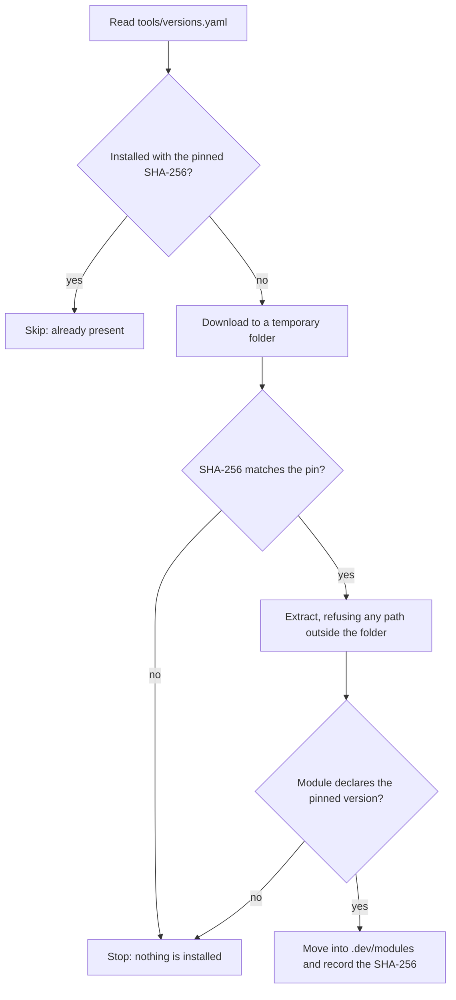

# The dev command

## Overview

`dev` is the one command that you use to work on this repository. It checks your machine, installs the pinned script tools, builds and tests the solution, builds the documentation, and runs the API-only stack. It is a
PowerShell program in `scripts/dev.ps1` with its modules in `scripts/modules`, and two thin shims start it: `dev` for Linux, macOS, and the Dev Container, and `dev.cmd` for Windows. The docs write `./dev`.
On Windows, `./dev` in PowerShell and `.\dev` in cmd.exe both run `dev.cmd`.

| Command | What it does | State |
| --- | --- | --- |
| `dev doctor [--profile api\|lite\|full\|ci]` | Checks the host, Git, the .NET SDK, PowerShell, the pinned tools, Docker and Compose, Docker's memory and CPUs against the profile budget, the ports, and `.env`. It changes nothing | available |
| `dev bootstrap [--skip-tools] [--skip-env] [--force]` | Installs the pinned script tools and creates `.env` with random local secrets | available |
| `dev build` | Builds `ProductCatalog.slnx` in Release | available |
| `dev test [all\|unit\|architecture\|scripts\|docs]` | Runs a suite: .NET unit tests, architecture tests, the script tests, or the documentation gate | available |
| `dev docs [serve]` | Builds the documentation site with warnings as errors, or serves it | available |
| `dev compose up\|down\|reset\|ps\|logs\|check` | Starts, stops, resets, lists, shows the logs of, and checks the API-only stack | available |
| `dev lab <id> setup\|run\|cleanup` | Sets up, runs, or cleans up a lab. Lab 1 is the quick start | available |
| `dev platform`, `dev tf` | Create, destroy, and inspect the local kind platform, and run Terraform | planned for Phase 3 |
| `dev seed`, `dev demo`, `dev clean` | Seed data, run a demonstration, and remove local state | planned, with the work package that needs each |

A command that is planned prints what it is and when it arrives, and exits with code 2, so a script cannot mistake it for success. The exit codes are the same everywhere: 0 is success, 1 is a failed check or step, and 2 is
wrong usage or a command that does not exist yet.

## Decision rationale

[ADR-0025](../../adr/0025-dev-command-and-dev-container.md) records why one PowerShell command behind thin shims beat a task runner and Bash scripts, and
[ADR-0024](../../adr/0024-verified-tool-installer.md) records why a small installer that checks every download beat `mise`.

| Criterion | What was found |
| --- | --- |
| License | The scripts are first-party code under the repository's Apache-2.0 license |
| Maintenance | The repository maintains it, with 278 Pester tests in `scripts/tests`, PSScriptAnalyzer at warning level, and a CI job that runs both |
| Cost | No prerequisite beyond Git, Docker, and the .NET SDK, because PowerShell is a local .NET tool |
| Trade-off | The repository maintains an installer and a small YAML reader, which the tests and the strict subset keep honest. `mise` stays on hold (checked 2026-10-10) |

## Setup tutorial

**Prerequisites:** Git, Docker (running), and the .NET SDK that `global.json` pins. A Dev Container has all three.

1. Run the help. The shim restores PowerShell as a local tool the first time, which takes a few seconds.

   ```bash illustrative
   ./dev help
   ```

   Expected output: the command table above, grouped as Setup, Build and test, Compose, and the rest, with the planned commands marked.

2. Install the pinned tools and create `.env`.

   ```bash illustrative
   ./dev bootstrap
   ```

   Expected output: `pester 5.9.0: installed`, `psscriptanalyzer 1.25.0: installed`, and `.env created with 10 generated secret(s)`. A second run says `present` and `already complete`.

3. Check the machine.

   ```bash illustrative
   ./dev doctor
   ```

   Expected output: one line for each check that starts with `[ok]`, `[warn]`, or `[fail]`, a `fix:` line under each check that does not pass, and a summary such as `doctor: 12 ok, 0 warning(s), 0 failure(s)`.
   The exit code is 1 only when a check failed.

4. Run the script tests. This is the command that CI runs in its `Script tests` job:

   [!code-bash[Script tests in CI](../../../.github/workflows/ci.yml#script-tests)]

   Locally, `./dev test scripts` runs the same script. Expected output: `PSScriptAnalyzer found no problems.` and a last line that starts `Tests Passed: 305, Failed: 0, Skipped: 1` (checked 2026-10-10), where the count grows with the tests.

5. Start the stack and check it. [Lab 1](../../labs/quick-start-api-stack.md) walks through it.

**Cleanup:** `./dev compose down` stops the stack, and `./dev compose reset` also deletes its data. The `.dev` folder holds the installed tools, and `.env` holds this machine's secrets. Git ignores both.

## How the installer works

`dev bootstrap` reads `tools/versions.yaml`, which pins each tool to an exact version, the address that it downloads from, and the SHA-256 of the file. The installer then:



- **Strict inputs.** The manifest reader accepts only a known kind, an exact version, a download address that is the PowerShell Gallery's own for that name and version, and a 64-character lower-case SHA-256. The YAML reader refuses tabs, flow
  collections, anchors, aliases, tags, and duplicate keys, and names the line.
- **No trust without a marker.** A folder that someone copied into `.dev` does not count as installed, because it has no marker with the pinned checksum.
- **Updating a pin.** Download the new package, compare its SHA-512 with the hash that the Gallery publishes, compute the SHA-256, and change the version, the address, and the checksum together with the inventory entry. The documentation auditor
  fails when `tools/versions.yaml` and the inventory disagree.

## How this project uses it

- **One entry point in docs.** Tutorials and labs show `./dev` commands, and a test checks that every command that AGENTS.md lists exists in the command table.
- **The same commands as CI.** `dev build`, `dev test`, and `dev docs` run what the workflows run, so a local result is the CI result.
- **Tested.** Every module has Pester tests that fake the machine, so the doctor checks, the installer, and the argument parser are shown to fail as well as to pass. The tests carry requirement IDs such as `REQ-DX-003`.
- **Honest about what is missing.** The command table lists the Phase 3 commands as planned, with the work package that delivers each.

## Validation and troubleshooting

| Symptom | Cause | Fix |
| --- | --- | --- |
| `Checksum mismatch for Pester 5.9.0 ... Nothing was installed` | The download differs from the pin: a corrupt download, or a changed package | Run `./dev bootstrap` again. If it repeats, do not edit the pin. Compare the package with the Gallery's published hash and ask the maintainer |
| `doctor` fails on Ports | Another program uses a port of the stack | Stop it, or change the variable that doctor names in `.env` |
| `doctor` warns that the Script tools are not installed as pinned | `.dev` is empty or was built from another pin | Run `./dev bootstrap` |
| `./dev compose up` says that `.env` is missing or incomplete | Bootstrap has not run, or the template gained a variable | Run `./dev bootstrap`, which adds only what is missing |
| `dev: the .NET SDK is not installed` | The shim cannot find `dotnet` | Install the SDK that `global.json` pins, or use the Dev Container |

## Further research

- [PowerShell documentation](https://learn.microsoft.com/en-us/powershell/) (checked 2026-10-10)
- [Pester documentation](https://pester.dev/docs/quick-start) (checked 2026-10-10)
- [PSScriptAnalyzer overview](https://learn.microsoft.com/en-us/powershell/utility-modules/psscriptanalyzer/overview) (checked 2026-10-10)
- [.NET local tools](https://learn.microsoft.com/en-us/dotnet/core/tools/global-tools#install-a-local-tool) (checked 2026-10-10)
- [ADR-0024: The verified tool installer](../../adr/0024-verified-tool-installer.md) and [ADR-0025: The dev command and the Dev Container](../../adr/0025-dev-command-and-dev-container.md)
