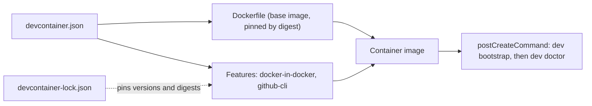

# Dev Containers

## Overview

A Dev Container is a container that you work inside. The editor starts it from a file in the repository, mounts your clone into it, and runs your terminal and your tools there. Because the file is
in the repository, every contributor gets the same operating system, the same tools, and the same versions, and a new machine needs Docker and an editor and nothing else.

Five parts of the specification matter here:

| Part | What it does | Where it lives here |
| --- | --- | --- |
| `devcontainer.json` | The configuration: how to build the container, which features to add, which commands to run, and which ports to forward | [.devcontainer/devcontainer.json](../../../.devcontainer/devcontainer.json) |
| Base image | The operating system and the tools that the container starts with | [.devcontainer/Dockerfile](../../../.devcontainer/Dockerfile), which starts from the Microsoft .NET Dev Container image |
| Features | Reusable installers for a tool, such as the GitHub CLI or Docker | `docker-in-docker` and `github-cli` in `devcontainer.json` |
| Lock file | Pins every feature to an exact version and a digest, so a rebuild gives the same result | [.devcontainer/devcontainer-lock.json](../../../.devcontainer/devcontainer-lock.json) |
| Lifecycle commands | Commands that run at fixed points, such as after the container is created | `postCreateCommand` runs `dev bootstrap` and `dev doctor` |



The Dev Container is the primary environment of this repository ([ADR-0025](../../adr/0025-dev-command-and-dev-container.md)). Native setup on Windows, Linux, and macOS is the second path, and
[the native setup guide](../../tutorials/native-setup.md) describes it.

## Decision rationale

[ADR-0025](../../adr/0025-dev-command-and-dev-container.md) compares a Dev Container with a task runner, Bash scripts, a container that shares the host's Docker socket, and Codespaces as the only
environment. The Dev Container won because it gives one environment on every host, it runs the same way in Codespaces, and CI can build it to prove that a fresh contributor can start.

| Criterion | What was found |
| --- | --- |
| License | The specification text is CC-BY-4.0, the Dev Containers CLI and the `devcontainers/ci` action are MIT, and the features and images are MIT (checked 2026-10-10) |
| Maintenance | The specification and the tools are maintained under the `devcontainers` organization on GitHub. CLI 0.89.0 was current when this was written (checked 2026-10-10) |
| Cost | A Dev Container costs the memory of Docker, and a Codespace costs quota. The Free plan includes about 30 hours a month on a 4-core machine (checked 2026-10-04, [ADR-0019](../../adr/0019-resource-profiles-and-host-support.md)) |
| Trade-off | The container runs privileged, because `docker-in-docker` needs it, and the inner Docker pulls its images again on the first run. The threat model lists the boundary |

## Setup tutorial

**Prerequisites:** Docker, running, and either VS Code with the Dev Containers extension or a GitHub account for Codespaces.

1. Clone the repository and open the folder in VS Code.
2. Choose **Reopen in Container** when VS Code offers it, or run **Dev Containers: Reopen in Container** from the command palette. The first build takes a few minutes.
3. Watch the creation log. The post-create command runs `dev bootstrap`, which installs the pinned script tools and creates `.env`, and then `dev doctor`.

   Expected output: a line for each check that starts with `[ok]`, and `doctor: 11 ok, 1 warning(s), 0 failure(s)`. The warning says that the Git identity is not set to a noreply address, which
   you fix once with the command that it prints ([ADR-0006](../../adr/0006-commit-identity-and-privacy.md)).

4. Run the quick start in a terminal inside the container.

   ```bash illustrative
   ./dev lab 1 setup
   ./dev lab 1 run
   ./dev lab 1 cleanup
   ```

5. To use a GitHub Codespace instead, create one from the repository page, on a machine with at least 4 cores and 16 GB. The configuration asks for that size. Nobody has exercised Codespaces for this
   repository yet, so the page for it waits for the first run.

To build the container without an editor, use the Dev Containers CLI. This is what the `devcontainers/ci` action does on a runner.

```bash illustrative
devcontainer up --workspace-folder . --frozen-lockfile
devcontainer exec --workspace-folder . sh ./dev doctor
```

**Cleanup:** stop the container from VS Code, then delete the container and its volumes in Docker. The inner Docker keeps its images in a volume that survives a rebuild, so delete that volume to
reclaim the space.

## How this project uses it

- **Pinned base.** The Dockerfile starts from `mcr.microsoft.com/devcontainers/dotnet:10.0` at a digest. That image carried SDK 10.0.401 on Ubuntu 24.04 (checked 2026-10-10), which is what `global.json` pins.
- **Locked features.** `docker-in-docker` at major version 4 (locked at 4.1.3) gives the container its own Docker daemon, with `moby` off so Docker CE is used. `github-cli` at major version 1 (locked at 1.1.3)
  adds the GitHub CLI. The documentation auditor fails when a feature is missing from the lock file, when the lock file keeps a feature that is gone, and when a locked feature has no digest.
- **Lifecycle.** `postCreateCommand` is `sh ./dev bootstrap && sh ./dev doctor`. It calls `sh` explicitly, so a clone on a file system without an executable bit still works.
- **Host requirements.** 4 CPUs and 16 GB, which is the smallest machine that plan section 12 names for the `api` profile.
- **Proof in CI.** The `devcontainer` workflow builds the container and runs the onboarding on every change to what the container runs, every Monday, and by hand. The commands are these:

  [!code-bash[Run the onboarding in a Dev Container](../../../.github/workflows/devcontainer.yml#onboarding)]

- **Updates.** Dependabot proposes updates to the base image (the `docker` ecosystem for `/.devcontainer`) and to the features and their lock file (the `devcontainers` ecosystem).

To change a feature or add one, edit `devcontainer.json`, then regenerate the lock file with the Dev Containers CLI and commit both files. A throwaway Node container runs the CLI, so no Node install is needed:

```bash illustrative
docker run --rm -v "$PWD:/w" -w /w node:24-bookworm-slim sh -c 'npm install --global @devcontainers/cli@0.89.0 && devcontainer upgrade --workspace-folder /w'
```

## Validation and troubleshooting

`dev doctor` inside the container shows whether the tools, Docker, the ports, and `.env` are in order.

| Symptom | Cause | Fix |
| --- | --- | --- |
| The build fails on a feature | The lock file does not match `devcontainer.json`, or the registry is unreachable | Regenerate the lock file with the command above, and commit it |
| `./dev: Permission denied` | The clone has no executable bit, as on a Windows file system | Run `sh ./dev ...`, which the post-create command already does |
| `dev doctor` says Docker memory is too low | The Docker Desktop VM has less than 4 GB | Raise the memory in Docker Desktop settings |
| The first `dev compose up` takes minutes | The inner Docker has its own image store and pulls about 3 GB | Wait once. The volume survives a rebuild |

## Further research

- [The Dev Container specification](https://containers.dev/implementors/json_reference/) (checked 2026-10-10)
- [Features and the lock file](https://containers.dev/implementors/features/) (checked 2026-10-10)
- [The Dev Containers CLI](https://github.com/devcontainers/cli) (checked 2026-10-10)
- [devcontainers/ci GitHub Action](https://github.com/devcontainers/ci/blob/main/docs/github-action.md) (checked 2026-10-10)
- [Developing inside a container in VS Code](https://code.visualstudio.com/docs/devcontainers/containers) (checked 2026-10-10)
- [GitHub Codespaces overview](https://docs.github.com/en/codespaces/overview) (checked 2026-10-10)
