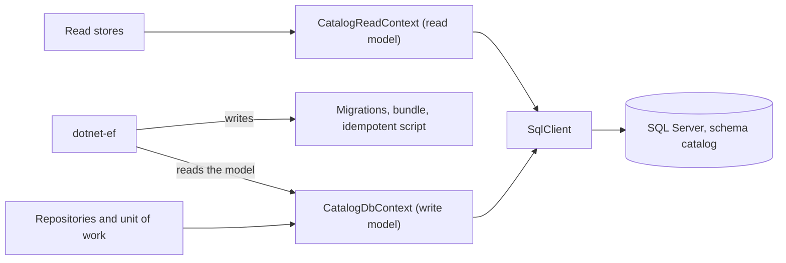

# Entity Framework Core

## Overview

Entity Framework Core (EF Core) maps .NET objects to rows of a relational database. A `DbContext` is one unit of change: it loads objects, remembers what you changed, and writes the changes in one transaction when you
call `SaveChanges`. This repository uses it for the write side of the catalog, on SQL Server 2022, through the SQL Server provider and the `Microsoft.Data.SqlClient` driver.

Five concepts cover what you need to read the rest of this page:

| Concept | What it is | Where it appears here |
| --- | --- | --- |
| Model | The description of which types map to which tables and columns | `CatalogDbContext` and the classes in `Persistence/Mapping` |
| Change tracker | The part of a context that compares the loaded values with the current ones | The unit of work saves what the tracker found |
| Value converter | A pair of functions between a .NET value and a column value | The value objects of the Domain are rebuilt through their `Create` |
| Concurrency token | A column that EF Core adds to the `WHERE` clause of an update, so a stale write changes no row | The `rowversion` column, which becomes the `ETag` |
| Migration | A generated C# file that changes the schema one step, with a snapshot of the model | `Persistence/Migrations`, applied by the migration bundle |



## Decision rationale

The project brief and plan section 8.4 choose EF Core, and [ADR-0033](../../adr/0033-ef-core-mapping-read-model-and-migrations.md) records how it is used. The alternatives that were weighed:

| Option | Verdict |
| --- | --- |
| EF Core with configuration classes (chosen) | Maps the Domain without attributes, generates the migrations from the model, and gives the `rowversion` concurrency check and the change tracking for free |
| Dapper or hand-written SQL | Rejected for the write side. The schema and the code would have no common source, and every change to a column would be a change in two places |
| A separate persistence model with a mapper | Rejected. Every aggregate would need a public way to build itself from stored values, which any code could call and which skips the rules of the model |

| Criterion | What was found |
| --- | --- |
| License | MIT, for the provider, the design package, and the `dotnet-ef` tool (checked 2026-11-02 on [NuGet](https://www.nuget.org/packages/Microsoft.EntityFrameworkCore.SqlServer/10.0.14)) |
| Maintenance | EF Core 10 is a long-term-support release that ships with .NET 10, and a patch arrives with each runtime patch |
| Cost | A change tracker and a model have a cost at startup and on each query, which is small for a catalog and measured when the performance smoke tests arrive in Phase 4 |

Three trade-offs follow from the choice:

- **The model shapes the constructors.** EF Core loads an aggregate through a constructor whose parameters have the names of properties. The private constructors of `Category` and `Product` have that shape, and the price is the one value that EF Core 10.0.14 cannot bind through a constructor (ADR-0033).
- **Two mappings of the tables.** The query side maps the tables again as plain rows, so the keyset queries compare real columns. A test compares the two mappings.
- **No retrying execution strategy yet.** A retry and a user transaction do not mix without wrapping the whole unit, so the first retry policy waits for measured failures (ADR-0033).

## Setup tutorial

**Prerequisites:** the prerequisites in the front matter. The commands run from the repository root.

1. Restore the pinned tools, which include `dotnet-ef` 10.0.14.

   ```bash illustrative
   dotnet tool restore
   ```

   Expected output ends with:

   ```text
   Tool 'dotnet-ef' (version '10.0.14') was restored. Available commands: dotnet-ef
   ```

2. List the migrations that the model has.

   ```bash illustrative
   dotnet tool run dotnet-ef migrations list --project src/Catalog.Infrastructure --startup-project src/Catalog.Infrastructure --context CatalogDbContext --no-connect
   ```

   Expected output:

   ```text
   20261102045650_InitialCreate
   Pending status not shown. Unable to determine which migrations have been applied. This can happen when your project uses a version of Entity Framework Core lower than 5.0.0 or when an error occurs while accessing the database.
   ```

   The second line appears because `--no-connect` skips the database, so the tool cannot say which migrations are applied.

3. Generate the idempotent script, which creates the whole schema and can run again.

   ```bash illustrative
   dotnet tool run dotnet-ef migrations script --idempotent --project src/Catalog.Infrastructure --startup-project src/Catalog.Infrastructure --context CatalogDbContext --output artifacts/catalog.sql
   ```

4. Generate the migration bundle, a self-contained program that applies the migrations to the database that you name.

   ```bash illustrative
   dotnet tool run dotnet-ef migrations bundle --project src/Catalog.Infrastructure --startup-project src/Catalog.Infrastructure --context CatalogDbContext --self-contained --output artifacts/efbundle
   ```

   The bundle is published for a runtime identifier, so its restore rewrites the lock files of the projects that it builds, and a locked restore (`CI=true`) refuses it with NU1004. Run this step in a scratch copy of the repository, or restore the lock files afterward with `git checkout -- '*packages.lock.json'`. The CI job that builds the bundle (planned, Phase 2 and Phase 3) works in a scratch copy with the locked mode off.

**Cleanup:** delete the `artifacts` folder. Neither file is checked in, and both are generated again from the model.

## How this project uses it

- **The write model.** `src/Catalog.Infrastructure/Persistence/CatalogDbContext.cs` maps the two aggregates and the three tables of the outbox, its receipts, and the idempotency records, all in the schema `catalog`. The mapping of each type is a class in `Persistence/Mapping`. Nothing in the Domain names EF Core.
- **The read model.** `CatalogReadContext` maps the same tables as plain rows without tracking. The read stores build the keyset queries on it.
- **The unit of work.** `EfUnitOfWork` opens one transaction on the context of the scope, saves, runs the hooks, and commits. It turns a stale write into `PreconditionFailed` and a taken SKU into `Conflict`.
- **The design-time factory.** `CatalogDbContextFactory` gives the tool a context without a database, so the commands above need no connection and no credential.
- **The generated files.** The files in `Persistence/Migrations` belong to the tool. They are marked `generated_code`, they are excluded from the coverage thresholds, and CODEOWNERS asks for the review of the owner on each change.
- **Who applies the schema.** Only the migrator identity does, by running the bundle. No production assembly calls `Migrate`, and `tests/Catalog.Architecture.Tests/MigrationPolicyTests.cs` holds the rule.

The full list of tables, columns, and indexes is on [the persistence page](../persistence.md).

## Validation and troubleshooting

The persistence tests run against a real SQL Server (see [Testcontainers for .NET](testcontainers-dotnet.md)). `SchemaTests` proves the tables, the indexes, and the precision, and it fails when the snapshot no longer describes the model. `MigrationTests` applies the idempotent script twice and compares its schema with the one that the migrations build.

| Symptom | Cause | Fix |
| --- | --- | --- |
| `SchemaTests` fails with "the snapshot of the migrations must describe the model" | A mapping changed without a new migration | Run `dotnet tool run dotnet-ef migrations add <Name> --project src/Catalog.Infrastructure --startup-project src/Catalog.Infrastructure --context CatalogDbContext --output-dir Persistence/Migrations`, and commit the migration apart from the code |
| `dotnet-ef` reports "Build failed" | A compile error or an analyzer error in a project that the tool builds | Run `dotnet build` and fix the error. The tool prints the real message only in the build output |
| The restore fails with NU1902 or NU1903 | A package has a published advisory | Pin the patched version of the package in `Directory.Packages.props`, as ADR-0033 did for `System.Security.Cryptography.Pkcs` |
| `No suitable constructor was found for the type 'Product'` | A constructor parameter has no property of the same name, or it names a complex property | Rename the parameter or remove it from the constructor, as ADR-0033 describes |

## Security and operations

- **Credentials.** The connection string of the design-time factory holds no credential, and the tool never opens a connection to generate the files. The bundle takes the connection string of the database to migrate as an argument, so the migrator identity supplies its own credential when it runs.
- **Permissions.** The application identity has data rights only, and the migrator identity has the rights to create and alter objects. `MigrationTests` proves that the first cannot create the schema or alter a table.
- **Updates.** The provider, the design package, and the tool share one version, which Dependabot proposes together. A new patch needs the tests to pass against the real database before it merges.
- **Blast radius.** A wrong migration changes the schema for every replica. Application rollback never rolls the schema back, so the policy is expand and contract (plan section 8.10), and the owner reviews each migration.

## Lab

None yet. WP1.13 writes the labs of Phase 1, including the one that creates a product and watches the outbox deliver.

## Further research

- [EF Core documentation](https://learn.microsoft.com/en-us/ef/core/): the reference for the model, the change tracker, and migrations (checked 2026-11-02)
- [Applying migrations](https://learn.microsoft.com/en-us/ef/core/managing-schemas/migrations/applying): the idempotent script and the bundle, with their trade-offs (checked 2026-11-02)
- [EF Core releases](https://github.com/dotnet/efcore/releases/tag/v10.0.14): the notes of the version that this repository runs (checked 2026-11-02)
