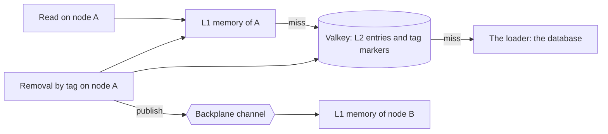

# FusionCache

## Overview

FusionCache is a .NET cache that keeps an entry on two levels and keeps the nodes in step. Level 1 (L1) is the memory of the process. Level 2 (L2) is a shared store, here Valkey through `IDistributedCache`. A backplane is a channel on which a node
says "this key changed", so the other nodes drop their copy before it expires. The catalog uses it behind the `ICatalogCache` port, so the Application layer never names it ([plan section 8.5](../../plans/implementation-plan.md), [ADR-0016](../../adr/0016-cache-implementation-fusioncache.md)).

Six concepts cover what you need to read the rest of this page:

| Concept | What it is | Where it appears here |
| --- | --- | --- |
| Single flight | Concurrent reads of one missing key on one node share one run of the loader | `Concurrent_reads_of_one_key_on_one_node_share_one_load` |
| Tag | A label on an entry. Removing the tag removes every entry that has it | `product:{id}`, `products:list`, `category:{id}` |
| Tag marker | A removal by tag writes a marker with the time of the removal. An entry that is older than the marker is dropped when it is read, and the entry itself stays in Valkey until its time to live ends | `v2:catalog:{env}:__fc:t:{tag}` |
| Circuit breaker | After a failure, FusionCache skips the shared cache or the backplane for a set time, so a call does not wait for a timeout each time. The default time is zero, which turns it off | `SharedCircuitBreakerDuration` and `BackplaneCircuitBreakerDuration`, 5 seconds |
| Wire-format marker | The `v2:` that FusionCache writes before every key in the shared cache, so a later release that changes the format cannot read an old entry | `v2:catalog:dev:v1:product:{id}` |
| Contract version | The `v1` in the key, which this repository raises when the shape of a cached type changes | `CacheContract.Version` |



## Decision rationale

[ADR-0016](../../adr/0016-cache-implementation-fusioncache.md) compares five options and chooses FusionCache, because Microsoft's HybridCache has no cross-node invalidation of the memory level in .NET 10 (checked 2026-10-04 in the ADR). [ADR-0038](../../adr/0038-catalog-cache-adapter-and-valkey-connection.md) records how the adapter and the connection are built.

| Criterion | What was found |
| --- | --- |
| License | MIT, for the core, the System.Text.Json serializer, and the Redis backplane (checked 2026-11-03 in the nuspec files on [NuGet](https://www.nuget.org/packages/ZiggyCreatures.FusionCache/2.9.0)) |
| Maintenance | 2.9.0 is the newest release (checked 2026-11-03). The port contains the dependency, because only one adapter names the library |
| Cost | A memory entry costs one cache entry, and the shared cache costs a serialization on each fill. Both are small for a catalog, and the hit ratio is a metric |

Four trade-offs follow from the choice:

- **Valkey is not certified.** FusionCache supports Redis. Spike 1.b and the tests of WP1.9 show that it works with Valkey 8.1, which is a functional result and not a promise of the library.
- **The time comes from the wall clock.** FusionCache computes the expiration of an entry and the time of a removal from the system clock, so a test cannot move it. The tests read the expiration that the adapter set and never wait for it.
- **A removal is lazy.** It writes a marker and the entries stay in Valkey until they expire. A reader finds the marker and loads again.
- **A skipped call is not an error.** With a circuit breaker open, a call to the shared cache returns without an exception. The adapter reads the breaker events to know when a removal did not reach the other nodes.

## Setup tutorial

**Prerequisites:** the prerequisites in the front matter. The commands run from the repository root.

1. Run the tests of the adapter. They need no Docker, because the shared cache is the in-process one or a broken one.

   ```bash illustrative
   dotnet test --project tests/Catalog.Application.Tests --configuration Release --filter-class "*CatalogCacheTests"
   ```

   Expected output ends with:

   ```text
   Test run summary: Passed!
   ```

2. Run the tests against a real Valkey. The fixture starts the image that `compose.yaml` pins, and the tests of the access control list read the rules of the application user from the same file.

   ```bash illustrative
   dotnet test --project tests/Catalog.Infrastructure.Tests --configuration Release --filter-class "*CacheOverValkeyTests" --filter-class "*ValkeyAclTests"
   ```

3. Read the settings. Both classes print nothing but their name, and the validator names a setting and never repeats a value.

   ```json
   {
     "Catalog": {
       "Cache": { "Environment": "dev", "MemoryDuration": "00:00:30", "ListDuration": "00:00:10" },
       "Valkey": { "Endpoint": "localhost:6379", "UserName": "catalog-dev" }
     }
   }
   ```

   The password of the Valkey user comes from an environment variable or a secret and is never in a file of the repository.

**Cleanup:** the test containers are removed when the run ends. Nothing else was created.

## How this project uses it

- **The adapter.** `src/Catalog.CrossCutting/Caching/FusionCatalogCache.cs` implements `ICatalogCache`. `CatalogCacheFactory` builds it from `CatalogCacheOptions`, a shared cache, and a backplane, and writes the settings of the plan in one place.
- **The connection.** `src/Catalog.Infrastructure/Caching/ValkeyConnection.cs` builds the `IDistributedCache` and the backplane. It is the only place that names StackExchange.Redis, and three architecture rules keep FusionCache in CrossCutting and the Valkey client in Infrastructure.
- **The contract.** `CacheJsonContext` lists the cached types for the source-generated JSON, and `CacheContract.Version` is part of every key. `CacheContractTests` holds the shape of each type.
- **The metrics.** `CacheMetrics` reports on the meter `Catalog.Cache`. [The cache reference](../caching.md) lists the instruments.
- **The invalidation.** `CacheInvalidationSubscriber` and `CacheInvalidationPolicy` in `Catalog.Application` remove the tags that an event made stale, once in process after the commit and again through the outbox with a receipt ([ADR-0039](../../adr/0039-cache-invalidation-by-immediate-dispatch-and-the-outbox.md)). [The consistency model](../../explanation/cache-consistency-model.md) states what that guarantees.
- **Who composes it.** The Api registers the cache in WP1.10. Until then `Catalog.Infrastructure.Tests` builds the nodes of a test with `CacheNode` and a whole replica with `CacheHost`.

Data flow: a query that implements `ICachedQuery` reaches `QueryCacheDecorator`, which calls `GetOrLoadAsync` with the key and the tags of the query. A removal by tag comes from the subscriber, which the dispatcher calls right after a commit and the outbox processor calls again with a receipt.

## Validation and troubleshooting

The unit tests prove the reads, the refusals, the faults, the expiration that is set, the metrics, and the shape of the entries. The Valkey tests prove the keys, the times to live, the marker of a removal, the access control list, two nodes and the backplane between them, and a server that stops and returns. The tests of two replicas over SQL Server and Valkey prove the whole invalidation path.

| Symptom | Cause | Fix |
| --- | --- | --- |
| `JsonTypeInfo metadata for type 'FusionCacheDistributedEntry...' was not provided` in a log | A cached type, or the wrapper that FusionCache adds to it, is not listed in `CacheJsonContext` | Add a `[JsonSerializable]` line for the type and for its wrapper, and add a sample to `CacheContractTests` |
| Every call waits for a timeout while Valkey is down | A circuit breaker duration is zero | Set `SharedCircuitBreakerDuration` and `BackplaneCircuitBreakerDuration`. The validator refuses zero |
| `NOPERM` in the log of the API | The access control list of the user does not allow a command, key, or channel | Read `ACL LOG` as `admin`, add the narrowest rule, and add a test to `ValkeyAclTests`. [The Valkey page](valkey.md) lists the rules |
| A value changed in the database and the API still serves the old one | The removal did not reach the other node, or the entry has not expired | Read `catalog.cache.invalidations` for `incomplete`, `catalog.outbox.immediate` for `failed`, and `catalog.cache.backplane.down`. The outbox repeats a removal that failed, and the old value ends when the memory time to live of 30 seconds ends |
| The password appears in a log line | Code printed a `ConfigurationOptions`, whose `ToString()` includes the password | Never print the options. Use `ToString(includePassword: false)` if you must |
| `CacheContractTests` fails after a change to a view | The shape of a cached type changed | Raise `CacheContract.Version` and update the snapshot |

## Security and operations

- **Credentials.** The Valkey user and password come from configuration. They are static in this work package, and the broker that rotates them arrives with the platform (Phase 3). The settings print nothing but their name, no problem repeats a value, and tests show that no log line, exception, key, or value holds the password.
- **Data.** A key holds a name of the code and an identifier or a hash, and a value is a view of a product. No tag of a metric holds a key. The data is public catalog data and is not personal.
- **Permissions.** The application user reaches `~v2:catalog:{env}:*` and `&catalog:{env}.Backplane:v2` with 14 commands, and `ValkeyAclTests` proves what it cannot do.
- **Updates.** Dependabot proposes updates to the four packages. A new FusionCache version needs the tests of the adapter and of Valkey to pass. A `StackExchange.Redis` 3.x release waits until the backplane package supports it.
- **Blast radius.** A bug in the adapter can serve a stale entry for at most the memory time to live, and a failure of Valkey degrades the node to its memory and the database. The database stays the source of truth.

## Lab

None yet. WP1.13 writes the lab that proves the two levels and the cross-node invalidation ([labs index](../../labs/index.md)).

## Further research

- [FusionCache documentation](https://github.com/ZiggyCreatures/FusionCache/tree/main/docs): the options, the cache levels, the backplane, and the tagging, in the repository of the project (checked 2026-11-03)
- [FusionCache on NuGet](https://www.nuget.org/packages/ZiggyCreatures.FusionCache/2.9.0): the package, its license, and its dependencies (checked 2026-11-03)
- [Distributed caching in ASP.NET Core](https://learn.microsoft.com/aspnet/core/performance/caching/distributed): the `IDistributedCache` abstraction that the shared cache implements (checked 2026-11-03)
- [Spike 1.b](../../research/spikes/1.b-fusioncache-valkey.md): the measurement of FusionCache against Valkey 8.1 and 9.1 (checked 2026-10-06)
