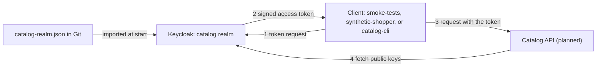

# Keycloak

## Overview

Keycloak is an identity provider: a server that signs users and services in and issues signed tokens. It implements OpenID Connect (OIDC), a
sign-in layer on top of OAuth 2.0. The catalog API never handles a password. A caller gets an access token from Keycloak, sends it to the API,
and the API checks the signature and the claims. This repository uses Keycloak for two jobs: it is the token issuer that the API's authorization
depends on, and it is a worked example of realm-as-code, where one JSON file in Git defines the whole configuration.

Five concepts cover most of what you need:

| Concept | What it is | Where it appears here |
| --- | --- | --- |
| Realm | An isolated space that manages its own users, credentials, roles, and clients, and authenticates only its own users | The `catalog` realm. A `platform` realm for operators arrives in WP3.5 |
| Client | An application that asks Keycloak for tokens. A public client cannot keep a secret, a confidential client can, and a bearer-only client only validates tokens | `catalog-api`, `catalog-cli`, `synthetic-shopper`, and `smoke-tests` |
| Client scope | A named bundle of protocol mappers, which write claims into a token, and role scope mappings. A client asks for a scope with the OAuth `scope` parameter | `catalog.read`, `catalog.write`, `catalog.admin`, and `basic` |
| Realm role | A permission label that Keycloak gives to a user or service account. A composite role includes other roles | `catalog-reader`, `catalog-editor`, and `catalog-admin` |
| Role scope mapping | A rule that limits which roles a token may carry, based on the scopes that were requested | One mapping from each catalog scope to its role |



**A scope is a request, not a permission.** The `scope` claim in a token records what a client asked for and Keycloak 26.8.0 granted. It does not
prove that the user holds the matching role. On the running stack, a user with only the `catalog-reader` role asked for all three catalog scopes
and received all three in the `scope` claim, while the `realm_access.roles` claim held only `catalog-reader` (verified 2026-10-10,
[ADR-0026](../../adr/0026-api-only-compose-stack-and-catalog-realm.md)). The API must therefore check the role claim as well as the scope. That
check is planned for WP1.7 and WP1.10. The plan is unchanged, and the maintainer decides whether plan section 8.7 needs a correction.

## Decision rationale

The decision register in [the implementation plan](../../plans/implementation-plan.md) records "API identity: Keycloak, realm-as-code" as a kept
user choice, and no ADR compares identity providers, so this page makes no such comparison. [ADR-0026](../../adr/0026-api-only-compose-stack-and-catalog-realm.md)
decides how Keycloak runs in Compose, and it considered four options:

1. Compose with four services and Keycloak importing one realm file (chosen).
2. The same stack, with Keycloak's data on the shared SQL Server, as the cluster will have it. It needs a database and a login before Keycloak
   starts and more memory, and Phase 1 has no requirement for it.
3. An in-process fake issuer. It needs no container, but nothing would prove the realm file. Plan section 8.7 keeps an in-process issuer for API
   integration tests only.
4. Aspire as the local orchestrator, which [ADR-0019](../../adr/0019-resource-profiles-and-host-support.md) holds.

Realm-as-code comes from plan finding F9: the Keycloak Operator's realm import runs once and never updates a realm, so the plan keeps one set of
realm files that Compose and the tests import now and `keycloak-config-cli` reconciles in the cluster in Phase 3.

| Criterion | What was found |
| --- | --- |
| License | Apache-2.0 (checked 2026-10-10 on the [repository](https://github.com/keycloak/keycloak)). Keycloak runs as a service and is not linked into the code, and its license is permissive under [ADR-0004](../../adr/0004-licensing-and-dependency-license-policy.md) anyway |
| Maintenance | 26.8.0 is the latest release, published 2026-10-01 (checked 2026-10-10 on the [release page](https://github.com/keycloak/keycloak/releases/tag/26.8.0)), and the repository received a push on 2026-10-10 |
| Cost | No license fee. The container used about 0.96 GiB at idle, from one sample on 2026-10-10 ([ADR-0026](../../adr/0026-api-only-compose-stack-and-catalog-realm.md)) |
| Trade-off | Keycloak is the second-largest container of the idle stack, after SQL Server (one sample each, [ADR-0026](../../adr/0026-api-only-compose-stack-and-catalog-realm.md)). Its development mode loses all data on restart, which the stack turns into a feature. A realm import is skipped when the realm already exists, so a persistent database needs a reconciler. Keycloak 26.8.0 also does not gate a requested scope by role, so the API carries a second check |

## Setup tutorial

**Prerequisites:** Docker with at least 4 GB of memory, the .NET SDK that `global.json` pins, and `curl`. The `./dev` command comes from
[the dev command](dev-command.md). On Windows, use `./dev.cmd` where this page says `./dev`.

1. Create `.env` and install the pinned script tools. `./dev bootstrap` writes a random value for every empty variable in
   [.env.example](../../../.env.example), including the Keycloak administrator password, the two client secrets, and the three demo passwords.

   ```bash illustrative
   ./dev bootstrap
   ```

2. Start the stack. The first run pulls about 3 GB of images for all four services. Keycloak imports the realm while it starts, and Compose waits
   until the health check passes.

   ```bash illustrative
   ./dev compose up
   ```

   Expected output ends with the endpoint list, which includes this line:

   ```text
   [ok  ] The stack is healthy. Everything listens on 127.0.0.1 only:
          Keycloak    http://localhost:8180/realms/catalog  (admin console: /admin)
   ```

3. Prove that the stack answers as the plan describes.

   ```bash illustrative
   ./dev compose check
   ```

   The line for Keycloak reads as follows, and the last line of the output must report `0 failure(s)`.

   ```text
   [ok  ] Keycloak realm: Issuer http://localhost:8180/realms/catalog, aud=catalog-api, client scopes follow each client, and the demo users get only their roles.
   ```

4. Read the discovery document, which every OIDC client reads first. It names the issuer and the endpoints.

   ```bash illustrative
   curl -s http://localhost:8180/realms/catalog/.well-known/openid-configuration | grep -o '"issuer":"[^"]*"'
   ```

   Expected output:

   ```text
   "issuer":"http://localhost:8180/realms/catalog"
   ```

5. Open the administration console at `http://localhost:8180/admin`. Sign in with the user name in `KEYCLOAK_ADMIN_USER` (`admin` by default) and the
   password in `KEYCLOAK_ADMIN_PASSWORD`, both in `.env`. This account belongs to the `master`
   realm and is not the demo user `admin` of the `catalog` realm. Choose the `catalog` realm, and look at **Clients**, **Client scopes**,
   **Realm roles**, and **Users**. The console shows what [the realm file](../../../identity/keycloak/realms/catalog-realm.json) describes.

6. Read a token and the roles of each demo user. The lab script does both, and `./dev lab 1 run` runs the check first and then these two regions
   of [lab-01.ps1](../../labs/scripts/lab-01.ps1). The first asks for a token as the `smoke-tests` client with the client credentials grant and prints three claims:

   [!code-powershell[Read a token as the smoke-tests client](../../labs/scripts/lab-01.ps1#token)]

   The second asks Keycloak for the access token it would issue to each demo user for the broadest scope request, and prints the roles in it:

   [!code-powershell[List the roles of each demo user](../../labs/scripts/lab-01.ps1#roles)]

   Expected output ends with these lines, after the check results and the `[info]` lines that name each step:

   ```text
     observe: iss = http://localhost:8180/realms/catalog
     observe: aud = catalog-api
     observe: scope = catalog.read catalog.write catalog.admin
     observe: reader gets the roles: catalog-reader
     observe: editor gets the roles: catalog-editor, catalog-reader
     observe: admin gets the roles: catalog-admin, catalog-editor, catalog-reader
   ```

**Cleanup:** `./dev compose down` stops and removes the containers, and `./dev compose reset` also deletes the data volumes of the stack. Keycloak keeps
nothing on disk, so the next start imports the realm again. `.env` stays, and Git ignores it. Delete the file by hand to throw the secrets away.

## How this project uses it

Five files make up the Keycloak part of the stack:

| File | What it holds |
| --- | --- |
| [compose.yaml](../../../compose.yaml) | The `keycloak` service: the image at its tag and digest, the flags, the environment, the health check, and the loopback port |
| [.env.example](../../../.env.example) | The variable names and the safe defaults. `./dev bootstrap` generates `.env` from it |
| [identity/keycloak/realms/catalog-realm.json](../../../identity/keycloak/realms/catalog-realm.json) | The only description of the `catalog` realm |
| [scripts/modules/Dev.Compose.psm1](../../../scripts/modules/Dev.Compose.psm1) | `./dev compose check`, the token request, and the evaluation of each demo user's roles |
| [scripts/tests/Realm.Tests.ps1](../../../scripts/tests/Realm.Tests.ps1) | Pester tests that fail when the realm file drifts from the plan: placeholders only for secrets, no implicit flow, no password grant, full scope off |

### How the service starts

The service runs the image `quay.io/keycloak/keycloak:26.8.0`, pinned by digest, with these arguments:

| Argument | Effect |
| --- | --- |
| `start-dev` | Development mode. The server accepts HTTP, turns off strict host name checks, and uses a local cache, which suits one container on a laptop (checked 2026-10-10 in the [server guide](https://www.keycloak.org/server/configuration)) |
| `--import-realm` | Imports every `.json` file in the import directory at start |
| `--db=dev-mem` | Keeps all data in memory, so every start begins empty |
| `--http-port=8080` | The port inside the container. Compose publishes it as `127.0.0.1:8180` |
| `--hostname=http://localhost:8180` | Fixes the issuer, whatever address the caller used to connect |
| `--health-enabled=true` | Turns on the health endpoints on the management port 9000. The image has no `curl`, so the Compose health check speaks HTTP over a Bash socket |

The realm file is bind-mounted read-only at `/opt/keycloak/data/import/catalog-realm.json`. The server guide requires a file named
`<realm name>-realm.json` and names `/opt/keycloak/data/import` as the import directory of the container (checked 2026-10-10). The guide also says that an import is skipped when the
realm already exists. The Compose stack never meets that case, because an in-memory database starts empty, so the realm is always what Git says
([REQ-IDN-005](../../requirements/requirements.yaml)). A persistent database changes this, which is why Phase 3 adds `keycloak-config-cli`.

The realm file holds `${NAME}` placeholders for the two client secrets and the three demo passwords. Keycloak fills them from the container's environment, and
[compose.yaml](../../../compose.yaml) passes exactly those five variables from `.env`. The bootstrap administrator comes from `KEYCLOAK_ADMIN_USER` and `KEYCLOAK_ADMIN_PASSWORD`.

### The catalog realm

The catalog scopes carry an audience mapper for `catalog-api`, and each maps to one realm role through a role scope mapping. The roles are
composites, so the editor includes the reader and the admin includes the editor.

| Scope | Realm role it maps to | What the plan lets it do (plan section 8.7) |
| --- | --- | --- |
| `catalog.read` | `catalog-reader` | All GET operations |
| `catalog.write` | `catalog-editor` | Create and update products |
| `catalog.admin` | `catalog-admin` | Discontinue products, and all category writes |

| Client | Type and grants | Scopes | Used by |
| --- | --- | --- | --- |
| `catalog-api` | Bearer-only resource server. It validates tokens and never asks for one | None | The API, which validates tokens for it (WP1.7 and WP1.10) |
| `catalog-cli` | Public. Authorization code flow with PKCE (S256) and the device flow. It holds no secret, and its redirect addresses are limited to `localhost` and `127.0.0.1` | Optional: all three catalog scopes | People, labs, and manual tests |
| `synthetic-shopper` | Confidential. Client credentials. Its service account has the `catalog-reader` role | Default: `catalog.read` only | The workload that generates synthetic traffic |
| `smoke-tests` | Confidential. Client credentials. Its service account has the `catalog-admin` role | Default: all three | Post-deployment checks |

The demo users are `reader`, `editor`, and `admin`, each with exactly one role (`catalog-reader`, `catalog-editor`, and `catalog-admin`) and a
profile on the reserved `example` domain. No client enables the implicit flow or the password grant, and every client turns full scope off.

### What a token carries

The realm signs with RS256, and an access token lasts 300 seconds. The token below is the abridged access token of the `smoke-tests` client, as
decoded on the stack on 2026-10-10, without `sub`, `jti`, `typ`, `iat`, and `exp`:

```json
{
  "iss": "http://localhost:8180/realms/catalog",
  "aud": "catalog-api",
  "azp": "smoke-tests",
  "scope": "catalog.read catalog.write catalog.admin",
  "realm_access": { "roles": ["catalog-editor", "catalog-reader", "catalog-admin"] }
}
```

The audience comes from the audience mapper in each catalog scope, so a token that carries no catalog scope has no `aud` and no roles. The roles
come from the `realm roles` mapper in the `basic` scope, and the role scope mappings limit them to the scopes that were requested.

### Scope versus role

Keycloak limits what a client may ask for, and it limits which roles a token carries. It does not limit which scopes a user receives by the roles the user has. This is the finding that
[ADR-0026](../../adr/0026-api-only-compose-stack-and-catalog-realm.md) records. The table shows what the stack returned on 2026-10-10 when
Keycloak evaluated the `catalog-cli` client for each user:

| User | Asked for | `scope` claim | `realm_access.roles` |
| --- | --- | --- | --- |
| `reader` | All three scopes | All three | `catalog-reader` |
| `editor` | All three scopes | All three | `catalog-editor`, `catalog-reader` |
| `admin` | `catalog.read` only | `catalog.read` | `catalog-reader` |

Two limits do hold. A client that has no optional scopes cannot ask for more than its defaults: the `synthetic-shopper` client received `invalid_scope` when it asked for
`catalog.read catalog.write`. And the role claim is trustworthy, because it holds only roles that the user really has, cut down to the scopes that were requested.
The Keycloak guide describes role scope mappings in the same terms: they limit the roles declared inside an access token (checked 2026-10-10, [guide](https://www.keycloak.org/docs/26.8.0/server_admin/index.html#_role_scope_mappings)).

The API (planned for WP1.7 and WP1.10) therefore has to require both claims for each operation:

| Operation | `scope` must contain | `realm_access.roles` must contain |
| --- | --- | --- |
| Any GET | `catalog.read` | `catalog-reader` |
| Create or update a product | `catalog.write` | `catalog-editor` |
| Discontinue a product, or write a category | `catalog.admin` | `catalog-admin` |

`./dev compose check` proves the role table through the administrator API, which can generate the example access token for a user and a client
with the same scopes, mappers, and role scope mappings as a real login. The realm has no flow that a script could run for a person, because the password grant is off.

### What comes later

- **WP1.10** adds `Catalog.Identity.ContractTests`, which import this realm file into a Keycloak Testcontainer, and the API's policies that require the role and the scope.
- **WP3.5** adds the `platform` realm for human operators and reconciles both realm files in the cluster with `keycloak-config-cli`.
- **Phase 3** moves Keycloak's data to the shared SQL Server and changes the issuer to `https://id.catalog.localtest.me:8443/realms/<realm>`. Compose keeps its one fixed `localhost` issuer.

## Validation and troubleshooting

`./dev compose check` is the proof. For Keycloak it checks that the issuer in the discovery document is exactly `http://localhost:8180/realms/catalog`,
that `smoke-tests` receives `aud=catalog-api` and all three scopes, that `synthetic-shopper` receives `catalog.read` only and is refused anything broader, and
that `reader`, `editor`, and `admin` get exactly the roles that the setup tutorial lists. `./dev compose ps` shows the health of the container, and
`./dev compose logs keycloak` prints the last 200 lines of its log.

| Symptom | Cause | Fix |
| --- | --- | --- |
| `./dev compose up` says that the environment file is missing or incomplete | `.env` does not exist, or a variable that the realm needs is empty | Run `./dev bootstrap` |
| `./dev compose check` reports `keycloak is starting` or `keycloak is unhealthy` | The import or the start is not finished, or Docker has too little memory. The container limit is 1.5 GB | Wait for the health check, which keeps trying for up to about three and a half minutes, then read `./dev compose logs keycloak`. Give Docker at least 4 GB |
| Port 8180 is taken | Another program uses it | Run `./dev doctor`, then change `KEYCLOAK_PORT` in `.env`. The issuer follows the port, so every client and validator must use the new issuer |
| A token request returns `invalid_scope` with "Invalid scopes" | The client does not hold the scope you asked for. `synthetic-shopper` holds only `catalog.read` | Ask for fewer scopes, or use `smoke-tests` |
| An authorization or device request returns `invalid_request` with "Missing parameter: code_challenge_method" | `catalog-cli` requires PKCE with S256 for both flows | Send `code_challenge` and `code_challenge_method=S256` |
| A token request returns `unauthorized_client` with "Client not allowed for direct access grants" | The password grant is off on purpose | Use the authorization code flow with PKCE or the device flow for people, and client credentials for services |
| A browser request returns "Implicit flow is disabled for the client" | The implicit flow is off on purpose | Use `response_type=code` with PKCE |
| A validator rejects the issuer | Keycloak always advertises `http://localhost:8180/realms/catalog`, even when you connect through `127.0.0.1` | Compare against exactly that string |
| The administration console rejects the demo `admin` password | The console signs in to the `master` realm. It uses `KEYCLOAK_ADMIN_PASSWORD`, and the demo user uses `CATALOG_ADMIN_PASSWORD` | Use the administrator password for the console |
| An edit of the realm file has no effect | A running Keycloak does not re-read the file | Run `./dev compose down` and `./dev compose up` |
| `reader` shows `catalog.admin` in the `scope` claim | Not a defect of the stack. Keycloak does not withhold a requested scope by role | Check the role claim, as the table in the section on scope versus role shows |

Two of the errors are quick to reproduce with `curl`. The first asks `catalog-cli` for a device code without PKCE, and the second tries the password grant:

```bash illustrative
curl -s -X POST -d client_id=catalog-cli -d scope=catalog.read http://localhost:8180/realms/catalog/protocol/openid-connect/auth/device
curl -s -X POST -d grant_type=password -d client_id=catalog-cli -d username=nobody -d password=wrong http://localhost:8180/realms/catalog/protocol/openid-connect/token
```

Expected output, one line for each command:

```text
{"error":"invalid_request","error_description":"Missing parameter: code_challenge_method"}
{"error":"unauthorized_client","error_description":"Client not allowed for direct access grants"}
```

## Security and operations

- **Credentials.** Every secret comes from `.env`, which `./dev bootstrap` generates with random values and Git ignores. No credential is in the realm
  file or in [compose.yaml](../../../compose.yaml). Static credentials are for Compose only, and Phase 3 replaces them with Vault-delivered ones (plan
  section 8.8). Never copy a `.env` file between machines.
- **The bootstrap administrator is temporary.** Keycloak treats the account that `KC_BOOTSTRAP_ADMIN_USERNAME` creates as temporary, and the guide asks you to
  remove it once a permanent administrator exists (checked 2026-10-10, [guide](https://www.keycloak.org/server/bootstrap-admin-recovery)). In the cluster the plan deletes
  it after bootstrap. In Compose it lives as long as the stack, which is acceptable for a disposable local stack.
- **Network.** The service is published on `127.0.0.1` only, on a port above 1023, and a test fails on any other mapping ([ADR-0026](../../adr/0026-api-only-compose-stack-and-catalog-realm.md)).
  The realm sets `sslRequired` to `external`, which allows plain HTTP only from local and private addresses (checked 2026-10-10 in the [guide](https://www.keycloak.org/docs/26.8.0/server_admin/index.html)).
  Do not publish this stack to a shared network.
- **Hardening.** The container has `no-new-privileges`, a 1.5 GB memory limit, no privileged mode, and no Docker socket.
- **Authorization.** Never authorize on the `scope` claim alone. Keycloak grants any scope that the client holds, whatever roles the user has, so the API must also require the matching role in
  `realm_access.roles` (WP1.7 and WP1.10). Keycloak's guide deprecates the Full Scope Allowed switch and recommends turning it off on every client
  (checked 2026-10-10 in the [guide](https://www.keycloak.org/docs/26.8.0/server_admin/index.html#_role_scope_mappings)), and every client in this realm already has it off.
  Revisit the API check if a Keycloak release starts to gate a requested scope by role ([ADR-0026](../../adr/0026-api-only-compose-stack-and-catalog-realm.md), "Revisit when").
- **Tokens.** Access tokens last 300 seconds, are signed with RS256, and carry the audience `catalog-api`. Brute-force detection is on with a failure
  factor of 5, self-registration is off, and the demo users are synthetic.
- **Realm file review.** Keycloak lets a placeholder name any environment variable of the container (checked 2026-10-10 in the
  [server guide](https://www.keycloak.org/server/importExport)). Review a change to the realm file as code that can read the environment of
  Keycloak, and keep the five variables that [compose.yaml](../../../compose.yaml) passes as the only ones.
- **Updates.** Dependabot proposes a new tag and digest for the image. A new Keycloak version also changes the inventory entry, the `verified-against` value of this page, and
  the expected values in [Dev.Compose.psm1](../../../scripts/modules/Dev.Compose.psm1), and the realm tests and `./dev compose check` must pass against it.
- **Blast radius.** The stack is disposable and holds only synthetic users and random local secrets, so losing it exposes no real data. If Keycloak is down, nobody can get
  a new token. A token that the API (planned) validates offline against the published keys stays valid until it expires, which is at most 300 seconds.
- **Threat model.** [The threat model](../../security/threat-model.md) lists unauthenticated and wrongly scoped API calls, and WP1.7 and WP1.10 deliver the controls.

## Lab

[Lab 1: Quick start: the API-only stack](../../labs/quick-start-api-stack.md) starts the stack, runs `./dev compose check`, reads a token as the
`smoke-tests` client, lists the roles of each demo user, and cleans up. For Keycloak it shows the fixed issuer and the audience in a real token, and that
each demo user gets different roles for the same scope request. The calls to the API itself arrive in WP1.10.

## Further research

- [Server Administration Guide: managing OpenID Connect clients](https://www.keycloak.org/docs/26.8.0/server_admin/index.html#_oidc_clients): client types, flows, and settings, for version 26.8.0 (checked 2026-10-10)
- [Server Administration Guide: client scopes](https://www.keycloak.org/docs/26.8.0/server_admin/index.html#_client_scopes) and [role scope mappings](https://www.keycloak.org/docs/26.8.0/server_admin/index.html#_role_scope_mappings): how scopes, mappers, and roles combine in a token (checked 2026-10-10)
- [Importing and exporting realms](https://www.keycloak.org/server/importExport): the import at start, the file naming rule, and placeholders (checked 2026-10-10)
- [RFC 6749, the OAuth 2.0 Authorization Framework](https://www.rfc-editor.org/rfc/rfc6749.html#section-3.3): section 3.3 on the scope parameter, and the client credentials grant (checked 2026-10-10)
- [RFC 7636, Proof Key for Code Exchange](https://www.rfc-editor.org/rfc/rfc7636.html): why a public client sends a code challenge (checked 2026-10-10)
- [RFC 8628, the OAuth 2.0 Device Authorization Grant](https://www.rfc-editor.org/rfc/rfc8628.html): the flow that `catalog-cli` offers for a device without a browser (checked 2026-10-10)
