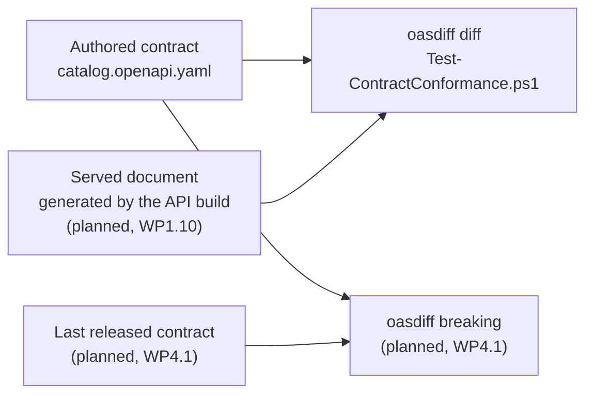

# oasdiff

## Overview

The authored contract is the source of truth for the HTTP API ([ADR-0017](../../adr/0017-contract-first-api-design.md)). From WP1.10 (planned), the API also describes itself, because its build generates an OpenAPI
document from the code. When the two documents describe different APIs, the code or the contract is wrong, and the build must fail so that a client does not find out first. A text comparison cannot
do this check, because the YAML contract and a generated JSON document differ in format, key order, and wording even when they describe the same API. oasdiff reads both documents as OpenAPI, matches their
paths and operations, and reports the differences in meaning (checked 2026-10-11 in the [README](https://github.com/oasdiff/oasdiff)).

Five concepts cover most of what you need:

| Concept | What it is | Where it appears here |
| --- | --- | --- |
| Base and revision | The two documents of a comparison. oasdiff reports what changed from the base to the revision | The authored contract is the base, and the served document is the revision |
| `diff` | Reports every difference in the API definition. The default format is YAML, and an empty result means no difference | The conformance check |
| `breaking` and `changelog` | Report only the changes that can affect a client, and leave out edits to descriptions and examples. `breaking` reports only the changes that break one: a request that was valid before can now be rejected, or a response can carry something that clients were not written to handle | The comparison with the last release (planned in WP4.1) |
| Excluded elements | `--exclude-elements` removes `description`, `examples`, `extensions`, `summary`, `title`, or `endpoints` from a `diff`, and `diff` and `summary` are the commands that accept it | The check ignores `description`, `examples`, and `summary` |
| `--fail-on-diff` | Makes `diff` exit with code 1 when it finds any change | The check turns that exit code into a failed build |

Two checks use oasdiff. Both compare the authored contract, `contracts/openapi/catalog/v1/catalog.openapi.yaml`, with another document:



WP1.5 builds the conformance check ([REQ-CON-002](../../requirements/requirements.yaml)): the script [tools/ci/Test-ContractConformance.ps1](../../../tools/ci/Test-ContractConformance.ps1), the `contract-conformance` service of
[tools/lint/compose.yaml](../../../tools/lint/compose.yaml), and the tests that show it can fail. No served document exists yet, so CI does not run the script against one. WP1.10 (planned) generates the served document in the
API build and runs it through the script, and WP4.1 (planned) adds the `breaking` comparison with the last released contract (plan section 8.6, steps 5 to 7). [Spectral](spectral.md) checks the authored contract on its own.

The script exits with 0 when the documents are structurally equal, 1 when they differ, and 2 when it could not compare them: a file is missing, a file is not YAML or JSON, Docker is not installed, or oasdiff cannot read a document.
A run that fails never reads as equality.

## Decision rationale

The plan names oasdiff for both gates, the conformance check and the breaking-change check (plan section 8.6, steps 6 and 7), and [ADR-0017](../../adr/0017-contract-first-api-design.md) adopts it.
[ADR-0027](../../adr/0027-contract-linter-and-conformance-tooling.md) pins version 1.33.0 and the elements to ignore. No ADR compares oasdiff with another comparison tool.

| Criterion | What was found |
| --- | --- |
| License | Apache-2.0, which GitHub reports for the [repository](https://github.com/oasdiff/oasdiff) (checked 2026-10-11). It is on the allow-list of [ADR-0004](../../adr/0004-licensing-and-dependency-license-policy.md), and the repository runs the image as a tool and never links or redistributes it |
| OpenAPI 3.1 | The project documents support for 3.1 documents in every command, generally available since v1.15.0, and it reads 3.2 documents too (checked 2026-10-11 in [OpenAPI 3.1 support](https://github.com/oasdiff/oasdiff/blob/v1.33.0/docs/OPENAPI-31.md)). The contract is OpenAPI 3.1.0 |
| Maintenance | v1.33.0, the version pinned here, is the latest stable release, published 2026-10-01 (checked 2026-10-11). It followed v1.32.0 (2026-09-13) and v1.32.1 (2026-09-15), and the pre-releases v1.33.1-rc.1 and v1.33.1-rc.2 appeared on 2026-10-07 and 2026-10-08. The project moves fast, and Dependabot proposes updates to the image tag and digest |
| Delivery | The official image `tufin/oasdiff`, pinned by tag and digest in the `contract-conformance` service. Nothing is installed on the host, and the repository is mounted read-only |
| Why `diff` | The conformance check wants every structural difference, including ones that would not break a client, such as a new endpoint or an added optional header. `diff` reports every difference and accepts `--exclude-elements`. `breaking` and `changelog` report only changes that can affect a client (checked 2026-10-11 in the [diff guide](https://github.com/oasdiff/oasdiff/blob/v1.33.0/docs/DIFF.md) and the [breaking changes guide](https://github.com/oasdiff/oasdiff/blob/v1.33.0/docs/BREAKING-CHANGES.md)) |
| Strict by default | The script ignores only `description`, `examples`, and `summary`, so a different `info.version`, `info.title`, or `servers` entry fails the check. `--exclude-elements` has no value for `servers` or `info.version` in v1.33.0 (checked 2026-10-11 in the output of `diff --help`), and `-IgnoredElements` of the script can add `title` and `extensions`. [ADR-0027](../../adr/0027-contract-linter-and-conformance-tooling.md) says that ignoring anything else that the plan does not list needs an ADR from WP1.10 |
| Quiet text output | With `--format text`, a difference outside the endpoints may print only "No endpoint changes, but there are some other changes". Run `diff` in the default YAML format to see it (step 5) |
| Hosted service | The project also offers a hosted review at oasdiff.com, and `breaking` and `changelog` accept an `--open` flag that uploads the comparison there, encrypted (checked 2026-10-11 in the [breaking changes guide](https://github.com/oasdiff/oasdiff/blob/v1.33.0/docs/BREAKING-CHANGES.md)). This repository runs only the command-line tool and does not use that flag |

A change to a schema that several operations share is reported once for each operation that uses it, so one edit can fill the report (observed on 2026-10-11 with a changed `maxLength` of the product name, which appeared under five operations).

## Setup tutorial

**Prerequisites:** Docker, and PowerShell 7 (`pwsh`). On a host without a native PowerShell, run `dotnet tool restore` and use `dotnet pwsh` in place of `pwsh` ([PowerShell](powershell.md)). The pinned version is v1.33.0, and the image is pinned by tag and digest in `tools/lint/compose.yaml`. The tutorial uses a copy of the contract as the
"served" document, because the API build does not generate one yet. The `.dev` folder is ignored by Git. Compose prints its own lines about the container before the output of the command.

1. Check the version that the image holds. The `contract-conformance` service has no fixed command, because the script passes the files and the elements to ignore.

   ```bash illustrative
   docker compose -f tools/lint/compose.yaml run --rm -T contract-conformance --version
   ```

   Expected output:

   ```text
   oasdiff version v1.33.0
   ```

2. Compare the contract with a copy of itself. The script copies both files to a temporary folder, runs
   `oasdiff diff <authored> <served> --exclude-elements description,examples,summary --fail-on-diff --format text` in the container, and removes the folder.

   ```powershell illustrative
   New-Item -ItemType Directory -Force .dev/served | Out-Null
   Copy-Item contracts/openapi/catalog/v1/catalog.openapi.yaml .dev/served/served.yaml
   pwsh -NoProfile -File tools/ci/Test-ContractConformance.ps1 -Served .dev/served/served.yaml
   ```

   Expected output, with exit code 0:

   ```text
   The served document is structurally equal to the authored contract (ignoring description, examples, summary).
   ```

3. Change the wording only. In `.dev/served/served.yaml`, change `summary: List categories` to `summary: Another summary`, and run the script again. The output and the exit code are the same as in step 2, because the check ignores summaries,
   descriptions, and examples.

4. Change the structure. In the same file, change the one line `name: Idempotency-Key` to `name: Idempotency-Id`, and run the script again.

   Expected output, with exit code 1:

   ```text
   ### New Endpoints: None
   -----------------------

   ### Deleted Endpoints: None
   ---------------------------

   ### Modified Endpoints: 2
   -------------------------
   POST /api/v1/categories
   - New header param: idempotency-id
   - Deleted header param: idempotency-key

   POST /api/v1/products
   - New header param: idempotency-id
   - Deleted header param: idempotency-key


   The served document differs from the authored contract. Change the code to match the contract, or change the contract first (ADR-0017).
   ```

   oasdiff lists both create operations, because they share the parameter. It prints the header names in lower case, because it compares header names without regard to case by default (checked 2026-10-11 in `diff --help`).

5. See a difference that the text format only counts. Copy the contract over the served file to undo your edits, change `version: 1.0.0` under `info` to `version: 1.0.1`, and run the script.

   Expected output, with exit code 1:

   ```text
   No endpoint changes, but there are some other changes


   The served document differs from the authored contract. Change the code to match the contract, or change the contract first (ADR-0017).
   ```

   To see the change, run `diff` in the default YAML format, which prints nothing when the documents are equal.

   ```bash illustrative
   docker compose -f tools/lint/compose.yaml run --rm -T contract-conformance diff contracts/openapi/catalog/v1/catalog.openapi.yaml .dev/served/served.yaml --exclude-elements description,examples,summary
   ```

   Expected output:

   ```text
   info:
       version:
           from: 1.0.0
           to: 1.0.1
   ```

6. Prove that the check can fail. CI runs the script tests, which analyze `scripts` and `tools/ci` and then run every Pester file there. The tests need Docker, because oasdiff runs in a container.

   [!code-bash[Script tests in CI](../../../.github/workflows/ci.yml#script-tests)]

   [tools/ci/ContractConformance.Tests.ps1](../../../tools/ci/ContractConformance.Tests.ps1) proves that wording changes pass, and that a changed constraint, a dropped required property, a missing response, a renamed header parameter, a changed security scope, a renamed
   endpoint, and a changed `info.version` all fail. It also proves that a JSON document compares with the YAML contract, which matters because the served document is JSON, and that the script exits with 2 for a missing file, a file that is not YAML or
   JSON, and a document that oasdiff cannot read. The summary of the whole run ends with a line like the one below, where the count of passed tests changes as tests are added (337 on 2026-10-11).

   ```text
   Tests Passed: 337, Failed: 0, Skipped: 1, Inconclusive: 0, NotRun: 0
   ```

**Cleanup:** remove the copy with the command below. `--rm` removes each container, and the repository is mounted read-only.

```powershell illustrative
Remove-Item -Recurse -Force .dev/served
```

## Further research

- [The oasdiff repository](https://github.com/oasdiff/oasdiff): the README lists the commands, the install options, and the releases, and the repository holds the license (checked 2026-10-11)
- [The diff guide](https://github.com/oasdiff/oasdiff/blob/v1.33.0/docs/DIFF.md): the output formats, `--exclude-elements`, and `--fail-on-diff` (checked 2026-10-11)
- [Breaking changes and changelog](https://github.com/oasdiff/oasdiff/blob/v1.33.0/docs/BREAKING-CHANGES.md): the `breaking` command that WP4.1 plans to use, with `--fail-on` and the severity levels (checked 2026-10-11)
- [How oasdiff decides what is breaking](https://www.oasdiff.com/docs/breaking-changes): the rule behind every verdict (checked 2026-10-11)
- [OpenAPI 3.1 support](https://github.com/oasdiff/oasdiff/blob/v1.33.0/docs/OPENAPI-31.md): what the commands read and detect in 3.1 and 3.2 documents (checked 2026-10-11)
- [oasdiff.com](https://www.oasdiff.com/): the project site and its hosted review service (checked 2026-10-11)
