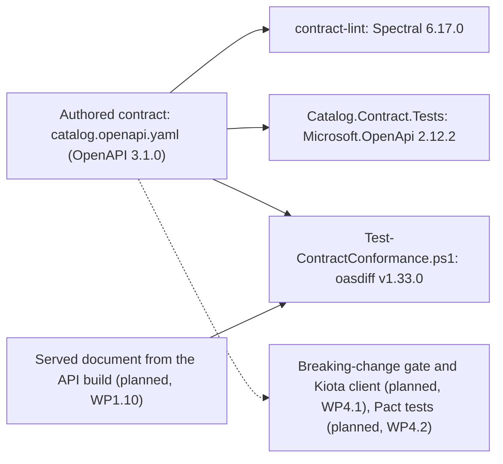

# OpenAPI

## Overview

An HTTP API is a set of agreements: which paths and methods exist, what each one accepts, what it returns for each outcome, which headers matter, and which credential a caller needs. When nothing
writes the agreements down, they live in the server code, and a client author learns them by reading the code or by trial. The OpenAPI Specification (OAS) is a standard, programming-language-agnostic
way to write them down as one document, which people and tools can read without the source code, extra documentation, or a look at the network traffic (checked 2026-10-11 on
[the specification](https://spec.openapis.org/oas/v3.1.0.html)).

This repository uses OpenAPI the contract-first way ([ADR-0017](../../adr/0017-contract-first-api-design.md)). The contract is authored before any endpoint exists, in
[contracts/openapi/catalog/v1/catalog.openapi.yaml](../../../contracts/openapi/catalog/v1/catalog.openapi.yaml), and the running API must match it
([REQ-CON-001 and REQ-CON-002](../../requirements/requirements.yaml)). The document describes 10 operations on categories and products, with the parameters, headers, schemas, and responses that
they share in `components`. Every error is a Problem Details body, and three OAuth2 scopes, `catalog.read`, `catalog.write`, and `catalog.admin`, guard the operations.
[The API contract page](../api-contract.md) summarizes the operations, [the API style guide](../api-style-guide.md) gives the rules, and
[ADR-0028](../../adr/0028-http-api-conventions-of-v1.md) records the conventions of version 1. This page teaches the standard and the way the repository checks the document.

Five concepts cover what you need to read the contract:

| Concept | What it is | Where it appears here |
| --- | --- | --- |
| OpenAPI document | One JSON object, written as JSON or YAML. Its `openapi` field names the version of the specification, and `info.version` names the version of the document, which is a different thing | `openapi: 3.1.0` and `info.version: 1.0.0` on the first lines of the contract |
| Path item and operation | A path such as `/api/v1/products/{productId}` holds one operation for each HTTP method. An operation has an `operationId`, parameters, an optional body, responses, and a security requirement. The `operationId` is unique in the document and case-sensitive, and tools use it as a name | The 10 operations, with camel-case IDs such as `createProduct`, which a generated client turns into method names |
| Components and `$ref` | The reusable parts (schemas, parameters, headers, responses, and security schemes) live under `components`, and a `$ref` points at one. A component key matches `^[a-zA-Z0-9\.\-_]+$`. Parameters listed on a path item apply to every operation under it, and an operation can override them but never remove them | `#/components/parameters/IdempotencyKey`, and the path-level `categoryId` parameter |
| Schema | The Schema Object describes a value, and it is a superset of JSON Schema Draft 2020-12, so `type`, `pattern`, `minLength`, `enum`, and `examples` mean what they mean in JSON Schema | `Money`, `Sku`, `Product`, and `ProblemDetails` |
| Security scheme and requirement | A scheme declares how a caller authenticates, and a requirement names the scheme and the scopes that an operation needs. In a list of requirements, one of them is enough. In one requirement that names several schemes, every scheme is needed | The `oauth2` scheme, and one `oauth2: [scope]` requirement on each operation |

These facts about version 3.1 come from the specification, and each one has a counterpart in the contract (all checked 2026-10-11 on
[the specification](https://spec.openapis.org/oas/v3.1.0.html)):

- **Quote the status codes.** A key in `responses` must be in quotation marks, such as `'200'`, so that a number key means the same in JSON and in YAML.
- **A nullable value is a type array.** The Schema Object uses the JSON Schema types, so a string that can be null is `type: [string, 'null']`. The 3.1.0 text has no `nullable` keyword, and
  [the migration guide](https://www.openapis.org/blog/2021/02/16/migrating-from-openapi-3-0-to-3-1-0) says that the keyword was removed in favor of type arrays. Quote the `'null'`, because an unquoted `null` in YAML is not the string.
- **There are two kinds of example.** A parameter or a media type takes `example`, or an `examples` map of objects with a `summary` and a `value`, and the two are mutually exclusive. A schema takes the JSON Schema `examples` array, and the old schema-level
  `example` is deprecated.
- **Some headers cannot be parameters.** A header parameter named `Accept`, `Content-Type`, or `Authorization` is ignored, and so is a response header named `Content-Type`. The contract describes the bearer token through the security scheme and the body type through `content`.

The specification has patch versions, and they only fix errors or clarify the text. The `major.minor` part (3.1) designates the feature set, tooling that supports 3.1 should accept every 3.1.x document, and tooling should not tell 3.1.0 from 3.1.1
(checked 2026-10-11). Version 3.1.0 is dated 15 February 2021. The latest published version is 3.2.1, dated 10 September 2026, and 3.1.1, 3.1.2, and 3.2.0 sit between them (checked 2026-10-11 on
[the latest version](https://spec.openapis.org/oas/latest.html)). The repository authors 3.1.0, and a later minor version needs its own ADR (the notes of the `openapi` entry in [the tool inventory](inventory.yaml)).



What exists today is the contract, its ruleset, the lint job, the conformance script and its tests, and the contract test project. No API serves the contract yet. WP1.10 adds the API and the served document, WP4.1 and WP4.2 add the checks on the right of the
diagram, and a contract lab is planned for WP1.13.

## Decision rationale

[Plan section 8.6](../../plans/implementation-plan.md) names the format: OpenAPI 3.1, authored in YAML. [ADR-0017](../../adr/0017-contract-first-api-design.md) records the decision to write the contract first, and
[ADR-0027](../../adr/0027-contract-linter-and-conformance-tooling.md) records the tools that check it. This page does not repeat them. It records why the contract is OpenAPI 3.1.0, and what that costs.

| Option | Verdict |
| --- | --- |
| OpenAPI 3.1.0, authored as YAML (chosen) | One reviewable file for every path, header, status code, and error. Spectral, oasdiff, Microsoft.OpenApi 2.x, and the planned Kiota client all read 3.1 (the notes of the `openapi` entry in [the tool inventory](inventory.yaml), checked 2026-10-11), and ASP.NET Core 10 generates 3.1 documents, so the served document can be compared with the authored one (checked 2026-10-11 on [the ASP.NET Core page](https://learn.microsoft.com/en-us/aspnet/core/fundamentals/openapi/aspnetcore-openapi?view=aspnetcore-10.0)) |
| A contract generated from the code | Rejected in ADR-0017. The design of headers, examples, and compatibility shows up late, after the endpoints exist |
| TypeSpec as the source | Rejected in ADR-0017. It adds another language to teach, and the evidence gathered for the .NET-first toolchain does not point to it |
| Server stubs generated from the contract | Rejected in ADR-0017. The stubs add ceremony and can hide the Clean Architecture boundaries behind generated glue |
| NSwag as the contract and client toolchain | Not adopted, and held in the inventory. The research record says that NSwag v14.7.1 still describes itself as a Swagger and OpenAPI 2.0 and 3.0 toolchain (checked 2026-10-04, as ADR-0017 cites) |
| A later minor version, 3.2 | Not chosen. A later minor version is a decision for its own ADR, and ASP.NET Core generates 3.2 documents only from .NET 11 (checked 2026-10-11 on the ASP.NET Core page) |

| Criterion | What was found |
| --- | --- |
| License | The specification is Apache-2.0 (checked 2026-10-11 on [the repository](https://github.com/OAI/OpenAPI-Specification)). The repository links no specification code. The tools are Spectral and oasdiff (Apache-2.0) and Microsoft.OpenApi (MIT), all on the allow-list of [ADR-0004](../../adr/0004-licensing-and-dependency-license-policy.md) |
| Maintenance | The specification has had two patch versions of 3.1 and two releases of 3.2 since 3.1.0, and the latest is dated 10 September 2026 (checked 2026-10-11) |
| Cost | Nothing to license. Spectral and oasdiff run from digest-pinned containers, and the two NuGet packages are restored with the solution |
| Tool support | Three tools read the contract today: Spectral, oasdiff, and Microsoft.OpenApi. A tool that cannot read a later version blocks the move to it, which ADR-0027 lists as a reason to revisit |

Four trade-offs follow from the choice:

- **Two descriptions of one API.** The contract and the code that WP1.6 to WP1.10 build to it can drift apart. The conformance check exists to fail when they do, and WP1.10 makes it blocking (ADR-0017).
- **A long file.** The contract is about 1,600 lines for 10 operations, because every response, header, and example is written out (checked 2026-10-11). Shared `components` and the Spectral rules keep that size checkable.
- **Not the newest version.** 3.1.0 is neither the latest 3.1 patch nor the latest minor version. The patch makes no difference to tooling, and the minor version waits for its own ADR.
- **A pin on the .NET library.** Microsoft.OpenApi stays on 2.x, although 3.10.2 is the latest release, because Microsoft.AspNetCore.OpenApi 10.0.12 depends on a version from 2.12.0 up to, but not including, 3.0.0 (checked 2026-10-11). The two packages have entries in
  [the dependency catalog](dependency-catalog.md#microsoftopenapi).

## Setup tutorial

**Prerequisites:** the prerequisites in the front matter. The steps need no .NET SDK, because Spectral and oasdiff run in containers. On a native host without `pwsh`, run `dotnet tool restore`, then use `dotnet pwsh` in its place
([the PowerShell page](powershell.md)).

**Pinned versions:** OpenAPI 3.1.0 (the first line of the contract), Spectral 6.17.0 (`stoplight/spectral:6.17.0`), oasdiff v1.33.0 (`tufin/oasdiff:v1.33.0`), and Microsoft.OpenApi and Microsoft.OpenApi.YamlReader 2.12.2. The two images are pinned by digest in
[tools/lint/compose.yaml](../../../tools/lint/compose.yaml), and `Directory.Packages.props` holds the package versions.

1. Read the version and the operations of the contract.

   ```bash illustrative
   head -n 4 contracts/openapi/catalog/v1/catalog.openapi.yaml
   grep 'operationId:' contracts/openapi/catalog/v1/catalog.openapi.yaml
   ```

   Expected output is the version lines, then the ten operation IDs:

   ```text
   openapi: 3.1.0
   info:
     title: Product Catalog API
     version: 1.0.0
         operationId: listCategories
         operationId: createCategory
         operationId: getCategory
         operationId: updateCategory
         operationId: discontinueCategory
         operationId: listProducts
         operationId: createProduct
         operationId: getProduct
         operationId: updateProduct
         operationId: discontinueProduct
   ```

2. Lint the contract. This is the step that the `Contract lint` job of the `ci` workflow runs, so a local result is the CI result. Run the command in the `run` line from the repository root. The first run pulls the Spectral image.

   [!code-bash[Contract lint in CI](../../../.github/workflows/ci.yml#contract-lint)]

   Expected output, after Docker's own container lines, and the command exits with code 0:

   ```text
   No results with a severity of 'warn' or higher found!
   ```

3. Break a copy of the contract on purpose, and lint the copy. The `contract-lint` service mounts the repository read-only and lints `contracts/**/*.openapi.yaml`, so the command mounts your scratch folder and names the copy. A command after the service name replaces the default command.

   ```bash illustrative
   mkdir scratch
   sed 's/name: Idempotency-Key/name: Idempotency-Id/' contracts/openapi/catalog/v1/catalog.openapi.yaml > scratch/broken.openapi.yaml
   docker compose -f tools/lint/compose.yaml run --rm -v "$PWD/scratch:/workdir/scratch:ro" contract-lint lint --ruleset contracts/openapi/spectral.yaml --fail-severity warn --format stylish scratch/broken.openapi.yaml
   ```

   Expected output names the rule that fired for each create. The columns are the line and column, the severity, the rule, its description, and the path in the document. Your line numbers differ when the contract has changed, and the command exits with code 1:

   ```text
   /workdir/scratch/broken.openapi.yaml
    125:18  error  catalog-create-requires-idempotency-key  Every POST that creates a resource requires the Idempotency-Key header (plan section 8.4).  paths./api/v1/categories.post.parameters
    478:18  error  catalog-create-requires-idempotency-key  Every POST that creates a resource requires the Idempotency-Key header (plan section 8.4).  paths./api/v1/products.post.parameters

   ✖ 2 problems (2 errors, 0 warnings, 0 infos, 0 hints)
   ```

4. Compare a served document with the authored contract. A copy that you did not change is structurally equal. From WP1.10 the served document is the JSON that the API build generates, and the script accepts a `.json`, `.yaml`, or `.yml` file.

   ```bash illustrative
   cp contracts/openapi/catalog/v1/catalog.openapi.yaml scratch/served.yaml
   pwsh -NoProfile -File tools/ci/Test-ContractConformance.ps1 -Served scratch/served.yaml
   ```

   Expected output, and the script exits with code 0:

   ```text
   The served document is structurally equal to the authored contract (ignoring description, examples, summary).
   ```

5. Change a constraint in the copy, and compare again. The script ignores descriptions, examples, and summaries, and every other difference fails it.

   ```bash illustrative
   sed 's/maximum: 100/maximum: 101/' contracts/openapi/catalog/v1/catalog.openapi.yaml > scratch/served.yaml
   pwsh -NoProfile -File tools/ci/Test-ContractConformance.ps1 -Served scratch/served.yaml
   ```

   Expected output is the oasdiff report and the verdict, and the script exits with code 1:

   ```text
   ### New Endpoints: None
   -----------------------

   ### Deleted Endpoints: None
   ---------------------------

   ### Modified Endpoints: 2
   -------------------------
   GET /api/v1/categories
   - Modified query param: pageSize
     - Schema changed
       - Max changed from 100 to 101

   GET /api/v1/products
   - Modified query param: pageSize
     - Schema changed
       - Max changed from 100 to 101


   The served document differs from the authored contract. Change the code to match the contract, or change the contract first (ADR-0017).
   ```

6. Read how the C# tests load the contract. Microsoft.OpenApi 2.x reads and writes JSON in its core package, and YAML needs the separate Microsoft.OpenApi.YamlReader package, which `AddYamlReader()` registers on the reader settings
   (checked 2026-10-11 on [the upgrade guide](https://github.com/microsoft/OpenAPI.NET/blob/main/docs/upgrade-guide-2.md)). The `Load` method below parses the text as YAML, and it throws when the parser reports an error, so a test never runs on a half-read contract.

   [!code-csharp[Load the contract with Microsoft.OpenApi](../../../tests/Catalog.Contract.Tests/Support/Authored.cs)]

**Cleanup:** delete the scratch folder. The steps changed nothing else.

```bash illustrative
rm -r scratch
```

## How this project uses it

The contract is data that the repository checks with tools, and these files make the checks testable. [The Spectral page](spectral.md) and [the oasdiff page](oasdiff.md) teach the two command-line tools, and [the dependency catalog](dependency-catalog.md#microsoftopenapi)
covers the two NuGet packages.

| File | What it holds |
| --- | --- |
| [catalog.openapi.yaml](../../../contracts/openapi/catalog/v1/catalog.openapi.yaml) | The version 1 contract, which is the source of truth for the HTTP surface |
| [spectral.yaml](../../../contracts/openapi/spectral.yaml) | The Spectral ruleset. It extends `spectral:oas`, raises the two example-validity rules to errors, and adds the `catalog-` rules, one for each sentence of plan sections 8.4, 8.6, and 8.7 that a linter can check |
| [compose.yaml](../../../tools/lint/compose.yaml) | The `contract-lint` and `contract-conformance` services, each pinned by tag and digest |
| [ci.yml](../../../.github/workflows/ci.yml) | The `Contract lint` job, which runs the lint on every pull request |
| [ContractRules.Tests.ps1](../../../tools/ci/ContractRules.Tests.ps1) | A Pester test that breaks the contract once for each rule and expects that rule to fire, so every rule is shown to fail |
| [Test-ContractConformance.ps1](../../../tools/ci/Test-ContractConformance.ps1) and [ContractConformance.Tests.ps1](../../../tools/ci/ContractConformance.Tests.ps1) | The conformance check, and the tests that show that wording changes pass and structural changes fail |
| [Catalog.Contract.Tests.csproj](../../../tests/Catalog.Contract.Tests/Catalog.Contract.Tests.csproj) | The C# tests that read the contract with Microsoft.OpenApi, for the checks that need other documents, such as the error catalog and the permission matrix |

Where the contract uses the 3.1 features that this page teaches:

| Feature | In the contract |
| --- | --- |
| Type arrays | `type: [string, 'null']` for `nextCursor` and for the product description |
| Schema `examples` | An array on schemas such as `Id`, `Sku`, and `Money.amount` |
| Parameter and media examples | `example` on each shared parameter, and an `examples` map with a `summary` and a `value` on each body |
| License identifier | `info.license.identifier: Apache-2.0`, an SPDX identifier that the specification makes exclusive with `url` |
| Shared components | `$ref` to `components/parameters`, `components/headers`, `components/schemas`, and `components/responses`, so a rule such as "every answer sends `api-supported-versions`" is one component |
| Problem Details | Every status of 400 or more has an `application/problem+json` body |
| Security | The `oauth2` scheme with an `authorizationCode` flow and a `clientCredentials` flow, and one scope on each operation |
| Servers | The Compose stack on `http://localhost:8080`, and the local cluster, planned for Phase 3 |

**Data flow and trust boundary.** Every input is a file of the repository. The Spectral container reads the repository through a read-only mount. The conformance script copies the two documents into a temporary folder and mounts that folder read-only into the oasdiff container.
The C# tests read the contract from disk. Nothing crosses a network at run time. From WP1.10 the served document is a build artifact that the API build generates (plan section 8.6, step 5), and it is not fetched from a running server.

**Ownership.** WP1.5 delivered the contract, the ruleset, the lint job, the conformance script, and the test project. WP1.10 serves the contract and runs the conformance check on the served document. WP4.1 adds the comparison with the last
released contract, the generated `Catalog.Client`, and Schemathesis, and WP4.2 adds Pact (all planned). WP1.13 writes the contract lab and publishes the contract pages on the documentation site.

**Failure modes.**

- A Spectral rule selects nothing, and so it passes silently. ADR-0027 names this risk, and `ContractRules.Tests.ps1` fails when a rule has no break, so a rule cannot arrive untested.
- The served document and the contract drift apart, and the conformance check fails (blocking from WP1.10).
- A tool stops reading the version that the contract uses, and ADR-0027 lists that as a reason to revisit the tooling.
- A pull request weakens a rule and breaks the contract in the same diff. The next section covers the review that catches it.

## Validation and troubleshooting

Three checks prove the setup, and the first two are in the tutorial. The lint is step 2. The conformance check is steps 4 and 5. The script tests are the third check. They break the contract once for each Spectral rule, and they make seven kinds of structural change that oasdiff must catch. They need Docker, and CI runs them in the `Script tests` job:

[!code-bash[Script tests in CI](../../../.github/workflows/ci.yml#script-tests)]

The C# contract tests run with the other tests of the solution, in the `dotnet test` line that [AGENTS.md](../../../AGENTS.md) lists. Read [the API contract page](../api-contract.md#check-the-contract) for how the three checks fit together.

| Symptom | Cause | Fix |
| --- | --- | --- |
| Spectral reports a `catalog-...` error | The contract breaks a rule of the API. The message names the rule, and the path points at the operation or the component | Fix the contract. If the rule is wrong, change `spectral.yaml` and its break in `ContractRules.Tests.ps1` in the same pull request, with the reason |
| Spectral reports `parser  Mapping key must be a string scalar rather than number` on a response | A status code is not in quotation marks, such as `304:` | Write the code as `'304':` |
| Spectral reports `oas3-schema` with `must be equal to one of the allowed values: "array", "boolean", "integer", "null", ...`, and many `oas3-valid-media-example` errors | A type array has an unquoted `null`, as in `[string, null]`, which YAML reads as a null value and not as the type name | Write `[string, 'null']` |
| `oas3-valid-media-example` or `oas3-valid-schema-example` fails | An example does not match its schema, for example a status that is not in the `enum` | Correct the example, or the schema if the rule of the API changed |
| The lint passes, and a rule seems not to apply | A rule that selects nothing passes silently | Add or fix the break for the rule in `ContractRules.Tests.ps1`, which must fail without it |
| The conformance script exits with code 1 | The served document differs from the contract in more than wording, and the oasdiff report lists each difference | Change the code to match the contract, or change the contract first (ADR-0017) |
| The conformance script exits with code 2 | It could not compare. The file is missing or is not a `.yaml`, `.yml`, or `.json` file, Docker is not installed, or oasdiff cannot read a document | Read the message above the exit. A document that is not valid YAML or JSON also gives code 2, and the script never reports equality in that case |
| A test fails with `has OpenAPI errors` and a pointer | `Authored.Load` found an error in the contract, such as a reference that does not resolve | Open the contract at the pointer and fix it. Run the lint, which finds most of these first |
| The locked restore fails after a package change | The `packages.lock.json` of `Catalog.Contract.Tests` is stale | Run `dotnet restore ProductCatalog.slnx` without the locked mode and commit the changed lock files ([ADR-0020](../../adr/0020-dependency-intake-controls.md)) |
| A pull request moves Microsoft.OpenApi to 3.x | The repository pins 2.x because ASP.NET Core 10.0.12 needs a version below 3.0.0 | Keep the pin, and say why in the pull request. The notes of the inventory entry record the reason |

## Security and operations

- **Credentials.** The contract and the ruleset hold no secrets. The server and OAuth URLs are the local defaults of the Compose stack and the planned local cluster, and the examples are synthetic. The secret scans read these files like every other file.
  No check needs a token. The first run pulls the Spectral and oasdiff images.
- **Review.** `/contracts/` has a code owner in [CODEOWNERS](../../../.github/CODEOWNERS), and the ruleset is in that folder, so a pull request that weakens a rule in the same diff that breaks it needs the owner's review. The
  [blast-radius map](../../../governance/policies/blast-radius-map.yaml) treats a change under `contracts/` as a contract change: it asks for the contract, build and test, script test, and documentation site jobs, and for a code owner and a contract review, and it lists the contract documentation, an ADR, and a changelog entry as the documents to update (checked 2026-10-11).
- **Container hardening.** The Spectral image runs as an unprivileged user over a read-only mount, and both images are pinned by digest. The mount is the whole repository, so a compromised image could read the git-ignored `.env`, which holds local, disposable passwords.
  The digest pin is what keeps an image from changing under the repository.
- **Compatibility.** The contract is not released until `v0.1.0` ([ADR-0028](../../adr/0028-http-api-conventions-of-v1.md)), so until then a pull request can change it. From WP4.1 a change that breaks the last released contract is blocked (planned).
- **Updates.** Dependabot proposes updates to the two images in `tools/lint` and to the NuGet packages. An update to Spectral or oasdiff changes compose.yaml and the matching entry in [the tool inventory](inventory.yaml), and the
  [Documentation.Auditor](documentation-auditor.md) compares the pin with the inventory. Microsoft.OpenApi stays on 2.x until Microsoft.AspNetCore.OpenApi allows 3.x. A new patch of the specification needs no change, and a new minor version needs an ADR.
- **Blast radius.** A wrong contract misleads every client, and the conformance check then holds the code to the wrong contract, so the review of a change to the contract is the main control. A compromised image can read what is mounted and cannot write to it.

## Lab

None yet for the contract. WP1.13 (planned) writes a contract lab. [Lab 1: Quick start](../../labs/quick-start-api-stack.md) starts the stack that the API will run in, but it does not touch the contract, and the API calls that serve it arrive in WP1.10.

## Further research

- [OpenAPI Specification v3.1.0](https://spec.openapis.org/oas/v3.1.0.html): the text that this page cites. Read the Schema Object, the Responses Object, and the Security Requirement Object first (checked 2026-10-11)
- [Learn OpenAPI](https://learn.openapis.org/): guides to the structure of a description, reuse with references, examples, security, and the upgrade from 3.0 to 3.1 (checked 2026-10-11)
- [Migrating from OpenAPI 3.0 to 3.1.0](https://www.openapis.org/blog/2021/02/16/migrating-from-openapi-3-0-to-3-1-0): why `nullable` became a type array and why schema `example` became `examples` (checked 2026-10-11)
- [JSON Schema Draft 2020-12](https://json-schema.org/draft/2020-12): the dialect that the Schema Object extends (checked 2026-10-11)
- [OpenAPI document generation in ASP.NET Core](https://learn.microsoft.com/en-us/aspnet/core/fundamentals/openapi/aspnetcore-openapi?view=aspnetcore-10.0): how the API will produce the served document in WP1.10, and which OpenAPI versions it can write (checked 2026-10-11)
- [Upgrade guide to OpenAPI.NET 2.0](https://github.com/microsoft/OpenAPI.NET/blob/main/docs/upgrade-guide-2.md): the 2.x object model, the separate YAML reader, and the compatibility with ASP.NET Core (checked 2026-10-11)
- [Spectral rulesets](https://docs.stoplight.io/docs/spectral/e5b9616d6d50c-rulesets): how `contracts/openapi/spectral.yaml` is written (checked 2026-10-11)
- [oasdiff](https://www.oasdiff.com/): the comparison tool behind the conformance check and, from WP4.1, the breaking-change gate (checked 2026-10-11)
