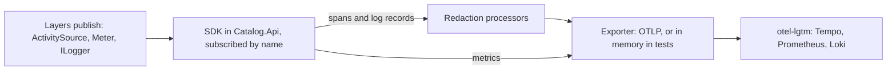

# OpenTelemetry .NET

## Overview

An API in production has to answer "what did this request do, and why did it fail or run slowly" without a debugger attached. OpenTelemetry is a vendor-neutral standard for that: a data model, an API and an SDK for each language, and a wire protocol.
OpenTelemetry .NET is the implementation for .NET. The catalog API uses it to emit traces, metrics, and logs, and to follow one failure from an error answer to the trace that explains it ([ADR-0043](../../adr/0043-observability-with-opentelemetry-and-redaction.md), plan section 8.11).

Eight concepts cover what you need to read the rest of this page:

| Concept | What it is | Where it appears here |
| --- | --- | --- |
| Signal | A kind of telemetry. A trace is the path of one request through the components, drawn as a tree of spans. A metric is a number that is measured and aggregated over time. A log record is a timestamped event | Tempo, Prometheus, and Loki in [grafana/otel-lgtm](otel-lgtm.md) |
| `ActivitySource` and `Meter` | The publishing side, which belongs to the base class library. A .NET `Activity` is what OpenTelemetry calls a span. A source or a meter has a name, and code writes to it whether or not anything listens | `Catalog.UseCases`, `Catalog.Outbox`, `Catalog.Credentials`, `Catalog.Cache`, and `Catalog.Idempotency` |
| SDK | The listening side. It subscribes to the sources and meters that it is given by name, then processes and exports what they publish. A source that nobody names is silent | `TelemetryComposition` in `Catalog.Api` |
| Processor and exporter | A processor sees each finished span or log record and may change it. An exporter sends it out. They run in the order in which they were added | Two redaction processors first, then the OTLP exporter |
| OTLP | The OpenTelemetry Protocol, which carries all three signals over gRPC (port 4317) or HTTP with protobuf (port 4318) | The exporter of the API and the ports of the Compose stack |
| Resource | The attributes that say which process produced the data, above all `service.name` | `catalog-api` |
| Sampling | The decision to record only a share of the traces | `TraceSamplingRatio`, which is 1 by default |
| Semantic conventions | Agreed names for attributes, so one query means the same for every service | `http.request.method`, `http.response.status_code`, and `error.type` |



### Publishing and listening

The base class library holds the publishing side: `System.Diagnostics.ActivitySource` for spans and `System.Diagnostics.Metrics.Meter` for counters, histograms, and gauges. When no listener has subscribed to a source, `StartActivity` returns `null`, and a measurement is dropped,
so the code writes `activity?.SetTag(...)` and pays almost nothing. Logs use `ILogger`, and the SDK adds a logging provider. This split is the reason that Domain, Application, Infrastructure, and CrossCutting need no OpenTelemetry package: they publish, and only the composition root listens.
A test of a layer can listen with a listener of the base class library and needs no SDK.

### Processors, exporters, and their order

A finished span or log record passes the processors in the order in which they were added, and an exporter sits in the same chain. An exporter that is added before a processor sends the value that the processor was meant to change, so a redaction processor must come first (REQ-SEC-006).
Metrics have no processor. A reader aggregates the measurements in the process and pushes them at an interval, so a metric label must be safe where it is written.

Spans and log records leave in batches, after at most 5 seconds by default, and metrics leave every 60 seconds by default (checked 2026-11-04 in the [SDK source at the tag core-1.20.1](https://github.com/open-telemetry/opentelemetry-dotnet/tree/core-1.20.1/src/OpenTelemetry)). A trace therefore reaches the stack within seconds, Tempo can take longer to make it searchable, and a metric can take a minute.

### OTLP and the standard variables

The OTLP exporter sends to the endpoint that the standard variables name. It sends over gRPC to `http://localhost:4317` when none is set (checked 2026-11-04 in the [README of the exporter at the tag core-1.20.1](https://github.com/open-telemetry/opentelemetry-dotnet/blob/core-1.20.1/src/OpenTelemetry.Exporter.OpenTelemetryProtocol/README.md)),
and the Compose stack publishes both ports on `127.0.0.1`, so the API needs no setting to reach it on a developer machine.

| Variable | What it sets | Value in this repository |
| --- | --- | --- |
| `OTEL_EXPORTER_OTLP_ENDPOINT` | Where the exporter sends | Not set, so the default above applies |
| `OTEL_EXPORTER_OTLP_PROTOCOL` | `grpc` or `http/protobuf` | Not set, so `grpc` applies |
| `OTEL_EXPORTER_OTLP_HEADERS` | Headers of every export, which can carry a credential | Never in a file. A deployment sets it in the environment |
| `OTEL_RESOURCE_ATTRIBUTES` | More resource attributes, such as the environment | Not set |

The API validates the endpoint and protocol variables when the host starts. A problem names the variable and never repeats a value, because a header or an address can hold a credential.

### Sampling

Head sampling decides when a trace starts whether to record it. The API uses a parent-based sampler over a ratio. A trace that another service started keeps the decision of that service, and a new trace is recorded with the probability in `Catalog:Telemetry:TraceSamplingRatio`, which is 1 by default and records every trace.
A request that is not recorded still has a trace identifier, so an error answer names one even then ([ADR-0043](../../adr/0043-observability-with-opentelemetry-and-redaction.md)). Sampling applies to traces and not to metrics.

### Semantic conventions

The semantic conventions of OpenTelemetry give an attribute an agreed name, so a backend can answer the same question about every service. The instrumentation libraries set them: the server span of ASP.NET Core carries `http.request.method` and `http.response.status_code`.
The catalog's own spans use the prefix `catalog.` for what the conventions do not cover (`catalog.use_case`, `catalog.outcome`) and `error.type` for a fault. The conventions for databases are still moving, so an attribute name that the EF Core or Redis instrumentation writes can change in a release.

### The two beta instrumentations

The instrumentation packages for EF Core and for StackExchange.Redis have never had a stable release, and 1.20.1-beta.1 is the newest of each (checked 2026-11-04). A beta package can change its attributes and its API in any release. The repository pins both exactly in `Directory.Packages.props`, never as a range, and a person reads the release notes on every upgrade.
`TelemetryPackageTests` fail when either pin is a range, is a stable version, or is not on the release of the SDK. The instrumentation of Redis profiles one connection at a time, so `ValkeyConnection` reports each connection that it opens through a `ValkeyConnectionObserver`.

### How this repository uses it

The SDK lives in the composition root only. [`TelemetryComposition`](../../../src/Catalog.Api/Composition/TelemetryComposition.cs) is the one place that names an OpenTelemetry package. The architecture tests (`ReferenceRulesTests` and `ReferencePolicy`) reject the SDK and the redaction package in Infrastructure and CrossCutting,
and the rule of the Application layer already rejects `OpenTelemetry*`. Each layer creates its own source and meter from the base class library, and the composition root subscribes to them by name:

| Name | Owner | What it publishes |
| --- | --- | --- |
| `Catalog.UseCases` | `UseCaseTelemetry` in `Catalog.CrossCutting` | One span for each use case, and the histogram `catalog.usecase.duration` in seconds, with the labels `use_case`, `kind`, and `outcome` |
| `Catalog.Outbox` | `OutboxMetrics` in `Catalog.Infrastructure` | The spans `outbox.process_batch`, `outbox.deliver`, and `outbox.handle`, the counters of delivery, and the gauges of the backlog and its age |
| `Catalog.Credentials` | `CredentialMetrics` in `Catalog.Infrastructure` | The spans `credentials.rotate` and `credentials.clear_pool`, and the metrics of the rotation |
| `Catalog.Idempotency` | `IdempotencyMetrics` in `Catalog.Infrastructure` | The counter `catalog.idempotency.decisions`, by outcome |
| `Catalog.Cache` | `CacheMetrics` in `Catalog.CrossCutting` | The gauges `catalog.cache.shared.down` and `catalog.cache.backplane.down`, which say that a circuit breaker is open |

[FusionCache](fusioncache.md) publishes through its own sources and meters. `CacheTelemetryNames` in the caching namespace of CrossCutting names them, so the composition root never names the library, and the package `ZiggyCreatures.FusionCache.OpenTelemetry` is not added.
The traces also include ASP.NET Core, HttpClient, SqlClient, [EF Core](efcore.md), and Valkey through the two beta packages, and the metrics include the runtime. The health endpoints are left out of the traces, because a probe every few seconds would be most of them. No instrumentation records the text of an exception.

Redaction replaces a value before an exporter sees it ([the catalog entry of the redaction package](dependency-catalog.md)):

- `CatalogTaxonomy` has two classes, `Secret` and `Personal`, and `MarkerRedactor` replaces a value of either with `[redacted]`.
- `TelemetryClassifier` decides what is sensitive. It classifies an attribute by its name (a word such as `password`, `token`, `authorization`, `cookie`, `connection_string`, or `email`) and a text value by its shape (a JSON web token, a bearer or basic credential, a connection string, an email address, or the profile folder of a person).
- `RedactingActivityProcessor` and `RedactingLogProcessor` run first, so every exporter that is added after them sees the redacted value.
- A log record never leaves with its exception. The processor keeps `exception.type` and the stack frames without file paths, and it removes the rest. The formatted message is not exported, because the attributes hold every value of the template.
- A label of a catalog metric is a fixed word, the stable name of a handler, or an event type, and never an identifier, a key, a caller, or text of a request.

The settings are in `Catalog:Telemetry`, and the environment variable of a setting uses two underscores for each colon:

| Setting | Values | Default |
| --- | --- | --- |
| `Catalog:Telemetry:Exporter` | `Otlp` sends the three signals over OTLP, and `None` sends nothing | `Otlp` |
| `Catalog:Telemetry:ServiceName` | The `service.name` of every signal, unless `OTEL_SERVICE_NAME` sets one | `catalog-api` |
| `Catalog:Telemetry:TraceSamplingRatio` | A number from 0 to 1 | `1` |

The tests run the real host with the exporter set to `None`. `TelemetryCapture` in `tests/Catalog.Api.Tests` adds the in-memory exporters of the package `OpenTelemetry.Exporter.InMemory` after the redaction, so what it holds is what an OTLP exporter of the real host would receive.
`TelemetryTraceTests` follow a request from a `traceparent` header through the use case, the cache, EF Core, SqlClient, Valkey, and the outbox handler. `TelemetryMetricsTests` search every exported series for a label that is not documented. `TelemetryLogTests` and `TelemetryRedactionTests` send sentinel values through the host and the processors, and `TelemetryOptionsTests` prove the validation, the OTLP export, and the off switch.

The dashboards and the alert rules that read these metrics are delivered by the second pull request of WP1.11, planned.

## Decision rationale

[ADR-0043](../../adr/0043-observability-with-opentelemetry-and-redaction.md) compares four options and chooses sources and meters in the layers, the SDK in the composition root, and redaction in processors. The plan names OpenTelemetry (plan section 8.11, REQ-OBS-001).

| Criterion | What was found |
| --- | --- |
| License | Apache-2.0 for every OpenTelemetry package that the repository references (the license expression of each nuspec, checked 2026-11-04). The redaction package is MIT ([the dependency catalog](dependency-catalog.md)) |
| Maintenance | 1.20.1 is the newest stable release of the SDK, the OTLP exporter, the hosting package, and the instrumentation of ASP.NET Core, HttpClient, SqlClient, and the runtime, published on 2026-10-20 and 2026-10-21. A 1.21.0 release candidate was published on 2026-10-28, and the repository stays on the stable line (checked 2026-11-04) |
| Footprint | Eight OpenTelemetry packages and the redaction package in `Catalog.Api`, and the in-memory exporter in `Catalog.Api.Tests` |

| Option | Result |
| --- | --- |
| Sources and meters in the layers, the SDK in the composition root, the two beta instrumentations pinned, redaction in processors | Chosen. The SDK stays out of the inner layers, and the redaction reaches what a library chose to log |
| The SDK in every layer | Rejected. Infrastructure and CrossCutting would depend on a package that Domain and Application must not know, and a test of a layer would build a provider |
| Spans written by hand for EF Core and for Valkey | Rejected. It copies what the packages maintain, and the plan names the beta packages |
| Redaction at the call site with `Microsoft.Gen.Logging` and `Microsoft.Extensions.Telemetry` | Rejected. It needs a generator and a replaced logger factory, it covers only the calls that someone annotated, and it cannot reach what a framework or a driver logs |

The trade-offs of the choice:

- **The lists lean toward redacting too much.** A harmless attribute can lose its value, for example the address of a peer in a Redis span. A test names the attributes that must stay readable, and a change to a list is a pull request.
- **The text of an exception never leaves the process.** A fault shows its type and its frames and not its message. The log of the host keeps the full exception, and the trace identifier joins the two.
- **The standard output of the host is not redacted,** because it does not pass through the OpenTelemetry pipeline. The code never logs a value that the plan forbids, and the threat model records the limit.
- **A statement has two spans.** EF Core and SqlClient both make one, as parent and child, and the child shows the network call.
- **The outbox does not carry the trace of its request.** A delivery by the processor starts a trace of its own, and the poll makes a root span for its claim statement every few seconds. Linking a message to its request needs a column in the outbox table, which is an expand migration that WP1.11 does not make.

## Setup tutorial

**Prerequisites:** the prerequisites in the front matter, and the ports 3000, 4317, 4318, 8080, and 8081 free on `127.0.0.1`. The commands run from the repository root. On Windows, use `./dev.cmd` where this page says `./dev`, and set an environment variable in PowerShell with `$env:NAME = 'value'`.

1. Create `.env` if it does not exist, and start the stack. `./dev compose up` starts SQL Server, Valkey, Keycloak, and otel-lgtm, and it waits until each is healthy ([the otel-lgtm page](otel-lgtm.md) covers the receiving side).

   ```bash illustrative
   ./dev bootstrap
   ./dev compose up
   ```

2. Start the API on the host in the Development environment. `appsettings.Development.json` holds the addresses of the stack, and the two passwords come from `.env` ([the HTTP API page](../http-api.md) explains each setting). No `OTEL_*` variable is needed, because the defaults reach the stack.

   ```bash illustrative
   export ASPNETCORE_ENVIRONMENT=Development
   export Catalog__Database__Password="<MSSQL_SA_PASSWORD from .env>"
   export Catalog__Valkey__Password="<VALKEY_APP_PASSWORD from .env>"
   dotnet run --project src/Catalog.Api
   ```

   The API listens on `127.0.0.1:8080` for requests and on `127.0.0.1:8081` for the probes. Expected output includes these two lines among the log lines of the host:

   ```text
   Now listening on: http://127.0.0.1:8080
   Now listening on: http://127.0.0.1:8081
   ```

   The database has no schema yet, so the outbox processor logs a failed pass at each poll, and `/health/ready` reports the host as unhealthy. That does not matter here. Apply the migrations with [the runbook](../../runbooks/database-migration.md) when you want requests that reach the database.

3. Send a request. A call without a token is refused with a 401, and the server span of the request is recorded all the same. The body of the error carries the identifier of that trace.

   ```bash illustrative
   curl -i http://127.0.0.1:8080/api/v1/products
   ```

   Expected output starts with the status line, and the body ends with a `traceId` of 32 hexadecimal digits. Copy the identifier.

   ```text
   HTTP/1.1 401 Unauthorized
   ```

4. Find the trace in Grafana. Open `http://localhost:3000` and sign in as `admin` with the value of `GRAFANA_ADMIN_PASSWORD` in `.env`. Open Explore, choose the Tempo data source, and run the TraceQL query below. It lists the traces of the service.

   ```text
   { resource.service.name = "catalog-api" }
   ```

   A search can lag the export by several seconds, so wait and run it again when nothing appears. Open the trace. The root span is named `GET /api/v{version:apiVersion}/products/`, and its attributes include `http.request.method`, `http.route`, `url.path`, and `http.response.status_code` with the value 401. The resource of the trace has `service.name` set to `catalog-api` and the version of the SDK.

   After the migrations, the poll of the outbox also makes root spans of its own for its claim statement, so find the trace of your request by its identifier from step 3.

   ```text
   { trace:id = "<traceId from the error body>" }
   ```

5. Change what the API sends with [the settings above](#how-this-repository-uses-it). Stop the API with Ctrl+C, set a variable, and start it again.

   ```bash illustrative
   export Catalog__Telemetry__Exporter=None
   dotnet run --project src/Catalog.Api
   ```

   A new request still gets an error answer with a `traceId`, because the instrumentation runs, and Grafana shows no new trace, because the host sends nothing. Set the variable to `Otlp` again, or unset it, to send. `Catalog__Telemetry__TraceSamplingRatio` takes a number from 0 to 1 and records about that share of the new traces.

   A wrong value stops the host before it serves a request, and the message names the setting or the variable and never repeats its value. For example, `OTEL_EXPORTER_OTLP_PROTOCOL=udp` ends the start with this message:

   ```text
   OTEL_EXPORTER_OTLP_PROTOCOL must be grpc or http/protobuf.
   ```

**Cleanup:** stop the API with Ctrl+C and unset the variables of the session. `./dev compose down` removes the containers and their telemetry, because the stack mounts no volume for otel-lgtm, and `./dev compose reset` also deletes the data volumes of the other services. `.env` stays.

## Further research

- [OpenTelemetry .NET documentation](https://opentelemetry.io/docs/languages/dotnet/): the entry point for the traces, metrics, logs, exporters, and instrumentation pages (checked 2026-11-04)
- [Getting started with ASP.NET Core](https://opentelemetry.io/docs/languages/dotnet/getting-started/): the registration that the composition root follows (checked 2026-11-04)
- [Signals](https://opentelemetry.io/docs/concepts/signals/): traces, metrics, and logs, and how they relate (checked 2026-11-04)
- [Sampling](https://opentelemetry.io/docs/concepts/sampling/): head and tail sampling, and why to sample (checked 2026-11-04)
- [Semantic conventions](https://opentelemetry.io/docs/specs/semconv/): the agreed attribute names and which of them are stable (checked 2026-11-04)
- [OTLP exporter configuration](https://opentelemetry.io/docs/languages/sdk-configuration/otlp-exporter/): the standard variables and their defaults (checked 2026-11-04)
- [Release notes of core-1.20.1](https://github.com/open-telemetry/opentelemetry-dotnet/releases/tag/core-1.20.1): what the pinned stable line changed (checked 2026-11-04)
- [Instrumentation of StackExchange.Redis](https://github.com/open-telemetry/opentelemetry-dotnet-contrib/tree/main/src/OpenTelemetry.Instrumentation.StackExchangeRedis) and [of EF Core](https://github.com/open-telemetry/opentelemetry-dotnet-contrib/tree/main/src/OpenTelemetry.Instrumentation.EntityFrameworkCore): the two beta packages, to read again on every upgrade (checked 2026-11-04)
- [Distributed tracing concepts in .NET](https://learn.microsoft.com/en-us/dotnet/core/diagnostics/distributed-tracing-concepts): `Activity` and `ActivitySource`, the base class library side (checked 2026-11-04)
- [Metrics in .NET](https://learn.microsoft.com/en-us/dotnet/core/diagnostics/metrics): `Meter` and its instruments (checked 2026-11-04)
- [Data redaction in .NET](https://learn.microsoft.com/en-us/dotnet/core/extensions/data-redaction): classifications and redactors (checked 2026-11-04)
