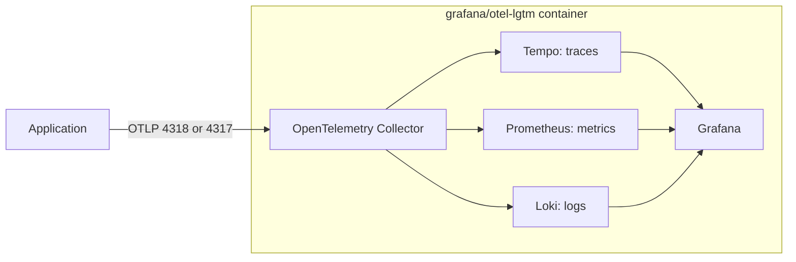

# grafana/otel-lgtm

## Overview

An application that uses OpenTelemetry needs somewhere to send its traces, metrics, and logs, and something to look at them with. Running a collector and
several storage backends by hand costs time and memory on a laptop. The `grafana/otel-lgtm` image puts a collector and the backends in one container.

Four concepts cover most of what you need:

| Concept | What it is | Where it appears here |
| --- | --- | --- |
| OTLP | The OpenTelemetry Protocol, which carries telemetry from an application to a collector or a backend. It runs over gRPC or HTTP | Port 4317 (gRPC) and port 4318 (HTTP) |
| Collector | A process that receives telemetry, batches it, and forwards each signal to a backend | One OpenTelemetry Collector inside the image |
| Signal | A kind of telemetry: traces, metrics, logs, and profiles | Tempo stores traces, Prometheus metrics, Loki logs, and a profiling backend profiles |
| Data source | A connection from Grafana to a backend, so one screen can query all of them | Grafana ships with one for each backend |



The image also bundles a backend for profiles (`grafana/pyroscope`), which the diagram leaves out. In this repository the image is the observability backend of the Compose
stack, the `api` profile of [ADR-0019](../../adr/0019-resource-profiles-and-host-support.md), and nothing else uses it. WP1.4 starts it and checks it, and WP1.11 provisions the
dashboards and adds the API's telemetry. Until then the stack accepts telemetry, and no application sends any.

## Decision rationale

The decision register in [the implementation plan](../../plans/implementation-plan.md) says: OpenTelemetry Collector, Prometheus, and Grafana everywhere, Tempo and Loki
in the `full` profile, and `grafana/otel-lgtm` for Compose only. Its stated reason is the laptop budget. [ADR-0026](../../adr/0026-api-only-compose-stack-and-catalog-realm.md) puts
the image in the Compose stack, and no ADR compares it with running the backends as separate containers.

| Criterion | What was found |
| --- | --- |
| License | The image repository is Apache-2.0 (checked 2026-10-10). The image bundles Grafana, Loki, Tempo, and `grafana/pyroscope`, which GitHub reports as AGPL-3.0, and Prometheus and the collector, which are Apache-2.0 (same check) |
| License policy | The repository neither links nor redistributes the image, and it runs it unmodified for local development. [ADR-0004](../../adr/0004-licensing-and-dependency-license-policy.md) treats such a tool as tool-only, and the `notes` field of the [inventory entry](inventory.yaml) records why |
| Maintenance | The latest release is v0.36.0, published 2026-10-09 (checked 2026-10-10). The stack pins 0.35.0, published 2026-10-02, and Dependabot proposes updates to the tag and the digest |
| Cost | The container limit is 1 GB, and the container used about 0.5 GiB at idle in one sample on 2026-10-10 ([ADR-0026](../../adr/0026-api-only-compose-stack-and-catalog-realm.md)) |
| Trade-off | The project describes the image as intended for development, demo, and testing environments, and it points to Grafana Cloud for production (checked 2026-10-10 in the [README](https://github.com/grafana/docker-otel-lgtm)). Compose mounts no volume, so removing the container removes the telemetry. The backends share one container, so they cannot be sized or restarted separately |

The bundled versions of 0.35.0 come from the [Dockerfile at that tag](https://github.com/grafana/docker-otel-lgtm/blob/v0.35.0/docker/Dockerfile) (checked 2026-10-10):
Grafana 13.2.2, Prometheus 3.15.0, Tempo 3.0.3, Loki 3.7.8, `grafana/pyroscope` 2.3.1, and OpenTelemetry Collector 0.161.0.

## Setup tutorial

**Prerequisites:** Docker with at least 4 GB of memory, `curl`, and the three ports 3000, 4317, and 4318 free on `127.0.0.1`. `./dev doctor` reports a port that
something else uses, and `GRAFANA_PORT`, `OTLP_GRPC_PORT`, and `OTLP_HTTP_PORT` in `.env` change them. On Windows, use `./dev.cmd` where this page says `./dev`.

1. Create `.env` if it does not exist, and start the stack. `./dev bootstrap` generates `GRAFANA_ADMIN_PASSWORD`, and `./dev compose up` starts all four services and waits until
   each is healthy. The [Keycloak page](keycloak.md) shows the output of `./dev compose up`.

   ```bash illustrative
   ./dev bootstrap
   ./dev compose up
   ```

2. Check that Grafana is healthy.

   ```bash illustrative
   curl -s http://localhost:3000/api/health
   ```

   Expected output includes these two lines (the answer also holds the commit hash of the build):

   ```text
   "database": "ok",
   "version": "13.2.2",
   ```

3. Check that the OTLP HTTP endpoint accepts an export. An empty export is valid, and `./dev compose check` sends the same one.

   ```bash illustrative
   curl -s -X POST -H 'Content-Type: application/json' -d '{"resourceSpans":[]}' http://localhost:4318/v1/traces
   ```

   Expected output:

   ```text
   {"partialSuccess":{}}
   ```

4. Send one span. The body is OTLP in JSON form: a resource named `docs-smoke` with one span named `hello`, which uses the example trace and span IDs of the W3C Trace Context specification. The
   first line takes the current time in seconds, and the body adds nine zeros to turn it into nanoseconds.

   ```bash illustrative
   now=$(date +%s)000000000
   curl -s -X POST -H 'Content-Type: application/json' http://localhost:4318/v1/traces -d '{"resourceSpans":[{"resource":{"attributes":[{"key":"service.name","value":{"stringValue":"docs-smoke"}}]},"scopeSpans":[{"scope":{"name":"manual"},"spans":[{"traceId":"0af7651916cd43dd8448eb211c80319c","spanId":"b7ad6b7169203331","name":"hello","kind":1,"startTimeUnixNano":"'"$now"'","endTimeUnixNano":"'"$now"'"}]}]}]}'
   ```

   Expected output is the same `{"partialSuccess":{}}`.

5. Find the span in Grafana. Open `http://localhost:3000` and sign in as `admin` with the value of `GRAFANA_ADMIN_PASSWORD` in `.env`. Open Explore, choose the Tempo data source,
   and run the TraceQL query `{ resource.service.name = "docs-smoke" }`. The result is one trace with the root span `hello`. A search can lag the export by
   several seconds (up to about 25 seconds on 2026-10-10), so wait and run it again when nothing appears. The Prometheus, Loki, and profiling data sources are next to Tempo in the same list.

6. Point an application at the image. The Grafana documentation says that the defaults of OpenTelemetry, which are protobuf over HTTP to `http://localhost:4318`, work with the image,
   so an SDK needs no other setting (checked 2026-10-10). The variables below state those defaults, in case your environment overrides them. The API will do this from WP1.11.

   ```bash illustrative
   export OTEL_EXPORTER_OTLP_ENDPOINT=http://localhost:4318
   export OTEL_EXPORTER_OTLP_PROTOCOL=http/protobuf
   ```

**Cleanup:** `./dev compose down` removes the container and its telemetry, and `./dev compose reset` also deletes the data volumes of the other services. `.env` stays.

## Further research

- [grafana/docker-otel-lgtm](https://github.com/grafana/docker-otel-lgtm): the README covers ports, environment variables, custom configuration, and dashboard provisioning, and the Dockerfile at a tag lists the bundled versions (checked 2026-10-10)
- [OTLP specification 1.11.0](https://opentelemetry.io/docs/specs/otlp/): the encoding and the gRPC and HTTP transports (checked 2026-10-10)
- [OTLP exporter configuration](https://opentelemetry.io/docs/languages/sdk-configuration/otlp-exporter/): the endpoint and protocol variables and their defaults (checked 2026-10-10)
- [OpenTelemetry .NET exporters](https://opentelemetry.io/docs/languages/dotnet/exporters/): how a .NET application sends OTLP, which the API does from WP1.11 (checked 2026-10-10)
