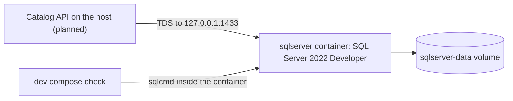

# SQL Server

## Overview

SQL Server is Microsoft's relational database engine. It keeps data in tables, answers queries written in Transact-SQL (T-SQL), keeps changes consistent
with transactions, and accepts client connections on TCP port 1433. This repository uses it as the system of record for the product catalog. The same
instance will also hold the idempotency and outbox tables ([plan section 8.4](../../plans/implementation-plan.md), WP1.8), and in the cluster (Phase 3)
Keycloak gets a database on it as well ([ADR-0026](../../adr/0026-api-only-compose-stack-and-catalog-realm.md)). In the Compose stack Keycloak uses its own
in-memory database, so SQL Server serves the API alone. The cache that sits beside it is on [the Valkey page](valkey.md).

Five concepts cover what you need to read the rest of this page:

| Concept | What it is | Where it appears here |
| --- | --- | --- |
| Instance | One running SQL Server process. It owns the system databases and every user database | The `sqlserver` service in [compose.yaml](../../../compose.yaml) |
| Database and schema | A database holds tables, and a schema groups the objects inside it | WP1.8 creates the `catalog` schema |
| Login and user | A login authenticates a person or program to the instance. A database user gives a login rights inside one database | The `sa` login today. Phase 3 replaces it with Vault-managed logins |
| Edition | The feature set and the license terms. Developer has the full Enterprise feature set and is licensed for development and test, not production | `MSSQL_PID=Developer` |
| Data volume | The folder `/var/opt/mssql` in the container, which holds the databases | The named volume `sqlserver-data` |



No application code connects to the database yet. The schema, migrations, and outbox arrive in WP1.8, and the HTTP API that uses them arrives in WP1.10. What
exists today is the running container and the check that proves it works.

## Decision rationale

The project brief names MS SQL as the data store (item 17 in [the brief traceability map](../../requirements/brief-traceability.md)), so this page does not
compare database engines. [Plan section 3](../../plans/implementation-plan.md) records two decisions about it: version 2022 with the latest cumulative
update, pinned by digest, because it is the mature release, and a later ADR on the path to 2025.
[ADR-0026](../../adr/0026-api-only-compose-stack-and-catalog-realm.md) records how the Compose stack runs it, and
[ADR-0019](../../adr/0019-resource-profiles-and-host-support.md) records which hosts can.

The open choice was how to run it:

| Option | Verdict |
| --- | --- |
| A container from the Microsoft image, pinned by digest (chosen) | One setup on every supported host, a clean reset with one command, and the same image that the Testcontainers suites use |
| An instance installed on the host | Rejected. Each machine would run a different build, and a reset would mean cleaning an installation |
| A substitute such as an in-memory fake | Rejected. [REQ-QUA-001](../../requirements/requirements.yaml) requires integration tests against a real SQL Server, and `rowversion`, which the API's `ETag` and `If-Match` handling relies on, is a SQL Server feature that [spike 1.d](../../research/spikes/1.d-testcontainers-mssql.md) verified through EF Core against the real engine |

| Criterion | What was found |
| --- | --- |
| License | Proprietary. The Developer edition is free, and Microsoft licenses it for development and test, not for production (checked 2026-10-10 on [the editions page](https://learn.microsoft.com/en-us/sql/sql-server/editions-and-components-of-sql-server-2022?view=sql-server-ver16)). The project links no SQL Server code and does not redistribute the image, which is the tool-only rule of [ADR-0004](../../adr/0004-licensing-and-dependency-license-policy.md) |
| Maintenance | SQL Server 2022 follows Microsoft's Fixed Lifecycle Policy. Mainstream support ends in January 2028 and extended support in January 2033 (checked 2026-10-10 on [the lifecycle page](https://learn.microsoft.com/en-us/lifecycle/products/sql-server-2022)) |
| Cost | Nothing to license for this use. The image is about 2.3 GB to pull (spike 1.d) |
| Platform | Microsoft supports SQL Server container images only on Linux hosts with Intel or AMD x86-64 CPUs, and it does not test or support Rosetta 2, Prism, or QEMU (checked 2026-10-10 on [the container deployment page](https://learn.microsoft.com/en-us/sql/linux/containers/deploy?view=sql-server-ver16)) |

Four trade-offs follow from the choice:

- **License acceptance.** The image refuses to start without `ACCEPT_EULA`, and the stack sets it to `Y`, which accepts Microsoft's terms on your behalf. `dev compose up` says so before it starts the container.
- **Host support.** Apple Silicon and Windows on Arm are best effort for the API-only path. Use the Dev Container, Codespaces, or an x86-64 host when the container does not run.
- **Footprint.** SQL Server is the heaviest service in the stack. It read about 1.14 GiB at idle in one sample (docker stats, 2026-10-10, [ADR-0026](../../adr/0026-api-only-compose-stack-and-catalog-realm.md)), out of about 2.7 GiB for the whole stack.
- **Static credentials.** The `sa` login with a password from `.env` is for Compose only, and Phase 3 replaces it.

## Setup tutorial

**Prerequisites:** the prerequisites in the front matter, and about 3 GB of free disk space for the stack's images. On Windows, `./dev` in PowerShell and `.\dev` in cmd.exe both run the `dev.cmd` shim.

**Pinned version:** `mcr.microsoft.com/mssql/server:2022-latest` at digest `sha256:4402d880…` (the full digest is in [compose.yaml](../../../compose.yaml)). On 2026-10-10 that image
reported server 16.0.4295.3 (RTM-CU27), Developer edition, x64.

1. Create `.env`. The command also installs the pinned script tools, and it fills every empty secret in [.env.example](../../../.env.example) with a random 32-character value of letters and digits, which meets
   [SQL Server's password policy](https://learn.microsoft.com/en-us/sql/relational-databases/security/password-policy?view=sql-server-ver16).

   ```bash illustrative
   ./dev bootstrap
   ```

   Expected output includes this line, where the number is the count of generated secrets. If `.env` already exists, the line says `.env is already complete, and nothing was changed.`

   ```text
   [ok  ] .env created with 10 generated secret(s). It stays on this machine and Git ignores it.
   ```

2. Start the stack. SQL Server starts beside Valkey, Keycloak, and Grafana. The command waits up to 300 seconds for every health check, and the first run pulls about 3 GB of images.

   ```bash illustrative
   ./dev compose up
   ```

   Expected output includes these lines, with Docker's progress between them:

   ```text
   [info] SQL Server runs as the Developer edition, and starting it accepts Microsoft's license terms for development and test use.
   [ok  ] The stack is healthy. Everything listens on 127.0.0.1 only:
          SQL Server  localhost,1433  (login sa, password in .env)
   ```

3. Define a helper that runs `sqlcmd` inside the container. The password stays in the container's environment, so it never appears on your command line.
   The `-C` option trusts the server certificate ([sqlcmd reference](https://learn.microsoft.com/en-us/sql/tools/sqlcmd/sqlcmd-utility?view=sql-server-ver16)), which the `sqlcmd` in `mssql-tools18` needs
   because it is secure by default ([container deployment page](https://learn.microsoft.com/en-us/sql/linux/containers/deploy?view=sql-server-ver16)) (both checked 2026-10-10).

   ```bash illustrative
   mssql() { docker compose exec -T sqlserver sh -c '/opt/mssql-tools18/bin/sqlcmd -C -S localhost -U sa -P "$MSSQL_SA_PASSWORD" "$@"' sh "$@"; }
   ```

4. Ask the server who it is.

   ```bash illustrative
   mssql -Q "SELECT @@VERSION"
   ```

   Expected output is one row that begins with the product, the update level, and the build:

   ```text
   Microsoft SQL Server 2022 (RTM-CU27) (KB5104824) - 16.0.4295.3 (X64)
       Aug 26 2026 11:02:22
       Copyright (C) 2022 Microsoft Corporation
       Developer Edition (64-bit) on Linux (Ubuntu 22.04.5 LTS) <X64>
   ```

5. Create a scratch database, and a table with a `rowversion` column. SQL Server changes that column's value on every update, and the API will expose it as an `ETag` (plan section 8.4).

   ```bash illustrative
   mssql -Q "CREATE DATABASE scratch"
   mssql -d scratch -Q "CREATE TABLE dbo.Item (Id int PRIMARY KEY, Quantity int NOT NULL, Version rowversion); INSERT dbo.Item (Id, Quantity) VALUES (1, 5); SELECT Id, Quantity, Version FROM dbo.Item; UPDATE dbo.Item SET Quantity = 6 WHERE Id = 1; SELECT Id, Quantity, Version FROM dbo.Item"
   ```

   Expected output is two result sets. The row is the same, and `Version` has a new value after the update. Your values differ from these:

   ```text
   Id          Quantity    Version
   ----------- ----------- ------------------
             1           5 0x00000000000007D1

   Id          Quantity    Version
   ----------- ----------- ------------------
             1           6 0x00000000000007D2
   ```

**Cleanup:** drop the scratch database, then stop the stack.

```bash illustrative
mssql -Q "DROP DATABASE scratch"
./dev compose down
```

`./dev compose down` keeps the `sqlserver-data` volume, so the data survives the next start. Use `./dev compose reset` instead to delete the stack and its data volumes.

## How this project uses it

The service is defined in [compose.yaml](../../../compose.yaml), and these files around it make its choices testable:

| File | What it holds |
| --- | --- |
| [compose.yaml](../../../compose.yaml) | The `sqlserver` service |
| [.env.example](../../../.env.example) | The `SQL_PORT` default, and the empty `MSSQL_SA_PASSWORD` that `dev bootstrap` fills |
| [Dev.Compose.psm1](../../../scripts/modules/Dev.Compose.psm1) | `Test-DevSqlServer`, the check behind `dev compose check` |
| [DevEnvironment.Tests.ps1](../../../scripts/tests/DevEnvironment.Tests.ps1) | Pester tests over compose.yaml and .env.example: pinned digests, loopback ports, memory limits, and no credential in the file |

What the service sets, and why:

| Setting | Value | Why |
| --- | --- | --- |
| `image` | `mcr.microsoft.com/mssql/server:2022-latest@sha256:4402d880…` | The tag lets Dependabot propose an update, and the digest makes the pull exact |
| `ACCEPT_EULA`, `MSSQL_PID` | `Y`, `Developer` | The image requires the first, and the second selects the free edition for non-production use (checked 2026-10-10 on [the environment variable reference](https://learn.microsoft.com/en-us/sql/linux/configure/environment-variables?view=sql-server-ver16)) |
| `MSSQL_SA_PASSWORD` | From `.env` | No credential is in the repository, and Compose refuses to start without the value |
| `MSSQL_MEMORY_LIMIT_MB` | `2048` | Caps what SQL Server uses, which keeps the idle footprint near 1 GB (spike 1.d). The Microsoft default is 80% of physical memory (checked 2026-10-10) |
| `mem_limit` | `3g` | A hard cap for the container |
| `ports` | `127.0.0.1:${SQL_PORT:-1433}:1433` | Loopback only, on a port that needs no administrator rights |
| `volumes` | `sqlserver-data:/var/opt/mssql` | A named volume, so `down` keeps the data and `reset` deletes it |
| `healthcheck` | `sqlcmd` runs `SELECT 1` every 10 seconds, with a 20-second start period and 18 retries | `up --wait` returns only when SQL Server answers a query |
| `security_opt` | `no-new-privileges:true` | The container cannot gain privileges |

**Data flow and trust boundary.** Today only people and `dev compose check` connect, from the host through `127.0.0.1` or from inside the container. The API, which runs on the
host, will connect to `localhost,1433` with the stack's static credentials (planned, WP1.8 and WP1.10). Nothing outside the host can reach the port. The integration tests will not use this
container. They start their own throwaway SQL Server through Testcontainers (plan section 10, WP1.8).

**Ownership.** WP1.4 delivered the stack and the check. WP1.8 delivers the schema, the migrations, and the outbox, and WP3.4 delivers the data tier in the cluster.

**Failure modes.**

- SQL Server does not become healthy, so `up` waits for it, fails after its 300-second timeout, and names the container.
- `.env` and the data volume disagree after a password change, because the database keeps the `sa` password it was first created with.
- Docker has too little memory, and `dev doctor` warns below 4 GB and fails below 3 GB ([ADR-0019](../../adr/0019-resource-profiles-and-host-support.md)).
- The host is Arm, where the container is not supported, and `dev doctor` warns about it.

## Validation and troubleshooting

`./dev compose check` proves the stack in one run. For SQL Server it proves that the `sa` login works inside the container and that `127.0.0.1` accepts connections on the published port.

```bash illustrative
./dev compose check
```

Expected output for the two lines that concern SQL Server:

```text
[ok  ] Containers: sqlserver, valkey, keycloak, otel-lgtm are running and healthy.
[ok  ] SQL Server: Login works and 127.0.0.1:1433 accepts connections (16.0.4295.3 Developer Edition (64-bit)).
```

Lab 1 runs the same check from a script, and the [Dev Container workflow](../../../.github/workflows/devcontainer.yml) runs that lab in a fresh container:

[!code-powershell[Run the stack check from the lab script](../../../docs/labs/scripts/lab-01.ps1#check)]

For more detail, list the containers and read the SQL Server log:

```bash illustrative
./dev compose ps
./dev compose logs sqlserver
```

Measure memory from the container, because SQL Server's own memory views overstate it inside a container (spike 1.d). `MSSQL_MEMORY_LIMIT_MB` does not change
`max server memory (MB)` in `sys.configurations`, which stays at 2147483647 (checked 2026-10-10).

```bash illustrative
docker stats --no-stream catalog-sqlserver-1
```

| Symptom | Cause | Fix |
| --- | --- | --- |
| `dev compose up` says to run `dev bootstrap`, or Compose reports a missing `MSSQL_SA_PASSWORD` | `.env` is missing or the value is empty, and compose.yaml requires it | Run `./dev bootstrap` |
| `SQL Server: The sa login does not work inside the container.` | `.env` changed after the first start, and the data volume still holds the old password | Run `./dev compose reset`, which deletes the data, then `./dev compose up` |
| `SQL Server: Nothing accepts connections on 127.0.0.1:1433.` | The published port differs from `SQL_PORT` in `.env`, or the container is not running | Check `SQL_PORT`, then run `./dev compose up` |
| The container exits at start, and its log reports a password error | A password that you set in `.env` breaks the policy: at least 8 characters from three of four sets, which are uppercase letters, lowercase letters, digits, and symbols (checked 2026-10-10 on [the quickstart](https://learn.microsoft.com/en-us/sql/linux/install-upgrade/quickstart-install-docker?view=sql-server-ver16)) | Delete the `MSSQL_SA_PASSWORD` line, run `./dev bootstrap`, then `./dev compose reset` |
| `address already in use` for port 1433 | A local SQL Server or another container holds the port | Set `SQL_PORT` in `.env` to a free high port, then run `./dev compose up`. `./dev doctor` lists the ports that are taken |
| `sqlcmd` or another client fails with a certificate error | The client encrypts by default and does not trust the container's certificate | Pass `-C` to `sqlcmd`, or use your client's trust-server-certificate setting. Do this for the local stack only |
| SQL Server is slow, or the stack does not become healthy | Docker has less memory than the stack needs | Give Docker at least 4 GB, and run `./dev doctor` |
| The container does not start on Apple Silicon or Windows on Arm | Microsoft does not support SQL Server containers under emulation | Use the Dev Container, Codespaces, or an x86-64 host |

## Security and operations

- **Credentials.** The `sa` login is the instance's administrator. Its password is random, local to the machine, and kept in `.env`, which Git ignores. The health check and `dev compose check` read it inside the container, so it does not appear on a host command line.
  Anyone who can run `docker inspect` on the container can read it, which is acceptable for a disposable local stack and is the reason the plan replaces it. In Phase 3 Vault delivers
  short-lived logins, and `sa` is disabled after Vault's own administrator login exists (plan section 8.8). Microsoft gives the same advice: create another `sysadmin` login, then disable `sa`
  (checked 2026-10-10 on [the quickstart](https://learn.microsoft.com/en-us/sql/linux/install-upgrade/quickstart-install-docker?view=sql-server-ver16)).
- **Network.** Compose publishes the port on `127.0.0.1` only, and a test fails on any mapping that is not loopback or is below 1024. In the cluster the data tier is private, and
  [the threat model](../../security/threat-model.md#tb6-data-tier) lists the controls and the work packages that deliver them.
- **Container hardening.** The container has `no-new-privileges`, a memory limit, no privileged mode, and no Docker socket. Microsoft's SQL Server 2019 and later containers start as a non-root user (checked 2026-10-10 on [the container configuration page](https://learn.microsoft.com/en-us/sql/linux/containers/configure?view=sql-server-ver16)).
- **Data.** The data is disposable. `./dev compose reset` deletes the `sqlserver-data` volume, and Microsoft documents that deleting a data volume deletes its data permanently (checked 2026-10-10 on
  [the container configuration page](https://learn.microsoft.com/en-us/sql/linux/containers/configure?view=sql-server-ver16)). Keep nothing there that you cannot rebuild.
- **License.** The Developer edition is for development and test. Do not reuse this container for production, and read Microsoft's terms before you use the image for anything else.
- **Updates.** Dependabot proposes updates to the tag and the digest together. An update changes compose.yaml, the `sql-server` entry in [the tool inventory](inventory.yaml), and this page, and the
  [Documentation.Auditor](documentation-auditor.md) compares the pin with the inventory. The move from 2022 to 2025 needs its own ADR (plan section 3).
- **Blast radius.** A compromised container exposes the local, disposable data and the `sa` login. Its environment holds only its own password, and no other service in the stack shares a credential with it.

## Lab

[Lab 1: Quick start: the API-only stack](../../labs/quick-start-api-stack.md) starts the stack, runs `dev compose check`, reads a Keycloak token, and cleans up. For SQL Server, it shows the `sa` login answering in a healthy container, and it breaks
the stack on purpose: a changed `sa` password in `.env` leaves SQL Server unhealthy, because the data volume keeps the first password. The API calls that use the database arrive in WP1.10.

## Further research

- [Deploy and connect to SQL Server Linux containers](https://learn.microsoft.com/en-us/sql/linux/containers/deploy?view=sql-server-ver16): the supported hosts, how to connect from inside and outside the container, and how to read the version (checked 2026-10-10)
- [Configure environment variables for SQL Server on Linux](https://learn.microsoft.com/en-us/sql/linux/configure/environment-variables?view=sql-server-ver16): every `MSSQL_` variable, the edition values, and the password rules (checked 2026-10-10)
- [Editions and supported features of SQL Server 2022](https://learn.microsoft.com/en-us/sql/sql-server/editions-and-components-of-sql-server-2022?view=sql-server-ver16): what the Developer edition includes and how it is licensed (checked 2026-10-10)
- [Configure and customize SQL Server Docker containers](https://learn.microsoft.com/en-us/sql/linux/containers/configure?view=sql-server-ver16): data volumes, backups, and running as non-root (checked 2026-10-10)
- [Troubleshooting SQL Server Docker containers](https://learn.microsoft.com/en-us/sql/linux/containers/troubleshoot?view=sql-server-ver16): startup errors, port conflicts, and the container log (checked 2026-10-10)
- [SQL Server 2022 lifecycle](https://learn.microsoft.com/en-us/lifecycle/products/sql-server-2022): the support dates for the version that this page covers (checked 2026-10-10)
