# Stryker.NET

## Overview

Code coverage says which lines a test ran. It does not say whether the test would notice a wrong line: a test that calls `Money.Add` and asserts nothing covers the method completely. Mutation testing
measures the second thing. The tool makes a small change to the code, runs the tests, and checks whether one of them fails. Stryker.NET does this for C#. In this repository it measures how well
the tests of `Catalog.Domain` protect the domain model ([ADR-0029](../../adr/0029-domain-model-and-mutation-baseline.md)).

Five concepts cover most of what you need:

| Concept | What it is | Where it appears here |
| --- | --- | --- |
| Mutant | A copy of the code with one change, such as `+` turned into `-`, a string turned into `""`, or a statement removed | 266 mutants of `Catalog.Domain` in the baseline |
| Killed | A mutant that makes at least one test fail. This is the good outcome | 211 in the baseline |
| Survived | A mutant that no test noticed. Either a test is missing or weak, or the mutant is equivalent | 12 in the baseline |
| Equivalent mutant | A mutant that changes no observable behavior, so no test can kill it. List it and move on | 7 of the 12 survivors |
| Mutation score | Killed divided by killed plus survived plus no coverage (mutants that no test reaches), as a percent | 94.62 percent (checked 2026-10-12) |

Stryker skips some mutants and leaves them out of the score: 41 were ignored by its block-already-covered filter, and 2 did not compile. The remaining 223 were tested. No test failed to reach a mutant in the
baseline, so the score there equals killed divided by killed plus survived. A mutant that no test reaches counts against the score, which is how the planted defect in step 5 lowers it.

```mermaid
flowchart LR
  accTitle: How the mutation service runs Stryker.NET
  accDescr: The repository is mounted read-only into a container. The script run-mutation.sh copies it to a scratch directory, restores the tools and packages, and runs Stryker there. Stryker mutates the copy of Catalog.Domain and runs the domain tests once for each mutant. The reports are written to TestResults/mutation on the host.
  REPO["Repository mounted read-only at /repo"] --> COPY["run-mutation.sh copies it to /work"]
  COPY --> RESTORE["dotnet tool restore and dotnet restore, locked"]
  RESTORE --> MUTATE["Stryker mutates the copy of Catalog.Domain"]
  MUTATE --> TESTS["Catalog.Domain.Tests runs for each mutant"]
  TESTS --> REPORTS["Reports in TestResults/mutation"]
```



The score is reported and is not a gate. Stryker's Microsoft.Testing.Platform (MTP) runner is a preview, and Stryker itself prints a warning that results should be verified (checked 2026-10-12).
[ADR-0018](../../adr/0018-test-stack-and-quality-gates.md), requirement `REQ-QUA-006`, and [plan section 10.4](../../plans/implementation-plan.md) set the target at 70 percent for the domain and make it a
blocking gate once the runner is generally available. A nightly job that publishes the report is a planned follow-up and is not part of WP1.6.

## Decision rationale

The plan names Stryker.NET as the mutation tool, and the repository did not compare it with another one. [ADR-0018](../../adr/0018-test-stack-and-quality-gates.md) records the stack, and
[ADR-0029](../../adr/0029-domain-model-and-mutation-baseline.md) records the first baseline. The tradeoffs are these:

- **License:** Apache-2.0 (checked 2026-10-12 on the [package license](https://www.nuget.org/packages/dotnet-stryker/5.0.0/license)). It is on the allow-list of
  [ADR-0004](../../adr/0004-licensing-and-dependency-license-policy.md), and the repository runs it as a tool and never links it.
- **Lifecycle is trial:** the MTP runner is a preview, so the lifecycle in the inventory is `trial`. Spike 1.c ran it successfully in a Linux container
  ([spike 1.c](../../research/spikes/1.c-mtp-coverage-stryker.md)).
- **It does not start on every Windows host:** where Smart App Control is enforced, Stryker fails at startup because 45 of the 104 DLLs in the tool package are not signed (spike 1.c, checked 2026-10-06).
  The `mutation` service therefore runs it in Linux, in the .NET SDK image, pinned by digest.
- **Static state hides some mutants:** the preview runner initializes static state once for each test process, so a mutant inside a static initializer never takes effect. Five of the 12 survivors
  are of this kind, all in `Currency`. Applying one by hand (`new("USD", 2)` changed to `new("", 2)`) made many tests fail, so the tests do kill it, and the score is slightly pessimistic.

## Setup tutorial

**Prerequisites:** Docker, and network access. Stryker 5.0.0 is pinned in [.config/dotnet-tools.json](../../../.config/dotnet-tools.json) with `rollForward` off, and the image is pinned by digest in
[tools/lint/compose.yaml](../../../tools/lint/compose.yaml), so there is nothing else to install. Four files make up the setup:

| File | Role |
| --- | --- |
| [tests/Catalog.Domain.Tests/stryker-config.json](../../../tests/Catalog.Domain.Tests/stryker-config.json) | Names the project to mutate, the runner, the reporters, and the thresholds |
| [tools/lint/run-mutation.sh](../../../tools/lint/run-mutation.sh) | Copies the repository, restores, and runs Stryker |
| [tools/lint/compose.yaml](../../../tools/lint/compose.yaml) | The `mutation` service: the image, the mounts, and the environment |
| [.config/dotnet-tools.json](../../../.config/dotnet-tools.json) | Pins `dotnet-stryker` 5.0.0, with the command `dotnet dotnet-stryker` |

The configuration mutates `Catalog.Domain.csproj` with the `mtp` runner and writes the clear-text, JSON, and Markdown reports. The thresholds `high` 85 and `low` 70 only color the report, and `break` 0
means the run never fails because of the score:

```json
{
  "stryker-config": {
    "project": "Catalog.Domain.csproj",
    "test-runner": "mtp",
    "reporters": ["cleartext", "json", "markdown"],
    "thresholds": { "high": 85, "low": 70, "break": 0 }
  }
}
```

1. Run the mutation service from the repository root. Add `-T` when you pipe the output. With the image cached, the run takes about 45 seconds, and Stryker itself takes about 19 of them (checked
   2026-10-12). The first run also pulls the image and restores packages.

   ```bash illustrative
   docker compose -f tools/lint/compose.yaml run --rm mutation
   ```

   Expected output ends with the lines below. Stryker prints its clear-text table and its preview warning before the last two lines, and the exit code is 0 whatever the score is.

   ```text
   == Running Stryker.NET on Catalog.Domain
   == Reports
   /reports/reports/mutation-report.json
   /reports/reports/mutation-report.md
   ```

2. Read the score. The reports are in `TestResults/mutation/reports/`, which Git ignores. The Markdown report has one row for each source file and ends with the total. The baseline of 2026-10-12 (172 tests) was
   266 mutants created, 41 ignored, 2 compile errors, 223 tested, 211 killed, 12 survived, and a score of 94.62 percent (checked 2026-10-12). The first run, before five tests were added, scored 92.38 percent with
   206 killed and 17 survived.

3. List the survivors from the JSON report. Use the JSON for numbers: the `# survived` column of the console table counts the skipped mutants too, so it can show more survivors than the JSON, while the
   score is the same in every output (spike 1.c). This command needs PowerShell 7 (see [PowerShell](powershell.md)).

   ```powershell illustrative
   $report = Get-Content TestResults/mutation/reports/mutation-report.json -Raw | ConvertFrom-Json
   foreach ($file in $report.files.PSObject.Properties) { foreach ($m in $file.Value.mutants | Where-Object status -eq 'Survived') { '{0}:{1} {2} -> {3}' -f $file.Name, $m.location.start.line, $m.mutatorName, $m.replacement } }
   ```

   Expected output is one line for each survivor, with the path inside the scratch copy at `/work`. The first lines of the baseline look like this:

   ```text
   /work/src/Catalog.Domain/Categories/Category.cs:41 Statement mutation -> ;
   /work/src/Catalog.Domain/Categories/CategoryId.cs:26 String mutation -> ""
   /work/src/Catalog.Domain/Common/Uuid7.cs:23 Bitwise mutation -> bytes[6] >>> 4
   ```

4. Triage each survivor, and ask one question: would a correct program behave differently? If yes, write the test that fails against the mutant. Five survivors of the first run were killed this way: the sign bit of a
   negative zero amount (`decimal.IsNegative`), a null identifier when a category is discontinued, and two null guards of the aggregate base class. If no, the mutant is equivalent. Do not add a Stryker disable
   comment to production code without a reason. The 12 survivors of the baseline were triaged like this:

   | Survivors | Verdict | Why |
   | --- | --- | --- |
   | `ToString("D")` changed to `ToString("")` on a `Guid` | Equivalent | Both are the same format |
   | `>>` changed to `>>>` on a non-negative byte | Equivalent | The two shifts agree for a non-negative value |
   | A null guard that the base-class constructor repeats | Equivalent | Same exception and same parameter name |
   | Two mutations of `value + 0.00m` | Equivalent | They add a zero of the other sign or subtract zero |
   | An initial `previousWasHyphen = true` | Equivalent | An earlier check on the first character makes it unreachable |
   | Five mutations in the static initializer of `Currency` | Artifact of the preview runner | See the decision rationale |

   The record of the baseline, with the survivors and their triage, is [the domain mutation baseline](../../testing/evidence/2026-10-12-domain-mutation-baseline.md).

5. Prove that the score can fall. On 2026-10-12, with the two Product test files removed (150 tests left), the score fell from 94.62 to 81.61 percent: 182 killed, 29 survived, and 12 with no test coverage.
   Of those 41 weak mutants, 29 were in `Product.cs`, and the other 12 were the baseline survivors elsewhere. The report listed them, and the files were restored (checked 2026-10-12). Repeat it when you doubt
   the score: delete a test file, run step 1, and compare the survivors with the baseline.

**Cleanup:** delete the `reports` folder under `TestResults/mutation`. `--rm` removes the container, and the scratch directory `/work` exists only inside it. The repository mount is read-only, so Stryker
never changes a source file of the repository.

## Security and operations

- **Privilege:** the container runs as root, over a read-only repository mount. It writes only `/work` inside the container and `/reports`, which is `TestResults/mutation` on the host.
- **Network:** the container can reach nuget.org to restore packages. The restore runs in locked mode (`CI=true`), and the NuGet source mapping and package signature rules of
  [ADR-0020](../../adr/0020-dependency-intake-controls.md) apply.
- **Updates:** the tool is pinned with `rollForward` off, so a new version arrives through a reviewed change to the manifest. Dependabot watches `tools/lint` for the image digest.
- **Blast radius:** if the service fails or reports a wrong score, the report is stale or misleading. Nothing merges or deploys because of it, since the score is not a gate.
- **Restore first:** Stryker logs a warning that the simulated build of the test project failed when `dotnet restore` has not run. The script restores first.

## Further research

- [Stryker.NET introduction](https://stryker-mutator.io/docs/stryker-net/introduction/): what mutation testing is and how the tool reports it (checked 2026-10-12)
- [Stryker.NET repository](https://github.com/stryker-mutator/stryker-net): releases, the license, and the configuration schema (checked 2026-10-12)
- [dotnet-stryker on NuGet](https://www.nuget.org/packages/dotnet-stryker): the package that the tool manifest pins (checked 2026-10-12)
- [Spike 1.c](../../research/spikes/1.c-mtp-coverage-stryker.md): the first run of the MTP runner, and the signed-DLL finding (checked 2026-10-06)
- [Testing strategy](../../testing/strategy.md): where mutation testing sits next to coverage and the other suites
