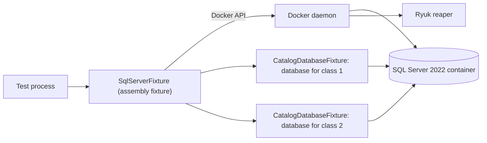

# Testcontainers for .NET

## Overview

Testcontainers for .NET starts Docker containers from test code, waits until they are ready, and removes them when the tests end. This repository uses it to run the persistence tests against a real SQL Server 2022, because `rowversion`, the filtered unique index, and the row locks of the outbox are behavior of the engine that a fake cannot show (REQ-QUA-001).

Five concepts cover what you need to read the rest of this page:

| Concept | What it is | Where it appears here |
| --- | --- | --- |
| Container builder | Code that describes an image, a password, and a wait strategy, and builds a container object | `MsSqlBuilder` in `SqlServerFixture` |
| Assembly fixture | An xUnit v3 object that starts once for the whole test assembly | `SqlServerFixture`, which starts one container |
| Class fixture | An object that starts once for one test class and can take an assembly fixture in its constructor | `CatalogDatabaseFixture`, which creates a database for the class |
| Resource reaper (Ryuk) | A helper container that removes the containers of a test run when the process ends, even after a crash | Pinned by digest in the fixture |
| Docker endpoint | The place where the library finds the Docker daemon: a named pipe on Windows, a Unix socket on Linux | The `linux-tests` service mounts the socket |



## Decision rationale

[ADR-0018](../../adr/0018-test-stack-and-quality-gates.md) chose Testcontainers, [spike 1.d](../../research/spikes/1.d-testcontainers-mssql.md) proved it on Windows, and [ADR-0034](../../adr/0034-integration-test-database-strategy-and-linux-run.md) records how the suites use it. The alternatives:

| Option | Verdict |
| --- | --- |
| Testcontainers (chosen) | A real engine, started from code, with a reaper that cleans up, and the same suites on every host that runs Docker |
| An in-memory fake or the EF Core in-memory provider | Rejected. It has no `rowversion`, no unique index with a filter, and no row locks, so it passes tests that SQL Server would fail |
| A shared SQL Server that the developer starts by hand | Rejected. The tests would depend on state that nobody controls, and two runs would disturb each other |

| Criterion | What was found |
| --- | --- |
| License | MIT (checked 2026-11-02 on [NuGet](https://www.nuget.org/packages/Testcontainers.MsSql/4.15.0)) |
| Maintenance | A release about every month. Version 4.16.0 exists (checked 2026-11-01), and the repository keeps 4.15.0, which spike 1.d ran, until Dependabot proposes the update |
| Cost | About six seconds to start the container, and about 1 GB of memory (spike 1.d). SQL Server images run on x86-64 hosts only (ADR-0019) |

Four trade-offs follow from the choice:

- **The builder accepts the license for you.** `MsSqlBuilder` sets `ACCEPT_EULA=Y`, which accepts Microsoft's terms for the Developer edition on your behalf. Those terms allow development and test use.
- **The default password is a constant.** The fixture always sets a generated one.
- **The reaper needs the Docker socket.** Pinning its image and turning the privileged flag off keep it small, and the socket is still a trust boundary (see the next sections).
- **Docker must be there.** A suite that skips itself when Docker is missing would be a gate that passes without its tests, so the suites fail instead.

## Setup tutorial

**Prerequisites:** the prerequisites in the front matter. The commands run from the repository root.

1. Run the persistence suites on your host. The first run pulls the SQL Server image, which is about 2.3 GB.

   ```bash illustrative
   dotnet test --project tests/Catalog.Infrastructure.Tests/Catalog.Infrastructure.Tests.csproj --configuration Release
   ```

   Expected output ends with a summary that reports no failure:

   ```text
   Test run summary: Passed!
     failed: 0
     skipped: 0
   ```

2. Run the whole suite in the Linux SDK image with coverage. The service mounts the Docker socket, so run it on your own machine only.

   ```bash illustrative
   docker compose -f tools/lint/compose.yaml run --rm linux-tests
   ```

   The reports are in `TestResults/linux`.

3. Look for leftovers. The reaper removes the containers a few seconds after the run, so the list is empty.

   ```bash illustrative
   docker ps --filter "ancestor=testcontainers/ryuk" --format "{{.Names}}"
   ```

**Cleanup:** nothing, because the reaper removes the containers. `docker image rm` frees the disk space of the images.

## How this project uses it

- **The container.** `tests/Catalog.Infrastructure.Tests/Support/SqlServerFixture.cs` starts one container for the assembly. The image is the digest that [compose.yaml](../../../compose.yaml) pins, which `ComposeImage` reads, so the local stack and the tests run the same build.
- **The databases.** `CatalogDatabaseFixture` creates a database for each test class, applies the migrations that ship, and drops it at the end. A class that needs an empty database calls `ResetAsync`.
- **The reaper.** The fixture pins `testcontainers/ryuk:0.14.0` by digest and turns the privileged flag off.
- **The Linux run.** The service `linux-tests` of [tools/lint/compose.yaml](../../../tools/lint/compose.yaml) mounts the Docker socket and sets `TESTCONTAINERS_HOST_OVERRIDE` to `host.docker.internal`, so the test container can reach the ports that the sibling containers publish on the host.
- **Failure modes.** No Docker daemon fails the fixture at startup, so every test of the assembly fails with one message. A host that cannot run the image (Apple Silicon, ADR-0019) uses a Codespace or an x86-64 host.

## Validation and troubleshooting

The first proof that the container works is the schema test, which runs against the migrated database. `MigrationTests` creates its own databases and logins on the same container.

| Symptom | Cause | Fix |
| --- | --- | --- |
| Every test fails with a message about the Docker endpoint | The daemon is not running, or the socket is not mounted | Start Docker Desktop, or run the Linux service through the compose command above |
| `NotSupportedException: Globalization Invariant Mode is not supported` | A test project turns the invariant globalization mode on, and SqlClient cannot run in it | Set `InvariantGlobalization` to `false` in the project, and set the invariant culture in code, as `Support/InvariantCulture.cs` does |
| The container starts but the connection is refused in the Linux service | The service cannot reach the published port of a sibling container | Check `TESTCONTAINERS_HOST_OVERRIDE` and the `extra_hosts` entry of the service |
| The fixture reports that `compose.yaml` has no pinned SQL Server image | The image line lost its digest | Restore `tag@sha256:...` in the compose file. Dependabot updates both parts |

## Security and operations

- **The Docker socket.** The reaper mounts the socket of the daemon, and so does the `linux-tests` service. A process that can use the socket controls the daemon, which is root-equivalent on a Linux host. [ADR-0034](../../adr/0034-integration-test-database-strategy-and-linux-run.md) limits the exception to one service on a developer machine, and [the threat model](../../security/threat-model.md) names it. A CI job never mounts the socket.
- **Credentials.** The SQL Server password is random for each run and lives for the life of the container. The logins that a test creates have random passwords too, and no test prints one.
- **Images.** The SQL Server image and the reaper are pinned by digest, and Dependabot proposes updates to the compose file. The fixture does not pull a floating tag.
- **Blast radius.** A compromised test dependency can use the socket during a run. The tests run on a developer machine with synthetic data, and the hosted runner is ephemeral.

## Lab

None yet. WP1.13 writes the labs of Phase 1.

## Further research

- [Testcontainers for .NET](https://dotnet.testcontainers.org/): the documentation of the builders, the modules, and the configuration (checked 2026-11-02)
- [Custom configuration](https://dotnet.testcontainers.org/custom_configuration/): the reaper image, the privileged flag, and the host override (checked 2026-11-02)
- [Spike 1.d](../../research/spikes/1.d-testcontainers-mssql.md): the measurements of the first run, on Windows
