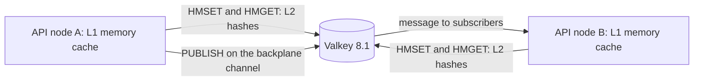

# Valkey

## Overview

Valkey is an in-memory data store that speaks the Redis protocol. It keeps keys and their values in RAM, answers commands over TCP port 6379, and delivers messages between clients through channels.
The project was forked from Redis right before Redis moved to its source-available licenses (checked 2026-10-10 on [the repository README](https://github.com/valkey-io/valkey)).

This repository uses it for two jobs under FusionCache, behind the `ICatalogCache` port ([plan section 8.5](../../plans/implementation-plan.md), `REQ-CACHE-001`):

- **The shared second level (L2).** Each API node keeps an in-memory first level (L1). Valkey holds the entries that every node can reuse, so a restarted or new node starts warm.
- **The backplane.** When one node changes data, it publishes a message on a channel, and the other nodes drop their L1 copy. Without it, a node keeps serving stale data until its L1 entry expires.

Five concepts cover what you need to read the rest of this page:

| Concept | What it is | Where it appears here |
| --- | --- | --- |
| Key and hash | Valkey maps a key to a typed value. FusionCache's `IDistributedCache` stores each entry as a hash, under a key that starts with `v2:` | Keys such as `v2:catalog:dev:<key>` |
| Eviction | A `maxmemory` limit and a policy that decides what to remove at the limit. With `allkeys-lru`, Valkey removes the least recently used keys, so a cache entry can disappear at any time and the database stays the source of truth | `--maxmemory 128mb --maxmemory-policy allkeys-lru` |
| Channel | A publisher sends a message to a named channel, and every current subscriber receives it. Delivery is at most once, and nothing is stored, so a message with no subscriber is lost (checked 2026-10-10 on [the Pub/Sub page](https://valkey.io/topics/pubsub/)) | The backplane channel `<prefix>.Backplane:v2` |
| ACL | A user with a password, a list of allowed commands, key patterns (`~`), and channel patterns (`&`). Rules apply from left to right (checked 2026-10-10 on [the ACL page](https://valkey.io/topics/acl/)) | The ACL file that Compose builds |
| Persistence | Snapshots (RDB) and the append-only file (AOF) write data to disk, and you can turn both off for a cache (checked 2026-10-10 on [the persistence page](https://valkey.io/topics/persistence/)) | The stack turns both off, so a restart empties the cache |



No application code uses Valkey yet. FusionCache, the key scheme, the tags, and the circuit breakers arrive in WP1.9. What exists today is the container, its access control list,
and the check that proves the list works. [Spike 1.b](../../research/spikes/1.b-fusioncache-valkey.md) proved that the combination behaves correctly. The database that sits beside it is on [the SQL Server page](sql-server.md).

## Decision rationale

[Plan section 3](../../plans/implementation-plan.md) records the distributed cache as Valkey on its long-term-support line, with the Redis protocol, and marks it as a user choice. The repository
records no comparison with Redis or another store, so this page does not make one. What it records is why the rest of the design works with Valkey:

- [ADR-0016](../../adr/0016-cache-implementation-fusioncache.md) compares five ways to build the cache, and it chose FusionCache with a Valkey L2 and backplane because Microsoft's HybridCache alone has no
  cross-node L1 invalidation in .NET 10 (checked 2026-10-04 in the ADR). The ADR is still proposed, and WP1.9 accepts it.
- FusionCache does not certify Valkey. Spike 1.b ran the same two-host tests against Valkey 8.1.10 and 9.1.2 and got identical results, so either line works as the L2 and the backplane.
- [ADR-0026](../../adr/0026-api-only-compose-stack-and-catalog-realm.md) records how the Compose stack runs it.

| Criterion | What was found |
| --- | --- |
| License | BSD-3-Clause (checked 2026-10-10 on [the license file](https://raw.githubusercontent.com/valkey-io/valkey/unstable/COPYING)) |
| Maintenance | Version 8.1 was first released on 2025-03-31. It gets maintenance fixes until 2028-03-31 and security fixes until 2030-03-31, and 9.1 (first released 2026-05-19) is the newest line (checked 2026-10-10 on [the release policy](https://valkey.io/topics/releases/)). The latest 8.x patch release is 8.1.10 (checked 2026-10-10 on [the download page](https://valkey.io/download/)). This repository calls 8.1 the long-term-support line |
| Cost | Nothing to license. The container used about 14 MiB at idle in the stack's sample (docker stats, 2026-10-10, [ADR-0026](../../adr/0026-api-only-compose-stack-and-catalog-realm.md)) |
| Trade-off | The cache is not durable here, and a restart empties it. That is the intent, because the database is the source of truth |

Four more trade-offs follow from the choice:

- **A trusted-network design.** Valkey assumes trusted clients in a trusted environment (checked 2026-10-10 on [the security page](https://valkey.io/topics/security/)), so the stack binds to the loopback interface and gives each client an ACL user.
- **No Testcontainers module.** The Testcontainers .NET project has no Valkey module, so the integration tests use its Redis builder with a pinned Valkey image (WP1.9).
- **Dynamic credentials are unproven.** Whether Vault's Redis plugin can issue Valkey credentials is an open spike in WP3.0. Until then the plan falls back to rotated credentials that Vault's key-value store holds ([plan section 8.8](../../plans/implementation-plan.md)).
- **An open plan question.** The ACL patterns that spike 1.b observed differ from the ones in plan section 8.5. The section on how this project uses Valkey describes the difference.

## Setup tutorial

**Prerequisites:** the prerequisites in the front matter. On Windows, `./dev` in PowerShell and `.\dev` in cmd.exe both run the `dev.cmd` shim.

**Pinned version:** `valkey/valkey:8.1` at digest `sha256:640c5e62…` (the full digest is in [compose.yaml](../../../compose.yaml)). On 2026-10-10 that image reported server 8.1.10.

1. Start the stack. These are the commands from [the SQL Server tutorial](sql-server.md#setup-tutorial), because every service starts together. Skip this step when the stack already runs.

   ```bash illustrative
   ./dev bootstrap
   ./dev compose up
   ```

   Expected output includes this line in the endpoint list:

   ```text
          Valkey      localhost:6379  (ACL users; the default user is off)
   ```

2. Define three helpers that run `valkey-cli` inside the container. The two passwords stay in the container's environment, so they never appear on your command line.
   The `-T` option turns the terminal off, so `valkey-cli` prints plain replies, as shown below. In a terminal it prefixes errors with `(error)`.

   ```bash illustrative
   valkey_anonymous() { docker compose exec -T valkey valkey-cli --no-auth-warning "$@"; }
   valkey_app() { docker compose exec -T valkey sh -c 'valkey-cli --no-auth-warning --user "$VALKEY_APP_USER" --pass "$VALKEY_APP_PASSWORD" "$@"' sh "$@"; }
   valkey_admin() { docker compose exec -T valkey sh -c 'valkey-cli --no-auth-warning --user admin --pass "$VALKEY_ADMIN_PASSWORD" "$@"' sh "$@"; }
   ```

3. Connect without credentials. The `default` user is off, so a connection that sends no credentials can do nothing.

   ```bash illustrative
   valkey_anonymous PING
   ```

   Expected output:

   ```text
   NOAUTH Authentication required.
   ```

4. Connect as the application user, which is `catalog-dev` unless you changed `VALKEY_APP_USER` in `.env`.

   ```bash illustrative
   valkey_app PING
   ```

   Expected output:

   ```text
   PONG
   ```

5. Write and read a hash under the application user's key prefix. FusionCache's L2 uses hashes in the same way, and `v2:` is its marker for the wire format (spike 1.b).

   ```bash illustrative
   valkey_app HMSET v2:catalog:dev:tutorial-probe data ok
   valkey_app HMGET v2:catalog:dev:tutorial-probe data
   ```

   Expected output:

   ```text
   OK
   ok
   ```

6. Try what the application user must not do: write a key outside its prefix, flush the database, and publish to a channel outside its prefix.

   ```bash illustrative
   valkey_app HMSET other:key data x
   valkey_app FLUSHALL
   valkey_app PUBLISH other hello
   ```

   The replies are one `NOPERM` error for each command: `NOPERM No permissions to access a key`, then `NOPERM User catalog-dev has no permissions to run the 'flushall' command`, then `NOPERM No permissions to access a channel`.

7. Publish a message on the backplane channel, which the user may use. The reply is the number of subscribers that received it. Nothing subscribes yet, so it is `0`, and the message is gone, because delivery is at most once.

   ```bash illustrative
   valkey_app PUBLISH catalog:dev.Backplane:v2 hello
   ```

   Expected output:

   ```text
   0
   ```

8. Read the denials as the administrator. Each entry in the log has a `reason` of `key`, `command`, `channel`, or `auth`, and an `object` that names what was denied.

   ```bash illustrative
   valkey_admin ACL LOG 5
   ```

   Expected output is a list of entries, newest first. The recent ones are the denials from step 6, with the objects `other`, `flushall`, and `other:key`.

9. Check the memory limit, the eviction policy, and that persistence is off. Run `valkey_admin INFO memory` and find the lines that start with `maxmemory` and `maxmemory_policy`, then run `valkey_admin CONFIG GET appendonly`.

   Expected output: `maxmemory` is `134217728`, which is 128 MB in bytes, `maxmemory_policy` is `allkeys-lru`, and `appendonly` is `no`. The `used_memory` line shows how much the data set uses now, and its value differs on your machine.

**Cleanup:** remove the probe key, then stop the stack. Valkey keeps nothing on disk, so a restart also empties it.

```bash illustrative
valkey_app UNLINK v2:catalog:dev:tutorial-probe
./dev compose down
```

## How this project uses it

The service and its access control list are defined in [compose.yaml](../../../compose.yaml), and these files around it make the choices testable:

| File | What it holds |
| --- | --- |
| [compose.yaml](../../../compose.yaml) | The `valkey` service and the `valkey-acl` config |
| [.env.example](../../../.env.example) | `VALKEY_PORT`, `VALKEY_APP_USER` (default `catalog-dev`), and the empty `VALKEY_ADMIN_PASSWORD` and `VALKEY_APP_PASSWORD` that `dev bootstrap` fills |
| [Dev.Compose.psm1](../../../scripts/modules/Dev.Compose.psm1) | `Test-DevValkey`, the ACL check behind `dev compose check` |
| [DevEnvironment.Tests.ps1](../../../scripts/tests/DevEnvironment.Tests.ps1) | A Pester test that fails when the default user is on, or the application user gains `+@all`, a dangerous command, `~*`, or `&*` |
| [Spike 1.b](../../research/spikes/1.b-fusioncache-valkey.md) | The measurement of the commands, keys, and channels that FusionCache needs |

What the service sets, and why:

| Setting | Value | Why |
| --- | --- | --- |
| `image` | `valkey/valkey:8.1@sha256:640c5e62…` | The tag lets Dependabot propose an update, and the digest makes the pull exact |
| `command` | `valkey-server --aclfile /etc/valkey/users.acl --maxmemory 128mb --maxmemory-policy allkeys-lru --save "" --appendonly no` | Loads the ACL file, caps the data set at 128 MB, evicts the least recently used keys at the cap, and turns both kinds of persistence off |
| `configs` | `valkey-acl` mounted at `/etc/valkey/users.acl` | Compose builds the file from an inline config and fills in the passwords from `.env`, so no password is in the repository |
| `mem_limit` | `256m` | A hard cap for the container |
| `ports` | `127.0.0.1:${VALKEY_PORT:-6379}:6379` | Loopback only, on a port that needs no administrator rights |
| `healthcheck` | `valkey-cli` as `admin` runs `ping` every 5 seconds, with 12 retries | `up --wait` returns only when Valkey answers as an authenticated user |
| `security_opt` | `no-new-privileges:true` | The container cannot gain privileges |

**The access control list.** Compose writes the ACL file from an inline config. It has three lines, in this order: the `default` user switched off, the `admin` user, and the application user, whose rules fill the rest of the table.
The application user is `catalog-dev` unless `VALKEY_APP_USER` says otherwise, and both users get their passwords from `.env`.

| Line or rule | Meaning |
| --- | --- |
| `user default off` | New connections start unauthenticated and must send credentials. The built-in user can no longer log in |
| `user admin on … ~* &* +@all` | Full access, for the health check and for people who operate the stack |
| `~v2:catalog:dev:*` | The keys FusionCache writes: its `v2:` marker, then the cache prefix and the key |
| `~catalog:dev:*` | The key form that plan section 8.5 describes |
| `%R~__Booksleeve_TieBreak` | Read-only access to a probe key that StackExchange.Redis reads when it connects |
| `&catalog:dev.Backplane:v2` | The backplane channel, which FusionCache names `<prefix>.Backplane:v2` |
| `&catalog:dev:*` | The channel form that plan section 8.5 describes |
| `&__Booksleeve_MasterChanged` | A channel that StackExchange.Redis subscribes to |
| `-@all`, then 17 `+` commands | No command at all, then only the 17 that spike 1.b measured |

Nine of the 17 commands (`client|id`, `client|setinfo`, `client|setname`, `cluster|nodes`, `config|get`, `echo`, `info`, `ping`, and `select`) come from the StackExchange.Redis connection handshake, and
the other eight (`expire`, `get`, `hmget`, `hmset`, `publish`, `subscribe`, `unlink`, and `unsubscribe`) come from FusionCache.

**Plan section 8.5 and the observed patterns.** The plan says the ACL lets each environment user access `~catalog:{env}:*` and `&catalog:{env}:*`. Spike 1.b observed the `v2:` key prefix and the
`<prefix>.Backplane:v2` channel, which those patterns do not match. The maintainer has not decided whether to correct the plan, so the stack allows both forms ([ADR-0026](../../adr/0026-api-only-compose-stack-and-catalog-realm.md)).
This page takes no side. WP1.9 fixes the key scheme, narrows the list to match it, and tests the result with FusionCache.

**Data flow and trust boundary.** Today only people and `dev compose check` connect, through `127.0.0.1:6379` or from inside the container. The API will run on the host and use one ACL user for the development
environment (planned, WP1.9). The cluster will give each environment its own user, limited to that environment's prefix and channels (threat model, TB6). The integration tests will not use this container.
They start their own throwaway Valkey through Testcontainers (plan section 10, WP1.9).

**Ownership.** WP1.4 delivered the stack and the check, and WP1.9 delivers FusionCache, the key and tag scheme, and the final ACL.

**Failure modes.**

- **Valkey is down.** The plan has the cache fall back to L1 and the database behind a circuit breaker, with readiness staying green ([plan section 8.5](../../plans/implementation-plan.md)). FusionCache's circuit breaker durations default to
  zero, which means they never activate, and spike 1.b saw every call pay the timeouts until they were set. WP1.9 sets them.
- **A backplane message is lost.** Delivery is at most once, so another node can keep a stale L1 entry until its time to live ends, which is 30 seconds by default in the plan.
- **The cache is full.** `allkeys-lru` removes the least recently used keys. The effect is more database reads, not an error.
- **The ACL denies a command.** The client gets `NOPERM`, and `ACL LOG` shows what was denied. The measured command list is the one that the scenario in spike 1.b needs, so a new feature that uses another command needs a rule.

## Validation and troubleshooting

`./dev compose check` proves the ACL in one run. It checks that:

1. The default user is off, because a `PING` without credentials is refused with `NOAUTH`.
2. The application user can write its own hash key with `HMSET` and read it back with `HMGET`.
3. The application user is denied a write outside its prefix, `FLUSHALL`, `ACL LIST`, and a `PUBLISH` outside its channel prefix.
4. The application user can publish to the backplane channel.

```bash illustrative
./dev compose check
```

Expected output for the two lines that concern Valkey:

```text
[ok  ] Containers: sqlserver, valkey, keycloak, otel-lgtm are running and healthy.
[ok  ] Valkey ACL: The default user is off, and the application user reaches only its own keys and channels with the measured command set.
```

Lab 1 runs the same check from a script, and the [Dev Container workflow](../../../.github/workflows/devcontainer.yml) runs that lab in a fresh container:

[!code-powershell[Run the stack check from the lab script](../../../docs/labs/scripts/lab-01.ps1#check)]

For more detail, list the containers and read the Valkey log:

```bash illustrative
./dev compose ps
./dev compose logs valkey
```

| Symptom | Cause | Fix |
| --- | --- | --- |
| `Valkey ACL: the default user is not switched off` | The container did not load the ACL file, or the `valkey-acl` config was edited | Compare the config in compose.yaml with spike 1.b, then run `./dev compose reset` |
| `Valkey ACL: the application user cannot write its own key`, `cannot read its own key`, or `cannot publish to the backplane channel` | The ACL is too narrow, or the application user's password in `.env` no longer matches the container | Run `valkey_admin ACL LOG`, compare the `object` with the key and channel patterns, and run `./dev compose reset` after a password change |
| `Valkey ACL: the application user can flush the database`, or `can write a key outside the catalog prefix` | The ACL is too broad | Restore the narrow rule from compose.yaml. The Pester test fails on the same change |
| `NOAUTH Authentication required.` from your own client | The default user is off by design | Send `--user` and `--pass` for the application user |
| `AUTH failed: WRONGPASS invalid username-password pair or user is disabled.` | The user name or password is wrong, or the user is the `default` user, which is off | Use the values in `.env`. After a password change, run `./dev compose reset` |
| `NOPERM` from your code | The ACL does not allow the command, key, or channel | Read `ACL LOG` as `admin`, then add the narrowest rule. WP1.9 owns the final list |
| Cache entries disappear | The 128 MB limit evicts the least recently used keys, or the container restarted, and persistence is off | This is expected for a cache. Check `used_memory` against `maxmemory` in `INFO memory` |
| `address already in use` for port 6379 | Another Valkey or Redis holds the port | Set `VALKEY_PORT` in `.env` to a free high port, then run `./dev compose up`. `./dev doctor` lists the ports that are taken |

## Security and operations

- **Credentials.** The stack has two Valkey passwords, one for `admin` and one for the application user. Both are random, belong to the machine, and live in `.env`, which Git ignores. The health check and
  `dev compose check` read them inside the container, so they do not appear on a host command line. In the cluster, Vault is expected to deliver the application credentials
  (plan section 8.8), and whether those are dynamic is the open WP3.0 spike.
- **Least privilege.** The default user is off, and the application user has 17 commands, two key patterns plus one read-only key, and three channel patterns. It cannot run `FLUSHALL`, `KEYS`, `EVAL`, `ACL`, `CONFIG SET`,
  `DEBUG`, or `SHUTDOWN`, and a Pester test fails if that changes. Two of the allowed commands, `config|get` and `cluster|nodes`, are broader than the cache needs. They come from the client handshake,
  and spike 1.b notes that StackExchange.Redis can disable them through its `CommandMap`. The spike did not test that, and WP1.9 should try it.
- **Network.** Compose publishes the port on `127.0.0.1` only. The stack does not use TLS, and Valkey sends `AUTH` unencrypted without it, which does not protect against eavesdropping (checked 2026-10-10 on
  [the security page](https://valkey.io/topics/security/)). That is acceptable on loopback. The cluster plans TLS for the data tier (threat model, TB6, WP3.4).
- **Container hardening.** The container has `no-new-privileges` and a memory limit, and it is not privileged and has no Docker socket. It cannot run with a read-only root file system, because Compose copies
  the inline ACL config into it ([ADR-0026](../../adr/0026-api-only-compose-stack-and-catalog-realm.md)).
- **Data.** Nothing is persisted and nothing needs a backup. A restart or `./dev compose reset` empties the cache.
- **Updates.** Dependabot proposes updates to the tag and the digest together. A patch release is meant to be safe and seamless, and a new minor or major release deserves the release notes first (checked 2026-10-10 on
  [the release policy](https://valkey.io/topics/releases/)). Version 9.1 is a drop-in candidate, because spike 1.b saw identical behavior on 8.1.10 and 9.1.2. An update changes compose.yaml, the `valkey` entry in
  [the tool inventory](inventory.yaml), and this page, and the [Documentation.Auditor](documentation-auditor.md) compares the pin with the inventory.
- **Blast radius.** The `admin` credential reads and changes everything in the cache, which is disposable. The application credential can touch only its own prefix and channels, so the damage it can do is poisoning
  that prefix's cache entries. In the cluster, one user for each environment keeps that damage inside the environment ([the threat model](../../security/threat-model.md#tb6-data-tier)).

## Lab

[Lab 1: Quick start: the API-only stack](../../labs/quick-start-api-stack.md) starts the stack, runs `dev compose check`, reads a Keycloak token, and cleans up. For Valkey, the check proves that the default user is off and
that the application user reaches only its own keys and the backplane channel. The API calls that use the cache arrive in WP1.10, and the lab on L1 and L2 caching and cross-node invalidation arrives in WP1.13 ([labs index](../../labs/index.md)).

## Further research

- [Valkey ACL](https://valkey.io/topics/acl/): the rule syntax, key permissions, selectors, and the ACL log (checked 2026-10-10)
- [Valkey Pub/Sub](https://valkey.io/topics/pubsub/): channels, pattern subscriptions, and the at-most-once delivery semantics that the backplane builds on (checked 2026-10-10)
- [Key eviction](https://valkey.io/topics/lru-cache/): `maxmemory`, the eviction policies, and how the approximate LRU algorithm works (checked 2026-10-10)
- [Valkey security](https://valkey.io/topics/security/): the trusted-environment model, protected mode, authentication, and TLS (checked 2026-10-10)
- [Valkey release policy](https://valkey.io/topics/releases/): versioning, the support windows, and the list of supported versions (checked 2026-10-10)
- [The Valkey repository](https://github.com/valkey-io/valkey): the source, the BSD-3-Clause license, and the release tags (checked 2026-10-10)
