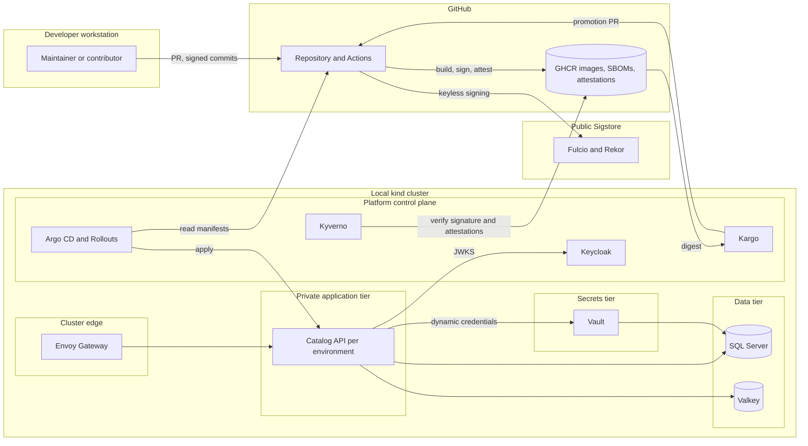

# Threat model

**Status: version 1, written in Phase 0 and updated in WP1.1, WP1.2, WP1.3, WP1.4, WP1.5, WP1.6, WP1.8, WP1.9, WP1.10, WP1.11, WP1.14, and WP1.15.** This model describes the *planned* system. A control is delivered only when the
Delivered column says so, and every other control names the phase that delivers it. Each phase updates it, and Phase 4 finalizes it. A work package
that changes a trust boundary, a data flow, or a credential must update this page (Definition of Done item 7 in [CONTRIBUTING.md](../../CONTRIBUTING.md)).

The method is STRIDE per trust boundary: Spoofing, Tampering, Repudiation, Information disclosure, Denial of service, and Elevation of privilege.
Start a new boundary from [the entry template](../templates/threat-model-entry-template.md).

## System context

## Assets

| Asset | Why it matters | Where it lives | Planned protection |
| --- | --- | --- | --- |
| Source code, history, and plan | Integrity of everything built from it | GitHub | Rulesets, review, signed commits recommended, secret scanning |
| Workflow definitions and tokens | Control over build, signing, and publishing | GitHub Actions | Pinned actions, least-privilege tokens, protected environments |
| Published images, SBOMs, provenance, signatures | What the cluster runs and what users trust | GHCR and public transparency logs | Digests, attestations, keyless signatures, admission verification |
| Product catalog data | The application's business data | SQL Server | Private tier, TLS, per-workload credentials, backups |
| Runtime credentials | Access to data and cache | Vault, delivered to pods | Short-lived leases, revocation, memory-backed files |
| Vault unseal keys and root token | Total control of the secrets tier | Operator custody, outside the repository | Documented custody, root token revoked after bootstrap |
| GitHub App private keys | Ability to open and merge promotion pull requests | Vault, synced only to Kargo | Single-repository scope, minimum permissions |
| Signing identity | Trust that an image came from this repository's trusted workflow | Fulcio certificate bound to workflow identity | Policy pins the exact identity and issuer |
| Cluster administration | Control of the platform | Local kubeconfig | Disposable environments, no copy between machines |
| Local certificate authority key | Ability to mint trusted certificates for the platform | Cluster secret | Scoped issuers, local-only trust |
| Identity tokens | Access to the API and platform UIs | Keycloak | Short lifetimes, audience and issuer checks |
| Telemetry | Can leak personal or sensitive data | Collector, Prometheus, Tempo, Loki | Redaction, no secrets or personal data in logs |

## Actors

| Actor | Capability assumed |
| --- | --- |
| Anonymous internet user | Reads the public repository, opens Issues and Discussions, forks, and opens pull requests from forks |
| External contributor | Submits fork pull requests that run workflows with a read-only token |
| Maintainer | Full administrative access; the only reviewer |
| Compromised dependency or action | Runs inside CI or the application with that component's privileges |
| Compromised developer workstation | Everything the maintainer's session can reach, including the local cluster |
| Malicious or vulnerable container image | Code running in a pod |
| Co-tenant workload | A pod in another namespace on the same cluster |
| Authorized API client | Calls the API within its scopes |
| Unauthorized API client | Calls the API without a valid token, or with the wrong scopes |
| AI assistant | Acts with the maintainer's tools; can be misled by untrusted text in Issues, pull requests, or web pages |

## Trust boundaries and initial threats

Controls are marked with the phase and work package that deliver them. Only the controls whose Delivered column says *delivered* exist today. The rest are *planned*.

### TB1: Developer workstation to GitHub

| Threat | Category | Control | Delivered |
| --- | --- | --- | --- |
| A stolen maintainer credential pushes malicious code | Spoofing, Tampering | Required pull requests and checks, CODEOWNERS on sensitive paths, signed commits recommended | Phase 0 (WP0.7) |
| Secrets or personal data are committed | Information disclosure | gitleaks over full history, push protection, secret scanning, privacy rules in [ADR-0006](../adr/0006-commit-identity-and-privacy.md), and from WP1.2 the `secret-patterns` and `commit-identity` rules of the security auditor, which run on every pull request and never print the value or the address | Phase 0 (WP0.6, WP0.7); WP1.2 delivered the auditor rules on 2026-10-08 |
| An AI assistant is steered by untrusted text into a harmful action | Tampering, Elevation of privilege | Agent rules, read-only skill scopes, no write tokens on untrusted input, review checklist. The governance skills run a deterministic CLI and hold no write scope, and a test checks each skill's declared scope and commands. The kickoff prompts that `governance session` prints are text from `governance/policies/session-policy.yaml`, which CODEOWNERS covers, with names filled in from the reviewed `status.yaml` in a single pass, and each tells the new session to treat Issue, pull request, and log text as data | Phase 0 (WP0.5); WP1.2 added the governance skills on 2026-10-08; WP1.14 added the session boundary skill and the prompts on 2026-10-12 |
| `governance github-sync --apply` changes labels, milestones, or issues with the maintainer's own GitHub sign-in | Elevation of privilege, Tampering | A dry run is the default, and the diff is shown first. The tool never deletes, changes only the labels it manages, and adds a missing marker to an issue body without changing the text. It uses the signed-in GitHub CLI and stores no token, sends bodies through standard input, validates the repository name, and refuses to run in GitHub Actions, so a workflow never holds the sign-in | WP1.2 delivered 2026-10-08 |
| The AI usage ledger leaks personal data, or a session records the work of another project, because the skill reads a local per-machine store that holds every session on the machine, and, as a fallback when that store has no rows for the session, the account's cloud copy of the session history, which holds the sessions of every repository of the account | Information disclosure, Tampering | The ledger holds opaque session IDs and numbers only. Its schema rejects any key that could hold text, and a test fails when the ledger holds an at sign, a URL, a drive or home-directory path, or the maintainer's account name. The `/ai-usage-recorder` skill reads either store with fixed read-only queries for the one session that it records, selects only counts and numbers (never a column that holds prompt or answer text), copies nothing from a turn, writes only records of its own session, and never edits an older record. A row that rests on the cloud store is marked derived, and `usage validate` computes its AIU again from its tokens and prices, so a derived number cannot be tuned by hand. `governance usage` never reads either store, and `usage validate` and `usage render --check` run on every pull request. Both stores are the account's own session history, which the Copilot app and its read-only tool deliver to the agent, so the fallback adds no credential, no write path, and no new trust boundary, and the ledger is public, so nothing in it is a secret ([ADR-0031](../adr/0031-ai-usage-ledger-and-estimate.md), the update of 2026-11-01) | WP1.15 delivered 2026-10-12, with the cloud fallback added 2026-11-01 |

### TB2: GitHub build, publish, and dependency intake

| Threat | Category | Control | Delivered |
| --- | --- | --- | --- |
| A third-party action or tool is compromised, as with tj-actions in 2025 and trivy-action in 2026 | Tampering | SHA pinning enforced by policy, immutable releases, minimal third-party actions, zizmor, least-privilege tokens | Phase 0 settings, enforced in Phase 2 (WP2.2) |
| A fork pull request exfiltrates a token or tampers with publishing | Information disclosure, Tampering | Approval for outside contributors, read-only default token, no `pull_request_target` that runs pull request code, publish only from `master` and tags through protected environments | Phase 0 settings, Phase 2 (WP2.2) |
| An artifact is swapped between jobs or in the registry | Tampering | One build per commit identified by digest, attestations bound to the digest, a verification job, admission verification | Phase 2 (WP2.4, WP2.5), Phase 3 (WP3.6) |
| A vulnerable or non-compliant dependency enters | Tampering, Elevation of privilege | Central package versions with transitive pinning, lock files with a locked restore in CI, package source mapping, required nuget.org repository signatures, NuGet audit with warnings as errors, a license allow-list gate, a forbidden-package list, and Dependabot with a cooldown. Dependency review follows in Phase 2 ([ADR-0020](../adr/0020-dependency-intake-controls.md)) | Phase 0 (Dependabot); WP1.1 delivered the rest of the intake controls on 2026-10-08; Phase 2 (WP2.3) adds dependency review |
| A trusted signing certificate expires, or a trusted signer is wrongly added | Spoofing, Tampering | The three nuget.org repository certificates are copied from the service's own endpoint, the newest expires on 2027-05-18 and `NuGet.config` says to re-read the endpoint before then, and a wrong fingerprint was shown to fail the restore (`NU3034`) | WP1.1 delivered 2026-10-08 |
| Pull request code runs on a CI runner during restore, build, and tests | Elevation of privilege, Information disclosure | The `ci` workflow uses `permissions: {}` with `contents: read` per job, `persist-credentials: false`, no secrets, no publishing, and a pull-request title that reaches scripts only through an environment variable. Outside-contributor approval is a repository setting | WP1.1 delivered 2026-10-08; Phase 2 (WP2.2) hardens it further |
| Testcontainers gives a test dependency control of the Docker daemon on a runner or workstation | Elevation of privilege | The reaper runs privileged with the Docker socket by default ([spike 1.d](../research/spikes/1.d-testcontainers-mssql.md)), so the first CI job that starts containers must run on an ephemeral hosted runner and use the digest-pinned reaper image | Planned, WP1.8 |
| Nobody can show who built what | Repudiation | Provenance, signatures, and public transparency-log entries per release | Phase 2 (WP2.5) |
| A workflow gains a write token, an unpinned action or image, a stored secret, a checkout that keeps the token, a `pull_request_target` trigger, or no timeout | Elevation of privilege, Tampering | The `workflow-permissions`, `action-pinning`, `workflow-secrets`, `checkout-credentials`, `pull-request-target`, and `workflow-limits` rules of the security auditor run on every pull request, with exceptions named in `governance/policies/security-policy.yaml`. A workflow that cannot be parsed is an error, so it cannot skip the rules. actionlint and zizmor follow in Phase 2 | WP1.2 delivered 2026-10-08; Phase 2 (WP2.2) adds zizmor and actionlint |
| A pull request weakens the auditors that audit it, because the tool is built from the pull request's own source | Tampering | The blast-radius map flags a change under `tools/Governance.Auditor/` for a close human read, every rule is tested against a conforming and a violating fixture, and the policy files are under `governance/`, which CODEOWNERS covers. Adding `tools/Governance.Auditor/` to CODEOWNERS is the maintainer's decision, and running the base branch's copy of the tool is a later option ([ADR-0021](../adr/0021-governance-auditor-cli.md), risk R20) | WP1.2 delivered the flag and the tests on 2026-10-08; the CODEOWNERS decision is open |
| Hostile text in a pull request attacks the governance tool: a YAML alias bomb, an XML entity in a test result, a Git reference that reads as an option, or markup in a test name or file name | Denial of service, Information disclosure, Tampering | The tool refuses YAML anchors and aliases, refuses XML with a DTD, gives every regular expression a timeout, passes arguments to programs as a list with no shell, accepts only plain Git reference characters, and escapes and shortens text before it reaches a job summary. The `governance` job has a read-only token and no secrets | WP1.2 delivered 2026-10-08 |
| A documentation tool is swapped or compromised: a lint container image, or the DocFX package | Tampering, Elevation of privilege | Every image is pinned by tag and digest in `tools/lint/compose.yaml`, including the Spectral and oasdiff images that WP1.5 added, and Dependabot proposes updates as reviewable pull requests. DocFX is a local tool with an exact version, `rollForward` turned off, and a required nuget.org repository signature. Each tool runs in a job with `contents: read`, no secrets, and the repository mounted read-only | WP0.6 for the first lint images; WP1.3 delivered the rest on 2026-10-08; WP1.5 added two images on 2026-10-11 |
| The nightly external link check reaches out to hosts that the pages name, and a hostile host or redirect answers | Information disclosure, Denial of service | The check runs only on a schedule or by hand, never on a pull request. It sends no token or secret, limits requests for each host, accepts no private or local address as a target, and prints text to a job summary inside a code fence. A broken link fails the nightly run and blocks nothing | WP1.3 delivered 2026-10-08 |
| The documentation preview publishes something that should stay private, because the site holds a copy of every repository file under `/repo/` | Information disclosure | The repository is public and holds no secrets, and gitleaks and the `secret-patterns` rule scan it. The preview is an artifact kept for seven days, and it is not published. GitHub Pages arrives at the Phase 1 exit (WP1.13), and a file that must not be published must not be in the repository | WP1.3 delivered 2026-10-08 |
| A pull request weakens the documentation auditor that audits it, or hostile text attacks it: a Markdown page, an include path, a project file with a DTD, a Compose file, or an inventory entry | Tampering, Denial of service, Information disclosure | The blast-radius map flags a change under `tools/Documentation.Auditor/` for a close human read, and every rule is tested against a conforming and a violating fixture. The tool refuses XML with a DTD and YAML anchors, gives every regular expression a timeout, keeps every include path inside the repository, and reports a file it cannot read instead of skipping it. The `Documentation auditor` job has a read-only token and no secrets ([ADR-0023](../adr/0023-documentation-auditor.md), risk R20) | WP1.3 delivered 2026-10-08 |
| A tool is used and the inventory does not say so, or a new file format hides tools from the auditor | Repudiation, Tampering | Discovery compares the files with the inventory in both directions, and the audit fails when a file in a format that it cannot read yet exists. A tool whose license is not permissive needs a note ([ADR-0004](../adr/0004-licensing-and-dependency-license-policy.md)) | WP1.3 delivered 2026-10-08; WP1.4 added the scanners for the Dev Container and `tools/versions.yaml` on 2026-10-10; WP3.1, WP3.6, and WP3.8 add the scanners for their formats |

### TB2a: Developer environment and local stack

The boundary between a contributor's machine, the Dev Container, the downloads that set them up, and the API-only stack that runs on `127.0.0.1` ([ADR-0024](../adr/0024-verified-tool-installer.md), [ADR-0025](../adr/0025-dev-command-and-dev-container.md), [ADR-0026](../adr/0026-api-only-compose-stack-and-catalog-realm.md)).

| Threat | Category | Control | Delivered |
| --- | --- | --- | --- |
| A developer tool download is tampered with, or a pull request changes the manifest to fetch something else | Tampering, Elevation of privilege | `tools/versions.yaml` pins each tool to an exact version and the SHA-256 of the file, and the installer accepts only the PowerShell Gallery's own address for that name and version. It refuses a mismatch, a package entry that leaves the install folder, and a module with another version, and it removes its temporary folder on any failure. A folder without the recorded checksum does not count as installed. A pin change is a reviewed diff, and the documentation auditor compares it with the inventory | WP1.4 delivered 2026-10-10 |
| The Dev Container runs privileged, because docker-in-docker needs it, so code in it could reach the host's Docker virtual machine | Elevation of privilege | The daemon is private to the container and no host socket is mounted (a test fails on `docker.sock` in `compose.yaml`), the stack binds only to loopback, the base image, features, and the `devcontainers/ci` action are pinned by digest or SHA, and the feature lock file is checked by the documentation auditor. Codespaces runs the container in a throwaway virtual machine. Accepted as risk R22 | WP1.4 delivered 2026-10-10 |
| A service of the local stack is reachable from the network, or from a process that should not reach it | Information disclosure, Elevation of privilege | Every port binds `127.0.0.1` on a high port, and a test fails on a mapping that is not loopback or is below 1024. Every container has `no-new-privileges` and a memory limit, and none is privileged. SQL Server, Valkey, Keycloak, and Grafana have generated credentials, and the Valkey default user is off | WP1.4 delivered 2026-10-10 |
| The generated `.env` with the local secrets is committed or leaves the machine | Information disclosure | Git ignores `.env`, `dev bootstrap` writes it with LF and restricts it to its owner on Linux and macOS, nothing copies it between machines (the machine-migration runbook says so), and the full-history `secrets` scan has no allowance for it. The documentation site copies every repository file that it does not exclude, so `docfx.json` excludes `.env` and `.dev/` and a test checks it (the working-tree scan found a copy in `_site` before the exclusion). The working-tree scan allows the one path `^/repo/\.env$`, which the maintainer approved, because gitleaks does not read `.gitignore` | WP1.4 delivered 2026-10-10 |
| A user obtains a scope that their role does not grant, and an API that trusts the `scope` claim lets them in | Elevation of privilege | Keycloak 26.8.0 grants a requested scope to a user without the mapped role, so the catalog realm puts `realm_access.roles` in the token, limited to the user's roles and the requested scopes, and `dev compose check` proves it for three users. The API must require the role as well as the scope (risk R21, [ADR-0026](../adr/0026-api-only-compose-stack-and-catalog-realm.md)) | Realm and check delivered in WP1.4 on 2026-10-10; the permission table that requires the scope and a role delivered in the first pull request of WP1.7 ([ADR-0032](../adr/0032-decorator-pipeline-and-application-results.md)); the authorization decorator delivered in the second pull request of WP1.7; the endpoint policies that require both delivered in the first pull request of WP1.10 on 2026-11-03 ([ADR-0040](../adr/0040-http-api-composition-and-token-validation.md)), and the Keycloak proof of the claims with real tokens delivered in the third on 2026-11-04 ([ADR-0042](../adr/0042-served-contract-conformance-and-snapshots.md)) |
| The Valkey ACL user can read or write another environment's keys, or flush the cache | Tampering, Elevation of privilege | The default user is off, and the application user starts from `-@all` and reaches only `~v2:catalog:dev:*`, the channel `&catalog:dev.Backplane:v2`, and 14 commands. `dev compose check` tries the forbidden actions and expects a refusal, and `ValkeyAclTests` runs the whole cache scenario with the rules read from `compose.yaml` and finds no denied command | WP1.4 delivered the Compose ACL and the check on 2026-10-10; WP1.9 narrowed it to the verified patterns on 2026-11-03 ([ADR-0038](../adr/0038-catalog-cache-adapter-and-valkey-connection.md)) |
| The third-party `devcontainers/ci` action is compromised and runs in the onboarding job | Tampering, Elevation of privilege | The action is pinned by commit SHA, the job has `contents: read` and no secrets, `push` is `never`, and the workflow runs only for paths that the Dev Container uses, weekly, and by hand | WP1.4 delivered 2026-10-10 |
| The mutation run executes repository code, and a dependency that it restores, as root in a container that has network access, and Stryker.NET rewrites source files | Tampering, Elevation of privilege | The `mutation` service mounts the repository read-only and copies it to a scratch directory in the container, and the copy leaves out `.git`, `.dev`, and the git-ignored `.env`, so no secret is in the container. The only writable mount is `TestResults/mutation`. The image is pinned by digest, the restore is locked and uses the repository's NuGet source mapping and signature rules ([ADR-0020](../adr/0020-dependency-intake-controls.md)), and the tool is pinned with `rollForward` off. No hosted workflow runs it yet, so no token or secret is in reach | WP1.6 delivered 2026-10-12 |
| The test run starts containers through the Docker socket, and the `linux-tests` service of `tools/lint/compose.yaml` mounts the socket itself, so code in the test process controls the Docker daemon of the host (root-equivalent on a Linux host) | Elevation of privilege | The exception is limited to one service on a developer machine: no CI job and no service of the Compose stack mounts the socket, the repository mount is read-only, the image is pinned by digest, the restore is locked and signed ([ADR-0020](../adr/0020-dependency-intake-controls.md)), and the comment on the service names the exception. The Testcontainers reaper image is pinned by digest and runs without the privileged flag. The hosted runner has Docker and runs the suites directly. Accepted as a residual risk below ([ADR-0034](../adr/0034-integration-test-database-strategy-and-linux-run.md)) | WP1.8 delivered 2026-11-02 |

### TB3: Public Sigstore

| Threat | Category | Control | Delivered |
| --- | --- | --- | --- |
| Signing publishes workflow identity, ref, commit, and run link to a public log | Information disclosure | Accepted because the repository is public ([ADR-0002](../adr/0002-repository-visibility-and-capability-strategy.md), [ADR-0013](../adr/0013-shift-left-security-toolchain.md)); a lab shows exactly which fields are exposed | Phase 2 (WP2.5) |
| A signature from the wrong identity is accepted | Spoofing | The admission policy pins the exact workflow identity and issuer | Phase 2 (WP2.0), Phase 3 (WP3.6) |

### TB4: Cluster edge

| Threat | Category | Control | Delivered |
| --- | --- | --- | --- |
| Unauthenticated or wrongly scoped API calls | Spoofing, Elevation of privilege | JWT validation with exact issuer and audience, policy-based authorization, denied-path tests. The contract already names exactly one scope for each of the 10 operations, and a test compares the permission matrix with it. The API requires the scope and one of the roles for every endpoint, from the same table as the use cases, and a test runs all 192 combinations of three scopes and three roles against three endpoints, and another sends the 64 combinations of each operation of the contract to the real endpoints against an independent ladder of roles | Contract delivered in WP1.5 on 2026-10-11; the validation and the policies delivered in the first pull request of WP1.10 on 2026-11-03 ([ADR-0040](../adr/0040-http-api-composition-and-token-validation.md)); the matrix over the operations of the contract delivered in the third on 2026-11-04 ([ADR-0042](../adr/0042-served-contract-conformance-and-snapshots.md)) |
| A forged token is accepted: an unsigned one, one that uses the public key as an HMAC secret, one with a valid signature and an algorithm outside RS256 and ES256, one for another audience, or one that a second issuer in the metadata makes valid | Spoofing, Elevation of privilege | The algorithms are fixed in code, the issuer is compared exactly and ignores the issuer that the metadata names (the handler adds it to the valid issuers by default), the audience is exact, a token needs an expiry, and the skew is at most 30 seconds, which the validator of the settings enforces. A token in the query string is not read. Tests send each forgery to the real pipeline and expect a 401 with the catalog entry and a challenge that names no cause | WP1.10 delivered 2026-11-03 ([ADR-0040](../adr/0040-http-api-composition-and-token-validation.md)) |
| A signing key that the identity provider withdrew keeps working, or a rotation locks every caller out | Spoofing, Denial of service | The handler reads the metadata again when a token names an unknown key, at most once for each refresh interval, and the last known good configuration, which keeps the previous key set for an hour, is turned off. A rotation that keeps the old key published while the new one starts, as Keycloak does, costs nothing. Tests publish a new key, withdraw one, and wait on the answer with a bounded poll | WP1.10 delivered 2026-11-03 |
| Metadata is read over plain HTTP in a deployment, so an attacker on the path swaps the keys | Spoofing, Tampering | `RequireHttpsMetadata` is on by default, and only the Development environment may turn it off, for the plain-HTTP issuer of the Compose stack. The validator of the settings stops the host at start otherwise | WP1.10 delivered 2026-11-03 |
| A change to the API contract removes a scope, a precondition, or an idempotency rule, or lets an error leak internals, and no reviewer notices | Elevation of privilege, Tampering, Information disclosure | The contract is authored first and linted on every pull request. The `catalog-` rules of the Spectral ruleset require a scope on every operation, `If-Match` and the 412 and 428 answers on every change, `Idempotency-Key` on every create, and `application/problem+json` on every error. A test breaks the contract once for each rule, so every rule is shown to fail. Contract tests compare the contract with the permission matrix and the error catalog, and the error examples are checked for leaks. `contracts/` is under CODEOWNERS and the blast-radius map asks for a contract review ([ADR-0027](../adr/0027-contract-linter-and-conformance-tooling.md), [ADR-0028](../adr/0028-http-api-conventions-of-v1.md)) | WP1.5 delivered 2026-10-11 |
| The running API differs from its contract: an undocumented endpoint, a missing precondition, or a looser input check | Tampering, Elevation of privilege | The tests generate the served document from the endpoints and compare it with the authored contract through oasdiff in CI, ignoring only descriptions, examples, and summaries, and a second test compares every transport record with its schema. An endpoint that gains a header, a response, or a scope that the contract does not have fails the build. The shared schemas, parameters, and headers are taken from the authored file, so a constraint that only a model enforces is checked by the tests of that model | Script delivered in WP1.5 on 2026-10-11; blocking since the third pull request of WP1.10 on 2026-11-04 ([ADR-0042](../adr/0042-served-contract-conformance-and-snapshots.md)) |
| The reference viewer or the document of the API is reachable in production, which gives a caller the examples and the scopes of every operation and a page that runs scripts under a looser content policy | Information disclosure | The document and the viewer exist only when the host runs in the Development environment, nothing is registered otherwise, and the looser content policy applies to the path of the viewer alone. A test starts a Production host and expects a 404 for the document, the viewer, and its script | WP1.10 delivered 2026-11-04 ([ADR-0042](../adr/0042-served-contract-conformance-and-snapshots.md)) |
| A retried create duplicates a resource, or two writers overwrite each other | Tampering | The contract requires `Idempotency-Key` on every create and `If-Match` on every change, with the 409, 412, 422, and 428 answers. The idempotency store reserves the key for one caller, answers a different payload with `Reused` and a request that runs with `InProgress`, and writes the first result in the transaction of the command, so the result exists exactly when the effect does. The key and the caller are compared exactly, so a change of case makes a different key, and no caller can read the result of another ([ADR-0036](../adr/0036-idempotency-store.md)). The endpoints read the key as one quoted string before the body, answer 400 for a missing or invalid one, and answer a replay, a different body, and a request that still runs with 201, 422, and 409. A change or a discontinue without `If-Match` is a 428, a stale one is a 412, and a weak tag, a list, or `*` is refused before the use case runs. Tests send each case to the real endpoints over a real SQL Server ([ADR-0041](../adr/0041-http-endpoints-versioning-and-conditional-requests.md)) | Store delivered in WP1.8 on 2026-11-02; the HTTP enforcement delivered in the second pull request of WP1.10 on 2026-11-04 |
| Request floods | Denial of service | A fixed-window limit for each caller, which is counted by the identifier of the token or, without a token, by the address, with a lower limit for a write (600 reads and 120 writes each minute by default) and a 429 with `Retry-After`. The size of a body is limited by Kestrel, and the reading of a body in the endpoints enforces the size again by counting the bytes that it reads, so a body without a length is checked too, and the depth of the JSON (32 KiB and 8 levels by default). Tests send a body of the limit, one byte more, and a streamed body of twice the limit. The gateway limits and the resource quotas arrive with the platform | Rate limit delivered in the first pull request of WP1.10 on 2026-11-03; the body limits in the second on 2026-11-04; Phase 3 (WP3.2) |
| A body, a header, or a parameter that the contract does not allow is accepted and changes what a later reader sees: an unknown member that a future version would read, a second `Idempotency-Key`, a repeated filter, or a value that a lenient parser reads differently from a strict one | Tampering | Every member that the contract does not name is a 400 that names its path, a value of the wrong type is a 400, a header that must hold one strong token is refused when it holds two or a weak one, a parameter that appears twice is refused, and an amount has the shape of the contract before it becomes a number. The checks are character by character and have no regular expression that could take long on a hostile input. Tests send each form to the real endpoints | WP1.10 delivered in the second pull request on 2026-11-04 ([ADR-0041](../adr/0041-http-endpoints-versioning-and-conditional-requests.md)) |
| Forged forwarded headers | Spoofing | `X-Forwarded-For`, `-Proto`, and `-Host` are read only from the networks and addresses that `Catalog:ForwardedHeaders` names, and both default lists, which trust the loopback address, are cleared. A network with a prefix of 0 is refused at start. A request from any other address cannot change the address, the scheme, or the host, and a forwarded host must still be an allowed one. Tests send the headers from a trusted network, an untrusted one, and the loopback address | WP1.10 delivered 2026-11-03; Phase 3 (WP3.2) names the gateway network |
| A caller chooses the host that the `Location` and `Link` headers name, or reaches the API through the address of a probe | Spoofing, Tampering | A request to the public port must name an allowed host, so the links never name an address that a caller chose. The API answers only on the public port and the health endpoints only on the management port, and the gate reads the port that the connection arrived on, so a `Host` header that names the other port changes nothing | WP1.10 delivered 2026-11-03 |
| Management or health endpoints exposed | Information disclosure | Management port that the gateway never routes. The health endpoints are served on a port of their own, and a request to the public port gets a 404 for them. The report lists each check with a text that the check wrote, replaces the description of a check that threw, and shows no exception, no connection string, no user name, and no credential. A test starts real sockets and searches every answer and log line for the sentinel passwords | WP1.10 delivered 2026-11-03; Phase 3 (WP3.2) |
| An error answer or a log line shows an exception, a query, a token, or a credential | Information disclosure | One writer makes every error of the API with a detail that is fixed text, the trace identifier of the request, and no value that the caller sent. An unhandled exception is a 500 whose text is generic, and the log holds the exception with the trace identifier. A database exception anywhere in the chain is a 503. Tests throw an exception with a marker text and expect that no answer shows it and that no log line holds a token | WP1.10 delivered 2026-11-03 |
| Traffic is read between gateway and API | Information disclosure | Re-encrypted upstream traffic with BackendTLSPolicy | Phase 3 (WP3.2) |

### TB5: Private application tier

| Threat | Category | Control | Delivered |
| --- | --- | --- | --- |
| A compromised pod moves laterally | Elevation of privilege | Default-deny NetworkPolicies, restricted Pod Security, non-root, read-only root filesystem, dropped capabilities | Phase 3 (WP3.2, WP3.6) |
| Over-broad RBAC | Elevation of privilege | Dedicated service accounts and least-privilege roles | Phase 3 (WP3.2) |
| Long-lived credentials are stolen and reused | Information disclosure | Short-lived leases delivered to memory-backed files | Phase 3 (WP3.3, WP3.4) |
| Authorization bypass | Elevation of privilege | Authorization at endpoints and at the use-case boundary, tested exhaustively. The endpoint policy and the authorization decorator read the same permission table, so they cannot disagree, and a test of the endpoints checks every combination of scope and role | Use-case boundary delivered in WP1.7; the endpoint policies delivered in the first pull request of WP1.10 on 2026-11-03; the matrix over the operations of the contract delivered in the third on 2026-11-04 ([ADR-0042](../adr/0042-served-contract-conformance-and-snapshots.md)) |

### TB5a: Telemetry from the API to the collector

The traces, metrics, and logs that the API sends over OTLP to the collector ([ADR-0043](../adr/0043-observability-with-opentelemetry-and-redaction.md)). The Compose stack runs one container for all backends on `127.0.0.1`, and the collector of the platform arrives in WP3.7.

| Threat | Category | Control | Delivered |
| --- | --- | --- | --- |
| A token, a credential, a connection string, a password, or personal data reaches a backend through a log record, a span tag, an exception text, or a metric label | Information disclosure | Two processors run before every exporter: they classify an attribute by its name and a text value by its shape (a token, a connection string, an email address, the profile folder of a person) and replace a classified value with `[redacted]`. A log record never leaves with its exception, only its type and its frames without file paths, and the formatted message is not exported. The statements of the database carry placeholders and no parameter, and the span of a use case adds the type of an exception and never its text. A metric label is a fixed word. Tests send sentinels through the real host (a token, a connection string, an email address, a driver message, and the passwords of the settings) and search every record, tag, and series for them, and a snapshot holds the shape of a redacted record | WP1.11 delivered 2026-11-04 |
| The standard output of the host holds an exception text or a value that the telemetry pipeline would have redacted | Information disclosure | Accepted as residual risk. The code never logs a value that the plan forbids, and the tests of the earlier work packages search every log line of the host for the sentinel passwords. The output is not part of the OTLP pipeline, so it is not redacted, and a deployment that collects it must treat it as sensitive until WP3.7 decides how it is collected | Residual risk R24 |
| A metric label or a span attribute takes a value that a caller controls, and the backend grows a series for each value | Denial of service | Every label is a fixed word, a handler name, or an event type. A test lists the labels of every exported series against a documented list, searches the values for an identifier, and writes many products to show that no series is added. The instrumentation never labels with a route value, and the routes are templates | WP1.11 delivered 2026-11-04 |
| The collector is down, slow, or wrong, and the API stops answering or fails | Denial of service | The exporters batch off the request path, so a request never waits for a collector, and a failed export is dropped. The options and the endpoint and protocol variables are checked when the host starts. A test starts the host with an OTLP endpoint that nobody serves and expects the same answers | WP1.11 delivered 2026-11-04 |
| The export is read or changed in transit, or goes to the wrong collector, and the headers carry a credential | Information disclosure, Tampering, Spoofing | The endpoint, the protocol, and the headers come from the standard `OTEL_*` variables and never from a file of the repository, and the validator names a variable and never repeats its value. The Compose stack sends plain HTTP to the loopback address only. A deployment sets an HTTPS address, and the mutual authentication of the collector arrives with the platform | Variables and validation delivered in WP1.11 on 2026-11-04; Phase 3 (WP3.7) |
| A caller sets the sampled flag in `traceparent` and so records every request of its own, or sends a trace identifier that it chose | Denial of service, Spoofing | The sampler is parent-based, so a caller that sets the flag decides the sampling of its trace, and a trace identifier from a caller is only an identifier. Accepted as residual risk until the gateway strips or replaces the header | Residual risk R25; Phase 3 (WP3.2) |

### TB6: Data tier

| Threat | Category | Control | Delivered |
| --- | --- | --- | --- |
| Direct access from another namespace or environment | Elevation of privilege | NetworkPolicy, cluster-internal services only, a policy that forbids external services in the data namespace | Phase 3 (WP3.2, WP3.4, WP3.6) |
| Credential theft or reuse | Information disclosure | Per-workload dynamic credentials with revocation that ends sessions, and TLS | Phase 3 (WP3.4) |
| A database credential leaks through a log line, an exception message, an exception data bag, a printed settings object, or a test output | Information disclosure | The credential lives in memory in a type that prints `[redacted]` instead of the password, and the settings type prints only its name. The sources log fixed phrases and exception type names, never file content. A setting that holds a credential is refused at startup by a message that names the keyword and never the value. A test puts a known password through a broken file, a rotation to a login that does not exist, and a pool clear, and finds it in no log entry, message, data bag, or printed object ([ADR-0037](../adr/0037-credential-rotation-and-pool-clearing.md)) | WP1.8 delivered 2026-11-02 |
| A rotation leaves the old login with live sessions, or a revocation that comes too early kills requests in flight | Denial of service, Elevation of privilege | New connections switch to the new login at once, the pool of the old login is cleared after a grace period, and the order is rotate, switch, clear, revoke. Clearing never interrupts a running command. A bad credential file never replaces the credential in use. Tests read `sys.dm_exec_sessions` to show that the old login has no session, and that it can be dropped afterward. The Vault side of the order (the revocation statements) is confirmed in WP3.3 and WP3.4 | Application side delivered in WP1.8 on 2026-11-02; Vault side in Phase 3 (WP3.3, WP3.4) |
| Cross-environment cache access or poisoning | Tampering | Per-environment ACL users limited to their key prefix and channels, TLS. The key holds the environment, so two environments on one server never read each other's entries (a test starts two), and a key of another environment, a channel of another environment, `KEYS`, `FLUSHALL`, `ACL`, `CONFIG`, and `SHUTDOWN` are refused by a test that connects as the user ([ADR-0038](../adr/0038-catalog-cache-adapter-and-valkey-connection.md)) | Key scheme, ACL, and tests delivered in WP1.9 on 2026-11-03; per-environment users and TLS in Phase 3 (WP3.4) |
| A Valkey password leaks through a log line, an exception message, a printed settings object, a key, or a value | Information disclosure | The settings type prints only its name, no problem of the validator repeats a value, and the code never prints a `ConfigurationOptions`, because its `ToString()` includes the password in StackExchange.Redis 2.10.1 (found 2026-11-03). Tests connect to a closed port with a known password and find it in no log entry or exception, and scan every key and value that the cache wrote to a real server. The password is static in this work package, and the broker that rotates it arrives with the platform | Delivered in WP1.9 on 2026-11-03; rotation in Phase 3 (WP3.3, WP3.4) |
| A cache entry holds personal data or a secret, a caller chooses part of a key, or a metric tag names a key | Information disclosure, Tampering | A key is a name of the code plus an identifier or the hash of the filter, and a test shows that no value of a request is in it. A value is a view of a product, a source-generated JSON context lists the types that can be written, and snapshot tests hold their shape. A tag of a metric is a fixed word, and a test finds no key in any tag. The log of the cache holds no value of an entry (`CatalogCacheTests`, `CacheContractTests`) | Delivered in WP1.9 on 2026-11-03 |
| A stale entry is served after a write, because the removal was lost, a node missed the backplane message, or Valkey was down | Tampering | The writing node removes the entries before it answers, so it reads its own writes even while Valkey is down. The outbox repeats the removal through a handler with a receipt, with a backoff, until Valkey confirms it, and one policy serves both paths. A node that missed the message is bounded by the memory time to live (30 seconds, 10 for a list), and the gauges `catalog.cache.shared.down` and `catalog.cache.backplane.down` report the state. Tests run two hosts, a lost immediate removal, and a Valkey outage ([ADR-0039](../adr/0039-cache-invalidation-by-immediate-dispatch-and-the-outbox.md), [the consistency model](../explanation/cache-consistency-model.md)) | Delivered in WP1.9 on 2026-11-03; the alerts on the gauges in WP1.11 |
| The invalidation handler is given a message that it cannot read, so a stale entry goes unnoticed or the message loops | Denial of service | The policy refuses an event type that it does not know, a payload that is not in the shape of its event, and a version that it does not read, and the text of the refusal names the event type and the message and never the payload. The outbox retries and then dead-letters the message, which increments `catalog.outbox.dead_lettered`. A test fails when the Domain gets an event that the policy lacks | Delivered in WP1.9 on 2026-11-03; the alert in WP1.11 |
| Valkey evicts a tag marker under memory pressure, so an entry that the marker should hide is served until it expires | Denial of service | A marker lives for twice the longest time to live of an entry, so eviction is the only way to lose one early. An entry lives 5 minutes in Valkey at most, and the memory of a node holds it for 30 seconds, which bounds the staleness. The Compose stack caps the memory and evicts the least recently used key (`allkeys-lru`). The production memory policy and an alert on evicted keys are open | Bound documented in WP1.9 on 2026-11-03; the metric in WP1.11; the production policy in Phase 3 (WP3.4) |
| SQL injection | Tampering | Parameterized queries through EF Core and input validation. The persistence layer builds no statement from text that a caller sent. The raw SQL of the outbox lease, the outbox finish, the cleanup, and the idempotency store passes every value, including the key and the caller, as a parameter of an interpolated `FromSql` or `ExecuteSql` call, and the lock hints and statuses are constants. The suites of the real database run those statements, including a key of printable ASCII with quotes | Persistence layer delivered in WP1.8 on 2026-11-02; input validation in Phase 1 (WP1.10) |
| A faulty or hostile outbox handler leaks a value into the table, the log, or a metric, or loops on one message and starves the rest | Information disclosure, Denial of service | The processor stores the name of the type of the fault and never its message, writes no payload to its log lines, and counts attempts when it leases, so a message that kills its host reaches the dead-letter state. A failing message backs off with jitter and never blocks the rows behind it, because the lease skips locked rows. The dead-letter state increments `catalog.outbox.dead_lettered` and logs an error ([ADR-0035](../adr/0035-outbox-processor-design.md)). The alert that watches the counter arrives in WP1.11 | WP1.8 delivered 2026-11-02; the alert planned in WP1.11 |
| Two hosts, or a slow host and its successor, deliver or finish one outbox message at the same time | Tampering | The lease statement takes rows with `UPDLOCK, READPAST, ROWLOCK`, and completing or failing a message needs the lease identifier, so a host whose lease ended changes nothing. Receipts keep a finished handler from running again. Delivery is at least once, so handlers must be idempotent (ADR-0035) | WP1.8 delivered 2026-11-02 |
| An application replica, or an attacker who holds the application identity, changes the schema | Tampering, Elevation of privilege | Only the migrator identity changes the schema, by running the migration bundle. The application identity has data rights only, and a test shows that it can neither create the schema nor alter a table, while the migrator can migrate. No production assembly calls `Migrate`, `EnsureCreated`, or `EnsureDeleted`, and an architecture test reads the member references of each built assembly to hold it ([ADR-0033](../adr/0033-ef-core-mapping-read-model-and-migrations.md)). The migration files are under CODEOWNERS | Code and tests delivered in WP1.8 on 2026-11-02; the identities in the cluster in Phase 3 (WP3.4, WP3.8) |
| A row is changed by hand to hold a value that the model refuses, and a handler acts on it | Tampering | Every value object is rebuilt through its `Create` when a row loads, so a refused value fails loudly and never becomes an aggregate that looks valid. The row version stops a stale write | WP1.8 delivered 2026-11-02 |
| Data loss | Denial of service | Backup job and a rehearsed restore | Phase 3 (WP3.4) |

### TB7: Secrets tier

| Threat | Category | Control | Delivered |
| --- | --- | --- | --- |
| Vault compromise exposes every secret | Information disclosure | Operator custody of unseal keys, audit device, narrow policies, network isolation, root token revoked after bootstrap | Phase 3 (WP3.3) |
| A GitHub OIDC token is replayed from another repository or ref | Spoofing | Bound claims for repository, workflow, ref, event, and audience, with a negative test | Phase 3 (WP3.3) |
| Unregistered trust anchors | Elevation of privilege | A trust-anchor register with custody, scope, rotation, and break-glass for each | Phase 3 (WP3.3) |

### TB8: Platform control plane

| Threat | Category | Control | Delivered |
| --- | --- | --- | --- |
| A malicious manifest is merged and deployed | Tampering | Pull request review, CODEOWNERS on production overlays, admission verification, restricted AppProjects | Phase 3 (WP3.6), Phase 4 (WP4.3) |
| Abuse of the promotion bot | Elevation of privilege | A single-repository GitHub App with minimum permissions, its key in Vault, and a human merge for production | Phase 4 (WP4.5) |
| Policy bypass | Elevation of privilege | Scoped, documented exceptions, Audit before Enforce, documented break-glass | Phase 3 (WP3.6) |
| Terraform state exposes secrets | Information disclosure | Secret-free local state for the cluster, no secret values in state | Phase 3 (WP3.1) |
| Platform UIs and APIs are exposed | Spoofing | Single sign-on through Keycloak and local admin accounts disabled after bootstrap | Phase 3 (WP3.5), Phase 4 (WP4.3) |

## Residual and accepted risks

- **A compromised workstation can reach the local cluster.** The cluster is disposable and holds only synthetic data, but the host is part of the trust base.
- **The Compose stack uses static credentials, and SQL Server runs with its `sa` login.** The stack is disposable, binds only to loopback, holds only synthetic data, and gets random secrets on every machine. Phase 3 replaces the static logins with Vault-managed ones (plan section 8.8).
- **The Dev Container is privileged** (risk R22).
- **The Linux test run mounts the Docker socket.** The `linux-tests` service of `tools/lint/compose.yaml` gives the test container control of the Docker daemon of the host, which Testcontainers needs to start SQL Server. It is limited to one service on a developer machine, and the first alternative to weigh is a socket proxy or rootless containers ([ADR-0034](../adr/0034-integration-test-database-strategy-and-linux-run.md)).
- **Standard NetworkPolicy cannot filter egress by hostname.** Internet egress is limited to a few controllers on port 443. Cilium is the documented upgrade path.
- **Vault is licensed under the BSL.** It is used only as a tool ([ADR-0004](../adr/0004-licensing-and-dependency-license-policy.md)).
- **Public transparency logs record signing metadata** ([ADR-0013](../adr/0013-shift-left-security-toolchain.md)).
- **One maintainer.** Review is partly automated, and every bypass is recorded ([ADR-0007](../adr/0007-solo-maintainer-governance.md)).
- **The viewer package ships with the API.** `Scalar.AspNetCore` and its static files are referenced by `Catalog.Api`, so they are in the published output although only the Development environment registers them. Nothing routes to them in another environment, and a test proves it. The image of WP3 can trim them ([ADR-0042](../adr/0042-served-contract-conformance-and-snapshots.md)).
- **The replaced initial commit may stay retrievable by its ID** ([ADR-0006](../adr/0006-commit-identity-and-privacy.md)).

## Assumptions

- The maintainer's GitHub account uses two-factor authentication.
- GitHub, Sigstore, and the cloud registries that host pinned images are trusted within their documented guarantees.
- Demonstration credentials are generated locally, are disposable, and are never reused.

## Open questions

- Whether Vault's Redis plugin can issue dynamic Valkey credentials, or rotated static ACL users are used instead (spike in WP3.0).
- How much of the scrape and trace pipeline needs mutual TLS inside the cluster (decided in WP3.7).
- Which controls move from advisory to blocking once the Kyverno policies leave Audit mode (WP3.6).

## How to update this model

1. Add or change the entry for the affected boundary, with the control and the test or evidence.
2. Change a control's *Delivered* column only when the work package that builds it has merged.
3. Add residual risks when a control is deferred, with the reason and the owner.
4. Record the change in the pull request description.
