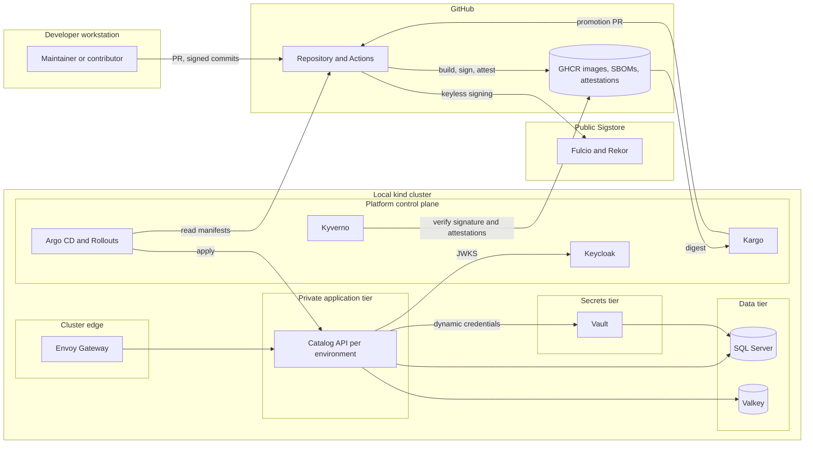

# Threat model

**Status: version 1, written in Phase 0 and updated in WP1.1, WP1.2, WP1.3, WP1.4, WP1.5, WP1.6, and WP1.14.** This model describes the *planned* system. A control is delivered only when the
Delivered column says so, and every other control names the phase that delivers it. Each phase updates it, and Phase 4 finalizes it. A work package
that changes a trust boundary, a data flow, or a credential must update this page (Definition of Done item 7 in [CONTRIBUTING.md](../../CONTRIBUTING.md)).

The method is STRIDE per trust boundary: Spoofing, Tampering, Repudiation, Information disclosure, Denial of service, and Elevation of privilege.
Start a new boundary from [the entry template](../templates/threat-model-entry-template.md).

## System context

## Assets

| Asset | Why it matters | Where it lives | Planned protection |
| --- | --- | --- | --- |
| Source code, history, and plan | Integrity of everything built from it | GitHub | Rulesets, review, signed commits recommended, secret scanning |
| Workflow definitions and tokens | Control over build, signing, and publishing | GitHub Actions | Pinned actions, least-privilege tokens, protected environments |
| Published images, SBOMs, provenance, signatures | What the cluster runs and what users trust | GHCR and public transparency logs | Digests, attestations, keyless signatures, admission verification |
| Product catalog data | The application's business data | SQL Server | Private tier, TLS, per-workload credentials, backups |
| Runtime credentials | Access to data and cache | Vault, delivered to pods | Short-lived leases, revocation, memory-backed files |
| Vault unseal keys and root token | Total control of the secrets tier | Operator custody, outside the repository | Documented custody, root token revoked after bootstrap |
| GitHub App private keys | Ability to open and merge promotion pull requests | Vault, synced only to Kargo | Single-repository scope, minimum permissions |
| Signing identity | Trust that an image came from this repository's trusted workflow | Fulcio certificate bound to workflow identity | Policy pins the exact identity and issuer |
| Cluster administration | Control of the platform | Local kubeconfig | Disposable environments, no copy between machines |
| Local certificate authority key | Ability to mint trusted certificates for the platform | Cluster secret | Scoped issuers, local-only trust |
| Identity tokens | Access to the API and platform UIs | Keycloak | Short lifetimes, audience and issuer checks |
| Telemetry | Can leak personal or sensitive data | Collector, Prometheus, Tempo, Loki | Redaction, no secrets or personal data in logs |

## Actors

| Actor | Capability assumed |
| --- | --- |
| Anonymous internet user | Reads the public repository, opens Issues and Discussions, forks, and opens pull requests from forks |
| External contributor | Submits fork pull requests that run workflows with a read-only token |
| Maintainer | Full administrative access; the only reviewer |
| Compromised dependency or action | Runs inside CI or the application with that component's privileges |
| Compromised developer workstation | Everything the maintainer's session can reach, including the local cluster |
| Malicious or vulnerable container image | Code running in a pod |
| Co-tenant workload | A pod in another namespace on the same cluster |
| Authorized API client | Calls the API within its scopes |
| Unauthorized API client | Calls the API without a valid token, or with the wrong scopes |
| AI assistant | Acts with the maintainer's tools; can be misled by untrusted text in Issues, pull requests, or web pages |

## Trust boundaries and initial threats

Controls are marked with the phase and work package that deliver them. Only the controls whose Delivered column says *delivered* exist today. The rest are *planned*.

### TB1: Developer workstation to GitHub

| Threat | Category | Control | Delivered |
| --- | --- | --- | --- |
| A stolen maintainer credential pushes malicious code | Spoofing, Tampering | Required pull requests and checks, CODEOWNERS on sensitive paths, signed commits recommended | Phase 0 (WP0.7) |
| Secrets or personal data are committed | Information disclosure | gitleaks over full history, push protection, secret scanning, privacy rules in [ADR-0006](../adr/0006-commit-identity-and-privacy.md), and from WP1.2 the `secret-patterns` and `commit-identity` rules of the security auditor, which run on every pull request and never print the value or the address | Phase 0 (WP0.6, WP0.7); WP1.2 delivered the auditor rules on 2026-10-08 |
| An AI assistant is steered by untrusted text into a harmful action | Tampering, Elevation of privilege | Agent rules, read-only skill scopes, no write tokens on untrusted input, review checklist. The governance skills run a deterministic CLI and hold no write scope, and a test checks each skill's declared scope and commands. The kickoff prompts that `governance session` prints are text from `governance/policies/session-policy.yaml`, which CODEOWNERS covers, with names filled in from the reviewed `status.yaml` in a single pass, and each tells the new session to treat Issue, pull request, and log text as data | Phase 0 (WP0.5); WP1.2 added the governance skills on 2026-10-08; WP1.14 added the session boundary skill and the prompts on 2026-10-12 |
| `governance github-sync --apply` changes labels, milestones, or issues with the maintainer's own GitHub sign-in | Elevation of privilege, Tampering | A dry run is the default, and the diff is shown first. The tool never deletes, changes only the labels it manages, and adds a missing marker to an issue body without changing the text. It uses the signed-in GitHub CLI and stores no token, sends bodies through standard input, validates the repository name, and refuses to run in GitHub Actions, so a workflow never holds the sign-in | WP1.2 delivered 2026-10-08 |

### TB2: GitHub build, publish, and dependency intake

| Threat | Category | Control | Delivered |
| --- | --- | --- | --- |
| A third-party action or tool is compromised, as with tj-actions in 2025 and trivy-action in 2026 | Tampering | SHA pinning enforced by policy, immutable releases, minimal third-party actions, zizmor, least-privilege tokens | Phase 0 settings, enforced in Phase 2 (WP2.2) |
| A fork pull request exfiltrates a token or tampers with publishing | Information disclosure, Tampering | Approval for outside contributors, read-only default token, no `pull_request_target` that runs pull request code, publish only from `master` and tags through protected environments | Phase 0 settings, Phase 2 (WP2.2) |
| An artifact is swapped between jobs or in the registry | Tampering | One build per commit identified by digest, attestations bound to the digest, a verification job, admission verification | Phase 2 (WP2.4, WP2.5), Phase 3 (WP3.6) |
| A vulnerable or non-compliant dependency enters | Tampering, Elevation of privilege | Central package versions with transitive pinning, lock files with a locked restore in CI, package source mapping, required nuget.org repository signatures, NuGet audit with warnings as errors, a license allow-list gate, a forbidden-package list, and Dependabot with a cooldown. Dependency review follows in Phase 2 ([ADR-0020](../adr/0020-dependency-intake-controls.md)) | Phase 0 (Dependabot); WP1.1 delivered the rest of the intake controls on 2026-10-08; Phase 2 (WP2.3) adds dependency review |
| A trusted signing certificate expires, or a trusted signer is wrongly added | Spoofing, Tampering | The three nuget.org repository certificates are copied from the service's own endpoint, the newest expires on 2027-05-18 and `NuGet.config` says to re-read the endpoint before then, and a wrong fingerprint was shown to fail the restore (`NU3034`) | WP1.1 delivered 2026-10-08 |
| Pull request code runs on a CI runner during restore, build, and tests | Elevation of privilege, Information disclosure | The `ci` workflow uses `permissions: {}` with `contents: read` per job, `persist-credentials: false`, no secrets, no publishing, and a pull-request title that reaches scripts only through an environment variable. Outside-contributor approval is a repository setting | WP1.1 delivered 2026-10-08; Phase 2 (WP2.2) hardens it further |
| Testcontainers gives a test dependency control of the Docker daemon on a runner or workstation | Elevation of privilege | The reaper runs privileged with the Docker socket by default ([spike 1.d](../research/spikes/1.d-testcontainers-mssql.md)), so the first CI job that starts containers must run on an ephemeral hosted runner and use the digest-pinned reaper image | Planned, WP1.8 |
| Nobody can show who built what | Repudiation | Provenance, signatures, and public transparency-log entries per release | Phase 2 (WP2.5) |
| A workflow gains a write token, an unpinned action or image, a stored secret, a checkout that keeps the token, a `pull_request_target` trigger, or no timeout | Elevation of privilege, Tampering | The `workflow-permissions`, `action-pinning`, `workflow-secrets`, `checkout-credentials`, `pull-request-target`, and `workflow-limits` rules of the security auditor run on every pull request, with exceptions named in `governance/policies/security-policy.yaml`. A workflow that cannot be parsed is an error, so it cannot skip the rules. actionlint and zizmor follow in Phase 2 | WP1.2 delivered 2026-10-08; Phase 2 (WP2.2) adds zizmor and actionlint |
| A pull request weakens the auditors that audit it, because the tool is built from the pull request's own source | Tampering | The blast-radius map flags a change under `tools/Governance.Auditor/` for a close human read, every rule is tested against a conforming and a violating fixture, and the policy files are under `governance/`, which CODEOWNERS covers. Adding `tools/Governance.Auditor/` to CODEOWNERS is the maintainer's decision, and running the base branch's copy of the tool is a later option ([ADR-0021](../adr/0021-governance-auditor-cli.md), risk R20) | WP1.2 delivered the flag and the tests on 2026-10-08; the CODEOWNERS decision is open |
| Hostile text in a pull request attacks the governance tool: a YAML alias bomb, an XML entity in a test result, a Git reference that reads as an option, or markup in a test name or file name | Denial of service, Information disclosure, Tampering | The tool refuses YAML anchors and aliases, refuses XML with a DTD, gives every regular expression a timeout, passes arguments to programs as a list with no shell, accepts only plain Git reference characters, and escapes and shortens text before it reaches a job summary. The `governance` job has a read-only token and no secrets | WP1.2 delivered 2026-10-08 |
| A documentation tool is swapped or compromised: a lint container image, or the DocFX package | Tampering, Elevation of privilege | Every image is pinned by tag and digest in `tools/lint/compose.yaml`, including the Spectral and oasdiff images that WP1.5 added, and Dependabot proposes updates as reviewable pull requests. DocFX is a local tool with an exact version, `rollForward` turned off, and a required nuget.org repository signature. Each tool runs in a job with `contents: read`, no secrets, and the repository mounted read-only | WP0.6 for the first lint images; WP1.3 delivered the rest on 2026-10-08; WP1.5 added two images on 2026-10-11 |
| The nightly external link check reaches out to hosts that the pages name, and a hostile host or redirect answers | Information disclosure, Denial of service | The check runs only on a schedule or by hand, never on a pull request. It sends no token or secret, limits requests for each host, accepts no private or local address as a target, and prints text to a job summary inside a code fence. A broken link fails the nightly run and blocks nothing | WP1.3 delivered 2026-10-08 |
| The documentation preview publishes something that should stay private, because the site holds a copy of every repository file under `/repo/` | Information disclosure | The repository is public and holds no secrets, and gitleaks and the `secret-patterns` rule scan it. The preview is an artifact kept for seven days, and it is not published. GitHub Pages arrives at the Phase 1 exit (WP1.13), and a file that must not be published must not be in the repository | WP1.3 delivered 2026-10-08 |
| A pull request weakens the documentation auditor that audits it, or hostile text attacks it: a Markdown page, an include path, a project file with a DTD, a Compose file, or an inventory entry | Tampering, Denial of service, Information disclosure | The blast-radius map flags a change under `tools/Documentation.Auditor/` for a close human read, and every rule is tested against a conforming and a violating fixture. The tool refuses XML with a DTD and YAML anchors, gives every regular expression a timeout, keeps every include path inside the repository, and reports a file it cannot read instead of skipping it. The `Documentation auditor` job has a read-only token and no secrets ([ADR-0023](../adr/0023-documentation-auditor.md), risk R20) | WP1.3 delivered 2026-10-08 |
| A tool is used and the inventory does not say so, or a new file format hides tools from the auditor | Repudiation, Tampering | Discovery compares the files with the inventory in both directions, and the audit fails when a file in a format that it cannot read yet exists. A tool whose license is not permissive needs a note ([ADR-0004](../adr/0004-licensing-and-dependency-license-policy.md)) | WP1.3 delivered 2026-10-08; WP1.4 added the scanners for the Dev Container and `tools/versions.yaml` on 2026-10-10; WP3.1, WP3.6, and WP3.8 add the scanners for their formats |

### TB2a: Developer environment and local stack

The boundary between a contributor's machine, the Dev Container, the downloads that set them up, and the API-only stack that runs on `127.0.0.1` ([ADR-0024](../adr/0024-verified-tool-installer.md), [ADR-0025](../adr/0025-dev-command-and-dev-container.md), [ADR-0026](../adr/0026-api-only-compose-stack-and-catalog-realm.md)).

| Threat | Category | Control | Delivered |
| --- | --- | --- | --- |
| A developer tool download is tampered with, or a pull request changes the manifest to fetch something else | Tampering, Elevation of privilege | `tools/versions.yaml` pins each tool to an exact version and the SHA-256 of the file, and the installer accepts only the PowerShell Gallery's own address for that name and version. It refuses a mismatch, a package entry that leaves the install folder, and a module with another version, and it removes its temporary folder on any failure. A folder without the recorded checksum does not count as installed. A pin change is a reviewed diff, and the documentation auditor compares it with the inventory | WP1.4 delivered 2026-10-10 |
| The Dev Container runs privileged, because docker-in-docker needs it, so code in it could reach the host's Docker virtual machine | Elevation of privilege | The daemon is private to the container and no host socket is mounted (a test fails on `docker.sock` in `compose.yaml`), the stack binds only to loopback, the base image, features, and the `devcontainers/ci` action are pinned by digest or SHA, and the feature lock file is checked by the documentation auditor. Codespaces runs the container in a throwaway virtual machine. Accepted as risk R22 | WP1.4 delivered 2026-10-10 |
| A service of the local stack is reachable from the network, or from a process that should not reach it | Information disclosure, Elevation of privilege | Every port binds `127.0.0.1` on a high port, and a test fails on a mapping that is not loopback or is below 1024. Every container has `no-new-privileges` and a memory limit, and none is privileged. SQL Server, Valkey, Keycloak, and Grafana have generated credentials, and the Valkey default user is off | WP1.4 delivered 2026-10-10 |
| The generated `.env` with the local secrets is committed or leaves the machine | Information disclosure | Git ignores `.env`, `dev bootstrap` writes it with LF and restricts it to its owner on Linux and macOS, nothing copies it between machines (the machine-migration runbook says so), and the full-history `secrets` scan has no allowance for it. The documentation site copies every repository file that it does not exclude, so `docfx.json` excludes `.env` and `.dev/` and a test checks it (the working-tree scan found a copy in `_site` before the exclusion). The working-tree scan allows the one path `^/repo/\.env$`, which the maintainer approved, because gitleaks does not read `.gitignore` | WP1.4 delivered 2026-10-10 |
| A user obtains a scope that their role does not grant, and an API that trusts the `scope` claim lets them in | Elevation of privilege | Keycloak 26.8.0 grants a requested scope to a user without the mapped role, so the catalog realm puts `realm_access.roles` in the token, limited to the user's roles and the requested scopes, and `dev compose check` proves it for three users. The API must require the role as well as the scope (risk R21, [ADR-0026](../adr/0026-api-only-compose-stack-and-catalog-realm.md)) | Realm and check delivered in WP1.4 on 2026-10-10; API enforcement planned in WP1.7 and WP1.10 |
| The Valkey ACL user can read or write another environment's keys, or flush the cache | Tampering, Elevation of privilege | The default user is off, and the application user starts from `-@all`, adds the measured commands, and reaches only its key and channel patterns. `dev compose check` tries the forbidden actions and expects a refusal. WP1.9 narrows the patterns to the final key scheme | WP1.4 delivered the Compose ACL and the check on 2026-10-10; WP1.9 narrows it |
| The third-party `devcontainers/ci` action is compromised and runs in the onboarding job | Tampering, Elevation of privilege | The action is pinned by commit SHA, the job has `contents: read` and no secrets, `push` is `never`, and the workflow runs only for paths that the Dev Container uses, weekly, and by hand | WP1.4 delivered 2026-10-10 |
| The mutation run executes repository code, and a dependency that it restores, as root in a container that has network access, and Stryker.NET rewrites source files | Tampering, Elevation of privilege | The `mutation` service mounts the repository read-only and copies it to a scratch directory in the container, and the copy leaves out `.git`, `.dev`, and the git-ignored `.env`, so no secret is in the container. The only writable mount is `TestResults/mutation`. The image is pinned by digest, the restore is locked and uses the repository's NuGet source mapping and signature rules ([ADR-0020](../adr/0020-dependency-intake-controls.md)), and the tool is pinned with `rollForward` off. No hosted workflow runs it yet, so no token or secret is in reach | WP1.6 delivered 2026-10-12 |

### TB3: Public Sigstore

| Threat | Category | Control | Delivered |
| --- | --- | --- | --- |
| Signing publishes workflow identity, ref, commit, and run link to a public log | Information disclosure | Accepted because the repository is public ([ADR-0002](../adr/0002-repository-visibility-and-capability-strategy.md), [ADR-0013](../adr/0013-shift-left-security-toolchain.md)); a lab shows exactly which fields are exposed | Phase 2 (WP2.5) |
| A signature from the wrong identity is accepted | Spoofing | The admission policy pins the exact workflow identity and issuer | Phase 2 (WP2.0), Phase 3 (WP3.6) |

### TB4: Cluster edge

| Threat | Category | Control | Delivered |
| --- | --- | --- | --- |
| Unauthenticated or wrongly scoped API calls | Spoofing, Elevation of privilege | JWT validation with exact issuer and audience, policy-based authorization, denied-path tests. The contract already names exactly one scope for each of the 10 operations, and a test compares the permission matrix with it | Contract delivered in WP1.5 on 2026-10-11; enforcement in Phase 1 (WP1.7, WP1.10) |
| A change to the API contract removes a scope, a precondition, or an idempotency rule, or lets an error leak internals, and no reviewer notices | Elevation of privilege, Tampering, Information disclosure | The contract is authored first and linted on every pull request. The `catalog-` rules of the Spectral ruleset require a scope on every operation, `If-Match` and the 412 and 428 answers on every change, `Idempotency-Key` on every create, and `application/problem+json` on every error. A test breaks the contract once for each rule, so every rule is shown to fail. Contract tests compare the contract with the permission matrix and the error catalog, and the error examples are checked for leaks. `contracts/` is under CODEOWNERS and the blast-radius map asks for a contract review ([ADR-0027](../adr/0027-contract-linter-and-conformance-tooling.md), [ADR-0028](../adr/0028-http-api-conventions-of-v1.md)) | WP1.5 delivered 2026-10-11 |
| The running API differs from its contract: an undocumented endpoint, a missing precondition, or a looser input check | Tampering, Elevation of privilege | The build generates the served document and compares it with the authored contract through oasdiff, ignoring only descriptions, examples, and summaries. The comparison script and its tests exist, and the blocking run needs the API | Script delivered in WP1.5 on 2026-10-11; blocking from Phase 1 (WP1.10) |
| A retried create duplicates a resource, or two writers overwrite each other | Tampering | The contract requires `Idempotency-Key` on every create and `If-Match` on every change, with the 409, 412, 422, and 428 answers. The implementation follows in the persistence and API work | Contract delivered in WP1.5 on 2026-10-11; enforcement in Phase 1 (WP1.8, WP1.10) |
| Request floods | Denial of service | Request limits, rate limiting, gateway limits, resource quotas | Phase 1 (WP1.10), Phase 3 (WP3.2) |
| Forged forwarded headers | Spoofing | Explicit known-proxy configuration and a test | Phase 1 (WP1.10), Phase 3 (WP3.2) |
| Management or health endpoints exposed | Information disclosure | Management port that the gateway never routes | Phase 1 (WP1.10), Phase 3 (WP3.2) |
| Traffic is read between gateway and API | Information disclosure | Re-encrypted upstream traffic with BackendTLSPolicy | Phase 3 (WP3.2) |

### TB5: Private application tier

| Threat | Category | Control | Delivered |
| --- | --- | --- | --- |
| A compromised pod moves laterally | Elevation of privilege | Default-deny NetworkPolicies, restricted Pod Security, non-root, read-only root filesystem, dropped capabilities | Phase 3 (WP3.2, WP3.6) |
| Over-broad RBAC | Elevation of privilege | Dedicated service accounts and least-privilege roles | Phase 3 (WP3.2) |
| Long-lived credentials are stolen and reused | Information disclosure | Short-lived leases delivered to memory-backed files | Phase 3 (WP3.3, WP3.4) |
| Authorization bypass | Elevation of privilege | Authorization at endpoints and at the use-case boundary, tested exhaustively | Phase 1 (WP1.7, WP1.10) |

### TB6: Data tier

| Threat | Category | Control | Delivered |
| --- | --- | --- | --- |
| Direct access from another namespace or environment | Elevation of privilege | NetworkPolicy, cluster-internal services only, a policy that forbids external services in the data namespace | Phase 3 (WP3.2, WP3.4, WP3.6) |
| Credential theft or reuse | Information disclosure | Per-workload dynamic credentials with revocation that ends sessions, and TLS | Phase 3 (WP3.4) |
| Cross-environment cache access or poisoning | Tampering | Per-environment ACL users limited to their key prefix and channels, TLS | Phase 1 (WP1.9), Phase 3 (WP3.4) |
| SQL injection | Tampering | Parameterized queries through EF Core and input validation | Phase 1 (WP1.8, WP1.10) |
| Data loss | Denial of service | Backup job and a rehearsed restore | Phase 3 (WP3.4) |

### TB7: Secrets tier

| Threat | Category | Control | Delivered |
| --- | --- | --- | --- |
| Vault compromise exposes every secret | Information disclosure | Operator custody of unseal keys, audit device, narrow policies, network isolation, root token revoked after bootstrap | Phase 3 (WP3.3) |
| A GitHub OIDC token is replayed from another repository or ref | Spoofing | Bound claims for repository, workflow, ref, event, and audience, with a negative test | Phase 3 (WP3.3) |
| Unregistered trust anchors | Elevation of privilege | A trust-anchor register with custody, scope, rotation, and break-glass for each | Phase 3 (WP3.3) |

### TB8: Platform control plane

| Threat | Category | Control | Delivered |
| --- | --- | --- | --- |
| A malicious manifest is merged and deployed | Tampering | Pull request review, CODEOWNERS on production overlays, admission verification, restricted AppProjects | Phase 3 (WP3.6), Phase 4 (WP4.3) |
| Abuse of the promotion bot | Elevation of privilege | A single-repository GitHub App with minimum permissions, its key in Vault, and a human merge for production | Phase 4 (WP4.5) |
| Policy bypass | Elevation of privilege | Scoped, documented exceptions, Audit before Enforce, documented break-glass | Phase 3 (WP3.6) |
| Terraform state exposes secrets | Information disclosure | Secret-free local state for the cluster, no secret values in state | Phase 3 (WP3.1) |
| Platform UIs and APIs are exposed | Spoofing | Single sign-on through Keycloak and local admin accounts disabled after bootstrap | Phase 3 (WP3.5), Phase 4 (WP4.3) |

## Residual and accepted risks

- **A compromised workstation can reach the local cluster.** The cluster is disposable and holds only synthetic data, but the host is part of the trust base.
- **The Compose stack uses static credentials, and SQL Server runs with its `sa` login.** The stack is disposable, binds only to loopback, holds only synthetic data, and gets random secrets on every machine. Phase 3 replaces the static logins with Vault-managed ones (plan section 8.8).
- **The Dev Container is privileged** (risk R22).
- **Standard NetworkPolicy cannot filter egress by hostname.** Internet egress is limited to a few controllers on port 443. Cilium is the documented upgrade path.
- **Vault is licensed under the BSL.** It is used only as a tool ([ADR-0004](../adr/0004-licensing-and-dependency-license-policy.md)).
- **Public transparency logs record signing metadata** ([ADR-0013](../adr/0013-shift-left-security-toolchain.md)).
- **One maintainer.** Review is partly automated, and every bypass is recorded ([ADR-0007](../adr/0007-solo-maintainer-governance.md)).
- **The replaced initial commit may stay retrievable by its ID** ([ADR-0006](../adr/0006-commit-identity-and-privacy.md)).

## Assumptions

- The maintainer's GitHub account uses two-factor authentication.
- GitHub, Sigstore, and the cloud registries that host pinned images are trusted within their documented guarantees.
- Demonstration credentials are generated locally, are disposable, and are never reused.

## Open questions

- Whether Vault's Redis plugin can issue dynamic Valkey credentials, or rotated static ACL users are used instead (spike in WP3.0).
- How much of the scrape and trace pipeline needs mutual TLS inside the cluster (decided in WP3.7).
- Which controls move from advisory to blocking once the Kyverno policies leave Audit mode (WP3.6).

## How to update this model

1. Add or change the entry for the affected boundary, with the control and the test or evidence.
2. Change a control's *Delivered* column only when the work package that builds it has merged.
3. Add residual risks when a control is deferred, with the reason and the owner.
4. Record the change in the pull request description.
